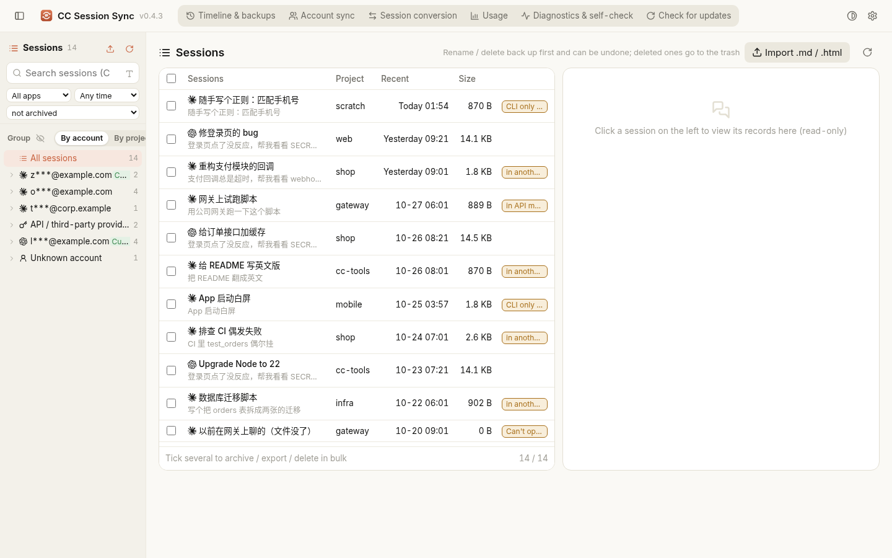
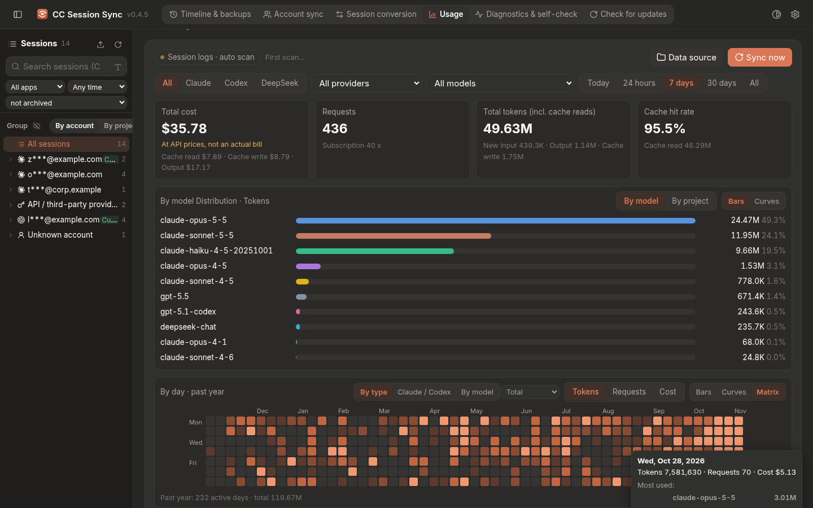

# CC Session Sync

**English** | [中文](README.md)

A session manager for Claude Code, Codex, Cursor, DeepSeek Harness (dsh), OpenCode and ZCode — a Windows desktop app that also installs with
pip and works from the command line (Windows / Linux / macOS). Every change is backed up first, recorded in a ledger and can be undone;
anything that can be dry-run is dry-run first.

1. **Account sync:** after you switch Claude Code accounts, old sessions "disappear". Claude Desktop keeps its session list per
   account / organization folder, so the new account's list is empty although the conversations are still on disk. The app registers the
   sessions from the other account folders into the current one (both Desktop and CLI logins). **Account switches are detected and notified.**
2. **Codex → Claude Code:** turns a Codex thread (`~/.codex/sessions/**/rollout-*.jsonl`) into a Claude Code session
   (`~/.claude/projects/<project>/<id>.jsonl`, optionally also registered in the Desktop list) that you continue with `claude --resume`
   or in Desktop. **Codex's files are only read** (the only exception is the optional "record in Codex's import ledger", off by default).
3. **Session management:** Claude Code, Codex, Cursor, dsh, OpenCode and ZCode sessions in one list, grouped by **account** or **project**;
   search (titles / full text), filter, read-only viewer; rename, archive, continue in a terminal, delete (backed up and moved to a recycle
   bin, never deleted directly); **export to .md / .html / raw .jsonl and import back** losslessly.
4. **Timeline & backups:** sessions are **backed up incrementally every 10 minutes** by default; pick a point in time, preview that
   version and compare it with now, then **Restore to Claude** as a new session (or replace, or restore to Codex).
5. **Any-to-any conversion** between all six apps: native targets (Claude Code, Codex, dsh, OpenCode) get a new session they can resume;
   Cursor and ZCode get a context file + paste prompt. Since 0.4.1 tool calls, images and reasoning are kept where the target supports
   them, and every written session is self-checked.
6. **Usage**, **Diagnostics / self-check**, **Check for updates** (never installs by itself), tray icon and system notifications.
7. **Chinese or English UI** (0.4.3): follows the system language by default; change it in 设置 / Settings → Language.

> It started as a feature of [CC Msg](https://github.com/helefee/CCMessage); this is a standalone app and does not need CC Msg. Data and
> settings are separate (this app keeps everything in `~/.cc-sessionsync`).



## Install

- **Windows (recommended):** download `CCSessionSync-Setup-<version>.exe` from
  [Releases](https://github.com/helefee/CC-SessionSync/releases) and run it.
  - Installs per user to `%LOCALAPPDATA%\Programs\CCSessionSync`, **no admin rights**; Start-menu (optional desktop) shortcut; uninstall
    from Settings → Apps.
  - Uses the system Edge WebView2 (present on Windows 10/11). No console windows.
  - The installer is unsigned, so SmartScreen may warn: "More info → Run anyway". Each release has a `.sha256` to verify.
  - The installed `CCSessionSync.exe` is also the CLI: `"%LOCALAPPDATA%\Programs\CCSessionSync\CCSessionSync.exe" status`.
- **pip** (Python 3.10+, Windows / Linux / macOS):
  ```bash
  pip install "cc-sessionsync[desktop] @ https://github.com/helefee/CC-SessionSync/releases/download/v0.4.3/cc_sessionsync-0.4.3-py3-none-any.whl"
  # CLI / browser UI only, no window: drop [desktop]
  pip install git+https://github.com/helefee/CC-SessionSync
  ```
  This gives you the `cc-sessionsync` command (or `python -m cc_sessionsync`). On Linux the window needs pywebview's GTK or Qt backend;
  without it the UI opens in your browser.

## Desktop app

- Single instance: launching it again brings the open window to the front. Closing the window minimizes to the tray by default
  (changeable in Settings). Tray menu: show / hide window, sync Claude sessions now, auto sync, session conversion, sessions, timeline &
  backups, usage, queued changes (when there are any), start at login, minimize to tray on close, start minimized, notifications, check for
  updates, diagnostics, quit.
- The UI listens on `127.0.0.1:8766` only and every request needs the one-time token embedded in the page.
- **System notifications:** sync / import finished, queued changes done, account switch detected, new version available. Can be turned off.

## Language

- The UI is available in **Chinese and English**. By default it **follows the system language** (Chinese Windows → Chinese, anything else →
  English). Change it in **设置 / Settings → Appearance & window → Language** (System / 中文 / English); the window reloads right away.
  The tray menu and notifications follow the same setting.
- Only the app's own text is translated. **Your session titles and conversation content are never changed.**
- Developers: all UI text is written in Chinese in the code; `cc_sessionsync/i18n/en.json` maps each Chinese fragment to English.
  `python tools/i18n_extract.py` adds new fragments (as `null`), `--check` fails when one is missing (run in the tests).

## What's new in 0.4

- **Parent / child sessions and a chat-style transcript (0.4.9):** the session list nests side sessions and task-spawned sessions
  (`spawnedFrom` in the Claude desktop registry) and Codex child threads under their parent, with a thin guide line, a child count and a
  collapse caret (remembered), in both the sidebar groups and the list. A child whose parent is missing or filtered out stays at the top level
  with a *Child session* tag; a search hit on a child also shows its parent, dimmed. Counts, selection, batch actions and rename are unchanged.
  The detail pane now looks like CC Msg / the Claude desktop app: your messages as bubbles, replies rendered as Markdown (highlighted code,
  lists, tables), tool calls as compact one-line rows grouped (“Ran 2 commands, Read 1 file…”) and expandable to the full input and result,
  thinking collapsed, subagent calls open their own transcript, hover copy buttons; big sessions show the latest 300 entries with *Load earlier*.
- **Big files, batches, folders; child sessions come along (0.4.8):** no more 200 MB limit. The desktop app uses the native *open files / open folder*
  dialogs, so only paths reach the page (0.4.7 read whole files into the page, and a dozen 100+ MB files crashed the window); in a browser files are
  uploaded in raw 8 MB chunks. *Import folder…* lists the importable files (size, app, title, type, child sessions; message counts fill in lazily),
  select all / none, then imports one file at a time in the background with progress (“3/17”) and Cancel; one failure does not stop the others;
  the whole batch is one undo entry. Claude Code → Claude Code is a streamed line-by-line copy: 17 fake sessions totalling 989 MB imported in 13 s
  with ~90 MB peak memory. CLI: `cc-sessionsync import <files or folder> [--apply]`.
  *Export raw jsonl* now also bundles the session's subagent transcripts (`<sid>/subagents/agent-*.jsonl`, meta, tool-results) in a sidecar folder
  `<export>.ccss/` with a `manifest.json` (type main / subagent, parent id, agentId, title, cwd); .md / .html exports embed them too. Importing writes
  them under the new session's `subagents/` with the new sessionId and the same agentIds, so Claude Code still shows the hierarchy; in batch / folder
  imports subagent files are grouped under their main session instead of becoming standalone sessions. Codex subagent threads are bundled and come back
  as Claude Code subagent transcripts. Titles are kept as-is (no more “(imported)”).
  **Account sync keeps relationships:** desktop entries with `spawnedFrom` (side sessions / task-spawned sessions) bring their parent along, also when you
  pick only the child; if the parent can't come (missing, or deleted in the target account) the child is still synced with a “will show as a standalone
  session” warning; task records referenced by `taskId` (`tasks.json` / `scheduled-tasks.json`) are merged by id, backed up and undone with the rest.
- **Import raw .jsonl (0.4.7):** files from *Export raw jsonl* (`.jsonl`, or `.jsonl.zstd` for compressed DeepSeek Harness sessions) can now be
  imported back with *Import .md / .html / .jsonl*. The app recognises the source automatically: Claude Code sessions come back as-is (only a new
  session id and title); Codex conversations, DeepSeek Harness sessions and Cursor / OpenCode / ZCode mirrors go through the same converters as
  *Session conversion* into a new Claude Code session. Same flow as .md / .html: preview first, undoable from the operation log, a native-format
  self-check after writing; mix .jsonl with .md / .html in one batch; an unrecognised .jsonl gets a clear message about what is supported.

- **Faster Usage page (0.4.6):** the matrix view reads a small per-day rollup table (kept up to date incrementally, rebuilt after price changes)
  instead of re-scanning a year of raw request logs, and results are cached per filter until the data changes; the payload is compact per-day arrays.
  Switching Today / 24 hours / 7 days / 30 days / All no longer refetches or redraws the matrix (it always shows the past year); rapid clicks cancel
  stale requests. The page draws the last matrix from a local cache right away and refreshes it after the cards and log; errors and timeouts show a
  reason and a Retry button instead of staying on "Loading…". The summary cards got faster too (no per-row time-zone conversion, fewer scans,
  options / per-source counts from rollups, incremental rollup by time range). On ~570k fake requests: 7 days 3.4 s → 0.3 s, 30 days 3.9 s → 1.2 s,
  five rapid clicks 17 s → 0.7 s; matrix data ~2 s → 15–40 ms (under 1 ms when cached).

- **Matrix view for daily usage (0.4.4 / 0.4.5):** the Usage page shows *By model distribution* on top (unchanged) and the daily card below.
  The daily card's style switch is now Bars / Curves / **Matrix**, and Matrix is the default (your choice is remembered): a GitHub-contributions-style
  calendar heatmap of the past year (columns = weeks, rows = weekdays labelled Mon / Wed / Fri, month labels, 5 levels in the app's accent colour
  for light and dark, Less…More legend, scrolls to the latest week, horizontally scrollable when narrow). Hover a day for its tokens / requests /
  cost and top models. The card's controls still apply: Tokens / Requests / Cost, By type (total / new input / output / cache read / cache write),
  Claude / Codex (one app), By model (one model); the page's app / provider / model filters too.



- **Chinese / English UI (0.4.3):** a language switch in Settings (System / 中文 / English; the default follows the system language).
  All UI strings were extracted into `cc_sessionsync/i18n/en.json` (about 2,080 fragments); the tray menu, tooltips and notifications follow
  the setting; your own session titles and conversation content are never translated. Full English README (this file).
- **Smaller installer + automatic rollback (0.4.2):** the build skips unused modules (asyncio, multiprocessing, debugger/profiler tools,
  the fallback implementations of zstandard and PyYAML), uses LTO, drops asserts and stronger LZMA2 settings. Measured on the same GitHub
  Actions Windows runner: installer 12.87 MB → 11.94 MB (−7%), installed app 39.4 MB / 64 files → 36.1 MB / 55 files, `CCSessionSync.exe`
  21.3 MB → 19.1 MB. When you click **Update now**, the installer keeps the current version (`CCSessionSync.prev`), runs a start-up health
  check of the new one (files intact, modules import, WebView present, local UI server answers) and, if it fails, restores the previous
  version automatically, fixes the version shown in Apps & features and notifies you; your data is untouched. The Check-for-updates dialog
  then shows a "rolled back" note for 30 days. Updates are still never installed automatically.
- **Conversion fidelity (0.4.1):** common tool calls (shell, read/write/edit, grep/glob, web fetch/search) are written as the target's own native tool calls with paired results
  (Claude Code Bash/Read/…, Codex `exec_command`, dsh `bash`/`read`/…, OpenCode 2.x `shell`/`read`, 1.x `bash`/`read`); tools a target lacks stay as text.
  Real images (PNG/JPEG/GIF/WebP, ≤5 MB each, ≤30 MB per session) are carried over (dsh attachments store, OpenCode inline files, Cursor images read from their local path).
  Reasoning becomes native reasoning for dsh/OpenCode. After each write the session is re-read with the target app's own rules (OpenCode via its CLI export) and the result dialog
  shows "自检通过" or the issues. Verified with the real CLIs against a local mock model; round-trip tests in `tests/scenarios/s_fidelity.py`.
- **Faster startup, capped memory (0.4.0):** the session list from last time is shown instantly on launch (tagged 上次的列表 · 正在刷新…)
  and refreshed in the background; only session files whose mtime/size changed are re-read (disk head cache in `~/.cc-sessionsync/cache/`).
  The list is slim; a session's content and resume command load when you open it. Cache capped at 60k entries and released after 3 min idle.
  Synthetic data, relaunch: 5,006 sessions 1.17 s → 0.10 s to first list, peak RSS 61 → 53 MB; 15,006 sessions 4.39 s → 0.15 s, 143 → 101 MB.

## All features

- **Reveal accounts (0.2.1):** accounts are masked by default; the eye button in the session list fetches the full email/name/org from the local token-protected
  API, keeps it in page memory only (never logged or stored); optional "always show full account" setting (off by default). Diagnostics stay masked.
- **Automatic session backup (0.2.1):** on by default every 10 minutes (min 5 min; minutes/hours/days), incremental (appended-delta + content
  dedup + zlib), low priority, skips if busy, catches up after sleep, notifies only on failure. Retention: all for 7 days, daily to 90 days,
  weekly after; the latest version of every session is always kept; manual cleanup.
- **Timeline (0.2.1):** pick a point in time (slider / date-time) per session or for all sessions, preview the conversation read-only with a
  diff against now, then **Restore to Claude** (new Claude Code session with a new id and "（恢复 @time）" title, registered in Claude Desktop
  for the current account, queued while Desktop runs; shows the `claude --resume` command). Also replace-current (backed up first, extra
  confirmation) and restore-to-Codex. Ledger + undo.
- **Export / import .md / .html (0.2.1):** readable files with the raw jsonl embedded, so importing back is lossless; import creates a new
  Claude Code session in the chosen project (dry-run preview first, undoable). `tools/verify_resume.py` checks that restored and imported
  sessions really resume in Claude Code.

- **Account-switch detection:** polls login files by mtime (cheap), debounces, then shows one notification
  "检测到 Claude Code/Codex 账号已切换：old → new" plus an in-window banner with Sync now / Open. Only masked emails are shown; tokens are
  never read. Tray balloons cannot carry buttons, so clicking the notification opens the window where the banner has the actions.
- **Updates are never installed automatically.** At most every 6 hours the app checks the latest GitHub release. A new version gives one tray
  notification per version, a red dot on the top-bar / settings "Check for updates" buttons and the tray icon, "● 有新版本 …" in the tray menu, and a banner (Update now / What's new /
  Later / Ignore this version) until you install or ignore it. Only **Update now** downloads the installer, verifies its SHA-256, installs
  silently and restarts.
- **Sessions:** list/search/filter Claude Code and Codex sessions, read-only viewer, rename (alias by default; optionally the tool's own
  title via `custom-title` / Codex `session_index.jsonl` + state DB), archive, export md/jsonl, resume in a terminal, delete (backed up to
  the session DB, then moved to `~/.cc-sessionsync/trash`; purging needs typing `DELETE`), restore to the original path only if it is free,
  otherwise as a new copy. Claude Desktop index edits are queued while Desktop runs.
- **Close & run, then relaunch (0.2.3):** when an action needs Claude Desktop closed (sync, restore, delete/archive/rename, trash restore,
  timeline replace), a dialog offers 关闭并同步（完成后重启） / wait until it quits / cancel. It records how Desktop was launched (MSIX AUMID via
  Get-AppxPackage, or the Squirrel `AnthropicClaude\claude.exe`), asks it to quit gracefully (WM_CLOSE + `taskkill` without `/F`, up to 15 s with
  progress), force-kills only after a second confirmation (and only Desktop's own process tree), warns about Claude Code sessions started by
  Desktop that would be interrupted, never touches other CLI `claude` processes, runs the queued jobs, relaunches Desktop the same way, verifies
  it started and reports the result (dialog + notification).
- **API mode / 3P (0.2.4):** discovers Claude Desktop's API-mode data dir (`%LOCALAPPDATA%\Claude-3p`, legacy `%APPDATA%\Claude-3p`, MSIX
  copies, `CLAUDE_USER_DATA_DIR`), groups its sessions as "API / 第三方供应商（3P）" (provider type only, never the key or gateway URL),
  shows entries whose transcript is missing as "无法打开" with limited actions, and adds an "API 模式" sync target that only writes into the
  bucket Desktop already created (never creates `ant-did` or folders). Diagnostics show the mode, active dir and candidates.
- **Usage accuracy (0.2.4):** 5m/1h cache-write pricing, most-complete streaming snapshot per `message.id:requestId`, Codex per-event deltas
  from `total_token_usage`, long-context tiers per request, fast/priority/flex multipliers, verified price table with dates, local-day
  buckets, per-row cost breakdown, Cowork / 3P logs, migration of the existing DB. Curve chart style (toggle, remembered) and per-model /
  per-project distribution charts; timeline grouped by day with a growth sparkline and ←/→ keys.
- **DeepSeek Harness ⇄ Claude Code (0.2.5):** reads DeepSeek Harness (dsh, MIT) v4 session logs (`$DSH_HOME/sessions/--project--/<id>/session.v4.jsonl[.zstd]`,
  independent checksummed zstd frames; profile `session-persistence-jsonl` root/compression overrides honoured), lists them read-only in
  session management (source filter + group), backs them up, and converts both ways with dry-run, ledger + hash-checked undo and idempotency.
  dsh → Claude Code applies `surfaceOp` (compaction), renders tools as text, drops reasoning (opt-in as text), images as placeholders (opt-in
  base64 from the attachment store), skips system prompt / runtime context. Claude Code → dsh only ever creates a new session dir (text only,
  atomic write, validated in memory first, contiguous seq, refuses format ≠ 4, mixed encodings, duplicate ids, locked/existing sessions).
  Verified end-to-end in CI: `claude --resume` on the imported session and the real dsh CLI resuming the written session in a scratch
  `DSH_HOME` against a local mock model. dsh usage is counted with DeepSeek's price table (peak rates; unknown models show "—").
- **Backup cleanup (0.3.9):** `~/.cc-sessionsync/backups` (config-file backups from 0.2–0.3.5) can be cleaned by age and/or total size:
  a manual 清理 dialog in 设置 → 数据 previews exactly which files go and how much space is freed; optional daily auto-clean under 高级
  (off by default); `cc-sessionsync clean-backups --days N [--mb M] [--yes]`. The newest backup of every original file is never deleted;
  `index.jsonl` is updated; unknown files, subfolders, `sessions.sqlite` and `claude-sync-bak` are untouched.
- **Storage format self-check (0.3.8):** read-only probes (table / column names, record types, format versions, counts; never account or
  credential tables) for Claude Code, Codex, Cursor, DeepSeek Harness, OpenCode and ZCode detect when an app changed how it stores sessions
  (new OpenCode tables, renamed ZCode columns, a newer Cursor `_v`, unknown Codex rollout records, broken files). Instead of sessions silently
  missing, a dismissible banner names the apps and how many sessions can't be read, 诊断自检 gets a "存储格式自检" card and per-app self-check
  items, and the conversion page shows "另有 N 个读不出来". Runs 1 min after start and every 6 h; notifies once per distinct problem.
- **Cross-app search + batch convert (0.3.7):** a 全部应用 source searches all six apps by keyword, app, project and time range (optionally
  inside conversation text via an incremental background index, `search-index.sqlite`), and converts / exports many sessions at once with a
  combined preview, a background job with progress, and one undo ledger per source app. Session lists are cached (stale-while-refresh) and
  rendered in pages.
- **Conversion preview (0.3.6):** before writing, shows target paths, message counts and what is lost / changed (images, attachments,
  reasoning, tool output, model names); "skip preview" lives under 设置 → 高级 (off by default).
- **Providers removed (0.3.5):** the 供应商 page (Agent / 服务商 / 高级), the model-routing proxy (Anthropic ⇄ OpenAI Responses / Chat
  conversion, key rotation), the generated Codex model catalogs, config warnings / one-click fixes, the tray entry and the `route` CLI are
  gone — too heavy. On the first launch of 0.3.5 the app undoes what 0.3.0–0.3.4 wrote, once: Codex `config.toml` and Claude Code
  `settings.json` are restored byte-identical when untouched since enabling, otherwise only the values still equal to ours are put back
  (`model_provider`, `model`, `model_catalog_json`, effort, env vars, `apiKeyHelper`); `[model_providers.cc-route]` / `[profiles.cc-route]`,
  `cc-route.config.toml`, `ccss-models-*.json` and `models_cache.json` are removed; without records only our keys are removed and
  `model_provider` never stays on cc-route (falls back to Codex's default ChatGPT login). The background proxy is stopped, the
  "CC Session Sync Route" Run entry and the local `route-token` are deleted. Every file is backed up to `~/.cc-sessionsync/backups` first;
  the result is logged (`legacy-0.3.5.json/.log`) and shown once in the window. Provider keys you stored and `key get` stay, because
  v0.2 provider switches / direct cards reference them from your configs.
- **Timeline & backups (0.2.9):** the Timeline and Backups pages are merged into one top-bar page "时间线与备份" with sub-tabs
  时间线 (timeline: segment bars, point-in-time picking, preview, restore to Claude, account/project grouping, growth curve) | 备份 (session
  backup DB: schedule, back up now, retention, location/size, recent versions; recycle bin; export/import .md/.html) | 撤销记录 (queued changes,
  session-operation log, account-sync backups, Codex/dsh/Cursor import ledgers and conversion ledgers, all with undo). `?page=backups`,
  `#backups`, the remembered last page, tray, notifications and the 会话转换 undo link open the right sub-tab (`?page=timeline&tab=bk|undo`).
- **Navigation (0.2.8):** the top bar no longer has per-pair pages; "Codex→Claude" is merged into "会话转换" (Codex → Claude Code
  embeds the Codex importer with its day/project/state filters, include-subagents, preview, in-place update and the anti-reimport switch).
  The old Codex / dsh / Cursor pages are only linked at the bottom of 会话转换; tray item, notifications, `?page=codex` deep links and the
  remembered last page open 会话转换 with the direction preselected.
- **Any-to-any session conversion + OpenCode / ZCode (0.2.7):** a unified "会话转换" page (and `cc-sessionsync convert …`) converts sessions
  between Claude Code, Codex, DeepSeek Harness, Cursor, OpenCode and ZCode through a common intermediate model (`ccss-ir/1`). Native
  targets write a **new** session the target can resume: Claude Code (jsonl, optional desktop registration), Codex (rollout + session index),
  dsh (new session dir) and OpenCode (imported through OpenCode's own CLI: `opencode session import --standalone` on 2.x, `opencode import`
  on 1.x, incl. the desktop app's bundled `opencode-cli`). Cursor and ZCode are export-only (Markdown context file + paste prompt), as is
  OpenCode when no CLI is found. Dry-run, ledgers + undo (sessions continued after conversion are kept), idempotency (same / changed /
  again), loop protection, origin title prefixes. OpenCode (`~/.local/share/opencode/opencode.db`, 1.x `session/message/part` and 2.x
  `session_v2/session_message`) and ZCode (`~/.zcode/cli/db/db.sqlite` + `v2/tasks-index.sqlite`) are read from a temp copy (db + wal),
  listed read-only in session management grouped by project, backed up and shown in the timeline; credential/account tables are never read.
  CI resumes converted sessions with the real CLIs: `claude --resume`, `codex exec resume`, `dsh --session-id`, `opencode run -s` (1.x and 2.x).
- **Cursor ⇄ Claude Code (0.2.6):** reads Cursor's editor DB (`User/globalStorage/state.vscdb`: `cursorDiskKV` `composerData:<id>` +
  `bubbleId:<id>:<bubble>`, `composerHeaders`; `workspaceStorage/<hash>/workspace.json` for grouping), agent transcripts
  (`~/.cursor/projects/*/agent-transcripts`) and `cursor-agent` CLI stores (`~/.cursor/chats/<md5(cwd)>/<id>/store.db`) strictly read-only
  (`immutable=1` when Cursor is closed, `mode=ro` otherwise, prefix range queries) into a normalized mirror used for viewing, backups, timeline
  and import. Cursor → Claude Code: text, tool calls/results as text (clipped), code/diffs as text, reasoning opt-in as text, images as
  placeholders, injected context dropped; dry-run, ledger + hash-checked undo, idempotent update; verified in CI with `claude --resume`
  for all three sources (`tools/verify_cursor.py`). Claude Code / Codex / dsh → Cursor is an exported Markdown context file (optionally in
  `<project>/.cursor/sessionsync/`) that you @-mention in a new Cursor chat — writing into Cursor's DB is not done because the format is
  undocumented and versioned, a chat spans three stores, new agent chats depend on opaque/encrypted `conversationState`/`agentKv` state,
  and it cannot be verified without logging in.
- **Font size & zoom (0.2.6):** larger default text (15px body, ≥12px labels), font size presets, 80–200% UI zoom (Ctrl+= / Ctrl+- / Ctrl+0,
  Ctrl+wheel), remembered; per-monitor DPI awareness on Windows; top nav collapses to icons when it doesn't fit.
- **Fix (0.2.6):** dsh → Claude Code with "register in desktop list" crashed (`_desktop_entry() got an unexpected keyword argument 'prefix'`).
- **Timeline growth curve (0.2.5):** total messages across all backed-up sessions per backup run (with per-app lines), draggable cursor.
- **Account-switch false positive fixed (0.2.5):** a months-old `000005.ldb` in Claude Desktop's Local Storage still held another account's
  telemetry; whenever the current account's records were uploaded/compacted away, "newest record wins" picked the stale account and the
  watcher reported a switch (and later a switch back). Now: last-known desktop account guarded by timestamp, 2 consecutive stable reads,
  persisted baseline (`watch-state.json`), 3P mode changes reported as mode switches, and a switch is marked handled after a sync or when
  there is nothing to sync.
- **Backups** (in 时间线与备份 since 0.2.9)**:** incremental, de-duplicated SQLite session backup (`~/.cc-sessionsync/sessions.sqlite`, optional schedule), recycle bin,
  operation ledger with undo.
- **Usage** (session-log based, request de-dup, cache tokens, costs "at API prices", "—" for unpriced models), **Model & API** (Claude Code
  and Codex providers, keys in Windows Credential Manager, `apiKeyHelper` / `model_providers`, model list, mapping, connection test, backups
  before every config write), **Diagnostics / Self-check** (pass / warn / fail with suggested fixes; runs on first launch).

The original two features:

1. **Bring back Claude Code sessions after switching accounts.** Claude Desktop keeps its session list per account/organization
   folder (`claude-code-sessions/<account>/<org>/local_*.json`); after an account switch the new folder is empty although the
   transcripts are still on disk. `cc-sessionsync sync` copies the missing entries into the current account's folder (Desktop or CLI
   login, MSIX/Store install supported). It never deletes, keeps tombstoned (deleted) sessions deleted, backs up the target folder
   first, and `restore` undoes a sync.
2. **Import Codex conversations into Claude Code.** `cc-sessionsync codex import` converts Codex rollouts
   (`~/.codex/sessions/**/rollout-*.jsonl`) into new Claude Code transcripts (`~/.claude/projects/<slug>/<uuid>.jsonl`) plus,
   optionally, a Claude Desktop session-list entry, so you can `claude --resume <id>` or open it in Desktop. Codex files are only
   read. It is a dry run unless you pass `--apply`; every run writes a ledger and `codex undo <ledger>` moves created files to a
   trash folder and restores updated ones.

**Optional `--mark-codex-imported` (default off):** also records each imported session in Codex's own
`<CODEX_HOME>/external_agent_session_imports.json` (same schema Codex writes: `records[]` with `source_path` in Rust-canonical form,
`content_sha256`, `imported_thread_id` = the original Codex thread, `imported_at`, `source_modified_at` in ns, `connector_names`, `title`),
so Codex Desktop's "import from Claude Code" does not re-import it as a duplicate. Enable per run with the flag, persistently with
`cc-sessionsync settings --codex-mark-imported on`, or with the toggle in the UI. It is the only Codex file ever written: the original is
backed up into the import ledger, the write is atomic, existing records and keys are preserved, and a malformed file is left untouched
(the import is refused with a clear error). `codex undo` restores the file byte-for-byte if it has not changed since, otherwise it reverts
only our records.

Changes to Claude Desktop's data are deferred while Desktop is running (it would overwrite them on exit): the job is queued,
a background process waits for Desktop to quit, applies it and relaunches Desktop.

Run `cc-sessionsync` for the desktop window (falls back to the browser without pywebview) or see the command list below.

**Conversion limitations:** before 0.4.1 tool calls were rendered as text; since 0.4.1 common tools, images and reasoning are kept
natively where the target supports them (see What's new), other tools stay as text (command + truncated output); Codex reasoning is
mostly encrypted and dropped by default (`--reasoning` keeps plaintext summaries);
Codex-injected context (AGENTS.md, environment) is skipped; sub-agent / `codex exec` / imported-from-Claude threads are skipped
unless `--all`. The Claude Code transcript format is undocumented; CI verifies with the latest Claude Code that an imported
session opens with `claude --resume` (against a local mock API).

## Command line

```bash
cc-sessionsync                            # open the desktop window (= cc-sessionsync desktop)
cc-sessionsync ui --port 8766 --no-browser  # local web UI only, no window
cc-sessionsync status                     # current Desktop / CLI accounts, account folders, Codex thread count
# ① fill in sessions after switching accounts
cc-sessionsync sync --dry-run             # dry run: what would be added for Desktop and CLI
cc-sessionsync sync                       # sync into the current Desktop account
cc-sessionsync sync --source cli          # sync into the current CLI (~/.claude.json) account
cc-sessionsync sync --to <account>/<org>  # pick the target folder by hand
cc-sessionsync backups                    # backups made before each sync
cc-sessionsync clean-backups --days 90    # clean old config backups: preview first, --yes to delete (0.3.9)
cc-sessionsync restore 20261017-101500    # undo a sync (backed up first as well)
cc-sessionsync auto                       # foreground: auto sync while Desktop is closed (Ctrl+C to stop)
# ② Codex → Claude Code
cc-sessionsync codex list --days 0                     # Codex threads (0 = any time)
cc-sessionsync codex import                            # dry run (the default; writes nothing)
cc-sessionsync codex import --only 3f9a1c,77b0de --apply   # import just these (last digits of the thread id)
cc-sessionsync codex import --cwd D:\work\shop --apply     # only threads from this project
cc-sessionsync codex import --no-desktop --apply       # CLI transcript only, leave the Desktop list alone
cc-sessionsync codex import --mark-codex-imported --apply   # also record in Codex's import ledger
cc-sessionsync codex ledgers                           # import ledgers
cc-sessionsync codex undo 20261017-101800              # undo one import
# ③ DeepSeek Harness ⇄ Claude Code
cc-sessionsync dsh detect                              # where dsh is, data dir, session root / compression
cc-sessionsync dsh list
cc-sessionsync dsh validate <id-or-file>              # offline check with dsh's own rules
cc-sessionsync dsh to-claude [--only <last digits>] [--reasoning] [--images] [--no-desktop] [--apply]
cc-sessionsync dsh from-claude [--only <last digits>] [--again] [--apply]   # only ever creates new dsh sessions
cc-sessionsync dsh ledgers
cc-sessionsync dsh undo 20261018-151308
# ④ Cursor ⇄ Claude Code (Cursor's data is read-only)
cc-sessionsync cursor detect
cc-sessionsync cursor list [-n 50]
cc-sessionsync cursor to-claude [--only <last digits>] [--reasoning] [--subagents] [--no-desktop] [--apply]
cc-sessionsync cursor context <claude|codex|dsh|cursor> <id> [--project] [--apply]   # context file for Cursor
cc-sessionsync cursor ledgers
cc-sessionsync cursor undo 20261018-201957
# ⑤ any-to-any conversion (0.2.7)
cc-sessionsync convert matrix                          # which directions are native, which export-only
cc-sessionsync convert detect                          # where OpenCode / ZCode are, sessions, opencode CLI
cc-sessionsync convert list <claude|codex|dsh|cursor|opencode|zcode> [-n 50]
cc-sessionsync convert run --from opencode --to claude --id <id>[,<id>] [--apply] [--again] [--reasoning] [--no-desktop] [--export] [--project]
cc-sessionsync convert ledgers
cc-sessionsync convert undo 20261021-042339
cc-sessionsync jobs [--cancel ID]         # jobs waiting for Desktop to quit
cc-sessionsync diag                       # diagnostics report (home dir masked, safe to share)
cc-sessionsync selfcheck [--offline] [--json]   # self-check; exit 1 if anything fails
# ⑥ sessions (read-only on the CLI; rename / delete / restore in the window)
cc-sessionsync sessions list [--agent claude|codex] [-n 50]
cc-sessionsync sessions backup            # incremental backup into ~/.cc-sessionsync/sessions.sqlite
cc-sessionsync sessions export claude <id> --fmt md
cc-sessionsync sessions trash             # recycle bin
cc-sessionsync sessions ops               # operation log
cc-sessionsync usage [--full]             # usage summary
```

The CLI output stays in Chinese; the language setting applies to the window, tray and notifications.

## Safety

- **Dry run first:** `sync --dry-run` and `codex import` without `--apply` only compute; in the UI you preview before you can apply.
- **Never write Claude Desktop's data while it runs** (it keeps the list in memory and overwrites it on exit). The app offers to close
  Desktop gracefully and relaunch it afterwards, or queues the job until you quit it yourself (`jobs` shows / cancels them).
- **Backups + undo:** every sync copies the target account folder to `~/.cc-sessionsync/claude-sync-bak/<time>/` with a ledger;
  imports and conversions keep ledgers with the previous versions; undo moves new files to `~/.cc-sessionsync/trash/` (never deletes)
  and restores updated ones. Sessions you continued after converting are kept.
- **Add, never delete:** sync only adds missing and refreshes outdated entries; sessions you deleted in the current account stay deleted.
- All writes go to a temp file first and are swapped in atomically.

## Directories

| | Default | Override |
|---|---|---|
| Claude Code data | `~/.claude` | `CLAUDE_CONFIG_DIR` |
| Codex data | `~/.codex` (or the Store Codex virtualized dir when only that has sessions) | `CODEX_HOME` |
| Claude Desktop data | Windows `%APPDATA%\Claude`; Store (MSIX) `%LOCALAPPDATA%\Packages\Claude_*\LocalCache\Roaming\Claude`; macOS `~/Library/Application Support/Claude`; Linux `~/.config/Claude` | in Diagnostics |
| Claude Desktop API mode (3P) | `%LOCALAPPDATA%\Claude-3p` (also the legacy and MSIX locations) | `CLAUDE_USER_DATA_DIR` |
| This app's data | `~/.cc-sessionsync` | `CC_SESSIONSYNC_HOME` |

`status` / `diag` show which location is used for each item and why.

## Development

```bash
pip install -e . pytest
python -m pytest -v                                    # scenario tests, all in temp dirs
python tools/i18n_extract.py --check                   # every UI string has an English entry
npm i -g @anthropic-ai/claude-code
python tools/verify_resume.py "$(command -v claude)"   # really opens imported sessions with claude --resume (local mock API)
python tests/demo_env.py /tmp/demo --serve 8797        # fake data + UI for screenshots (writes only /tmp/demo)
```

Windows installer: `tools/build_desktop.ps1` (Nuitka + hidden smoke test + Inno Setup); CI also installs it, runs the self-check,
tests the update rollback and uninstalls. Release: bump `__version__` in `cc_sessionsync/__init__.py`, tag `v<version>`; the `release`
workflow publishes `CCSessionSync-Setup-<version>.exe` (+ `.sha256`), wheel, sdist and `SHA256SUMS.txt`.

License: MIT, see [LICENSE](LICENSE); third-party notices in [THIRD_PARTY_NOTICES.md](THIRD_PARTY_NOTICES.md).
