# CC Session Sync

[English](README.en.md) | **中文**

Claude Code / Codex 的会话管家，Windows 桌面程序（也能 pip 装、命令行用）。所有改动都先备份、记账本、能撤回，能演练的先演练：

1. **账号同步**：Claude Code 换账号后，旧会话「不见了」→ 补回来。Claude 桌面端的会话列表按「账号 / 组织」分文件夹存，换号后新号的列表是空的，
   但对话内容其实都还在本机。这里把别的账号文件夹里的会话登记补进当前账号（桌面端 + 命令行两套登录都能认）。**检测到换号会弹通知**。
2. **会话管理**：Claude Code 和 Codex 的会话放一起看；左侧按**账号**（这台电脑上所有 Claude 桌面端账号 / 组织文件夹，含商店版目录、
   命令行账号、Codex 账号 / 供应商）或按**项目**分组，搜（标题 / 全文）、筛，只读查看对话；改名、归档、在终端里接着聊、
   删除（挪进回收站，不直接删）；**导出 .md / .html / 原始 jsonl 再导回来**（文件里带原始记录，无损）。
3. **DeepSeek Harness 会话（0.2.5）**：DeepSeek Harness（dsh）的会话也在会话管理里（只读列表 / 查看 / 用量）。
4. **Cursor 会话（0.2.6）**：Cursor 的对话（编辑器里的 Agent / Chat、agent 记录、`cursor-agent` 命令行）也在会话管理里（只读列表 / 查看）。
5. **跨应用会话列表**：同一界面查看 Claude Code / Codex / DeepSeek Harness / Cursor / OpenCode / ZCode / Antigravity 的会话（只读浏览；`.md` / `.html` / `.jsonl` 文件导入可变成新的 Claude Code 会话）。
6. **0.3.5 拿掉了「供应商」**（模型路由 / 卡片 / 服务商）：太重、不好懂。第一次启动 0.3.5 会把它改过的 Codex / Claude Code 配置**恢复原样**，见下文。
7. **用量**、**诊断 / 自检**、**检查更新**、托盘和系统通知。账号同步自带同步前备份与「同步记录」一键撤销（见下；不是时间线页）。

> 最早是 [CC Msg](https://github.com/helefee/CCMessage) 里的功能，这里单独拿出来，不需要装 CC Msg；两个程序的数据和设置互不影响
> （本程序的数据都在 `~/.cc-sessionsync`）。

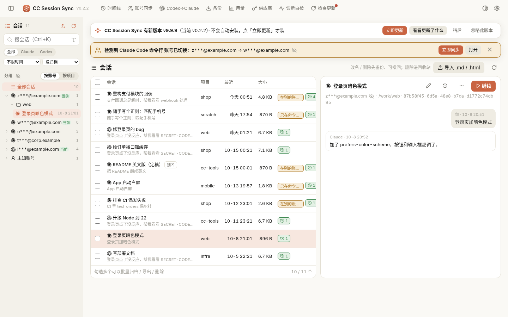

## 安装

- **Windows（推荐）**：在 [Releases](https://github.com/helefee/CC-SessionSync/releases) 下载 `CCSessionSync-Setup-<版本>.exe`，双击安装。
  - 装到当前用户目录 `%LOCALAPPDATA%\Programs\CCSessionSync`，**不要管理员权限**；开始菜单（可选桌面）有快捷方式；「设置 → 应用」里能卸载。
  - 界面用系统自带的 Edge WebView2（Windows 10/11 一般都有）。不弹任何黑框。
  - 安装包没签名，SmartScreen 可能提示，点「更多信息 → 仍要运行」。发布页有 `.sha256` 可以核对。
  - 装好的 `CCSessionSync.exe` 也是命令行：`"%LOCALAPPDATA%\Programs\CCSessionSync\CCSessionSync.exe" status`。
- **pip**（Python 3.10+，Windows / Linux / macOS）：
  ```bash
  pip install "cc-sessionsync[desktop] @ https://github.com/helefee/CC-SessionSync/releases/download/v0.2.2/cc_sessionsync-0.2.2-py3-none-any.whl"
  # 只要命令行 / 浏览器界面，不要窗口：去掉 [desktop]
  pip install git+https://github.com/helefee/CC-SessionSync
  ```
  装完有 `cc-sessionsync` 命令；也可以 `python -m cc_sessionsync`。Linux 上窗口要 pywebview 的 GTK 或 Qt 后端；没有就自动用浏览器打开。

## 桌面程序

- 只开一个：再点快捷方式会把已经开着的窗口叫出来。关窗口缺省缩到托盘（设置里能改），托盘菜单：显示 / 隐藏窗口、立即同步 Claude 会话、
  自动同步、会话管理、用量、排队中的改动（有的时候）、开机自启、关窗口到托盘、启动时到托盘、通知、
  检查更新、诊断自检、退出。
- 界面只听 `127.0.0.1:8766`，每个请求都要带页面里的一次性口令（别的网页 / 程序调不了）。
- **系统通知**：同步 / 导入做完、排队的改动做完、检测到换号、有新版本。可以在设置里关。

### 界面

- **顶部按钮栏**：账号同步 / 用量 / 诊断自检 / 检查更新（红点）/ 主题，当前页高亮；会话页保留导入 / 导出；
  **设置（齿轮）在右上角**。点了在主区域显示那一页（**不是弹窗**，用量也一样）。
  点左上角标题、左侧「会话」或任何一个会话就回到会话页。窗口窄的时候按钮只显示图标（鼠标停上去有名字）。
- **左侧面板只放会话列表**：搜会话（Ctrl+K）、全文搜、Claude / Codex、时间、归档筛选，下面是**按账号 / 按项目**的分组树，最里层就是会话本身
  （数量、当前账号标「当前」、没在任何桌面端账号里登记的会话归到「未知账号」）。点一组 = 筛选，点一个会话 = 在右边打开。
  面板能拖宽度（会记住），**Ctrl+B** 收起 / 展开。
  打开一个会话时中间**不再重复一份列表**，会话占满；「← 会话列表」回到列表（多选、批量导出 / 删除在那里，已选的保留），
  想要旧的左右分栏点「并排显示列表」（会记住）。左侧面板收起时中间的列表照旧并排显示。
- 托盘菜单的「用量…」「诊断自检…」等会打开窗口并直接切到那一页。
- **显示完整账号**：账号缺省打码（`z***@example.com`）。点会话列表里的眼睛（分组旁边，或会话详情里的账号旁边）才从本机接口（127.0.0.1 + 口令）取完整邮箱 / 名字 / 组织，只放在页面内存里，
  不写日志、不存盘，重开就又打码；设置里可以开「总是显示完整账号」（缺省关）。诊断报告永远是打码的。


### 导出 / 导入 .md / .html / .jsonl

- 单个、批量、左侧一整组都能导出。Markdown / HTML 好读（角色、时间、代码块；HTML 单文件、自带浅色 / 深色样式，工具调用折叠），
  并且**内嵌完整的原始记录**（md 里是一段隐藏注释，html 里是 `<script type="application/json">`），导回来一模一样。
- 导入：先预览（不写任何东西），再变成一个新的 Claude Code 会话，放进你选的项目、登记进桌面端当前账号；可以撤回。别处来的 Markdown 按标题尽量解析。
- **0.4.7：原始 jsonl 也能导回来。**「导出原始 jsonl」得到的文件（`.jsonl`，DeepSeek Harness 压缩的是 `.jsonl.zstd`）用「导入 .md / .html / .jsonl」
  直接导入，自动认出是哪个应用的记录：Claude Code 会话原样还原（只换新会话号和标题）；Codex 对话、DeepSeek Harness 会话、Cursor / OpenCode / ZCode
  的镜像导入成新的 Claude Code 会话。记进操作记录能撤回，写完按 Claude Code 的会话规矩自检一遍；
  可以和 .md / .html 混在一起选；认不出的 jsonl 会说明能导什么。

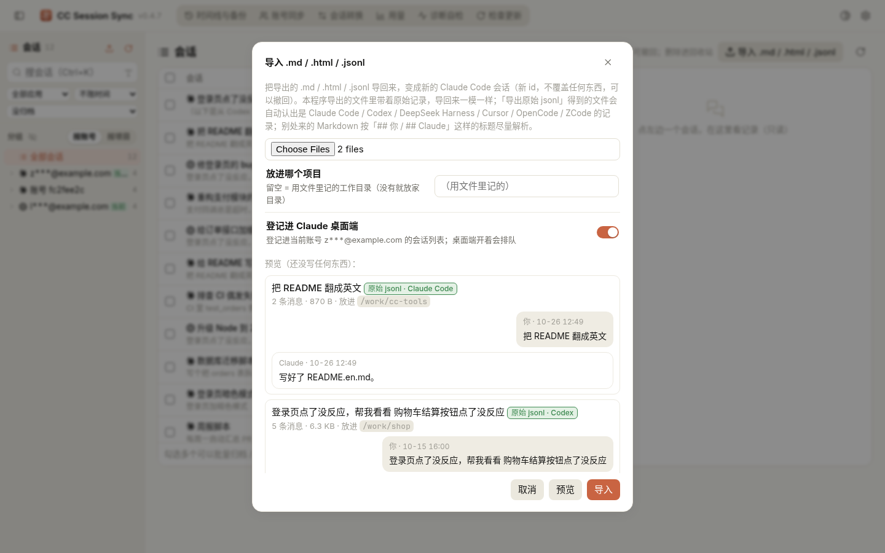

### 更简单的用量页与侧边栏（0.5.6）

- **用量统计图简化**：去掉「原样式 / 曲线图 / 矩阵图」切换，按模型 / 按项目的分布和趋势都改成简单柱状图（仍可按 Tokens / 请求数 / 费用查看）。
- **流转动画改为实时反馈**：打开用量页时停在当前合计，并默认打开「实时」；新记下的用量会马上加进图里，不再从头回放已经发生过的用量。源日志通常是一次调用结束后才写出用量，所以跟的是「刚记下就跟上」。播放 / 拖进度条仍可用来回看。
- **对话查看去掉 Token 流转**：打开会话只看对话，不再提供「对话 | Token 流转」切换和工具栏「实时」按钮。用量页的流转还在。
- **点账号展开对话列表**：左侧点击账号或项目这一整行即可展开或收起对话，不必再点左侧的 `>`。

### 精简功能面 + 更可靠的换号检测（0.5.5）

- **会话转换已移除**：不再提供跨应用「转换」页 / CLI；请用会话页的 **导入 .md / .html / .jsonl** 与 **导出**（含批量）。
- **时间线与备份页已移除**：不再浏览快照或「恢复到 Claude」。磁盘上的 `sessions.sqlite` 不删；**账号同步**自带的同步前备份与「同步记录」一键撤销仍在。
- **Claude 账号登录 / 切换检测加强**：同时看 `.claude.json`（含 `CLAUDE_CONFIG_DIR`）、桌面端 Local Storage、凭据文件路径/mtime/size（**从不读凭据内容或 Keychain 密文**）。防抖约 2.5 秒，有候选时加快轮询。登出→登录也算。桌面端开着时会明确提示「已检测到账号切换…等待退出后再同步」——这是已认出、在等待，不是没检查到。

### Antigravity 会话列表与用量（0.5.4）

- **只读**：发现 `~/.gemini/{antigravity-cli,antigravity,antigravity-ide}/brain/<id>/.system_generated/logs/transcript_full.jsonl`（对照 [CC Switch](https://github.com/farion1231/cc-switch) `agy.rs`）；同 `step_index` 多行时最后一行胜出。
- **对话**：可在会话列表查看（只读）。**不写** Antigravity 自己的库。本程序不把 Antigravity 会话转写到其他应用。
- **用量**：`PLANNER_RESPONSE` 上的 `input_tokens` / `output_tokens` / `cache_read_tokens` / `cache_write_tokens` 为真实计数（input 不含 cache，output 已含 thinking）；旧 `.pb` / 仅有索引的会话不估数字。
- **限制**：无 transcript 的旧 protobuf 会话只列出；写入 Antigravity 不安全故不做。

### 换号自动同步、同步记录一键撤销、同步进度（0.5.3）

- **切换 Claude 账号后自动同步**（设置 →「切换 Claude 账号后自动同步对话历史」，缺省开）：检测到 Claude 桌面端（Local Storage 里的 accountUuid / organizationUuid）或 Claude Code 命令行（`~/.claude.json` 的 `oauthAccount`，`CLAUDE_CONFIG_DIR` 下同理）换了登录账号，确认稳定后把别的账号的会话补进新账号，通知「检测到 Claude 账号切换为 X，已同步 N 个会话」，可一键撤销。第一次运行只记下当前账号，不同步；只补缺的、不覆盖；写之前先备份；桌面端开着时排队，关掉后再做。关掉开关后只提醒、不写任何东西。
- **一个主按钮**：「账号同步」页顶部「立即同步 N 个」，缺省全选；要挑会话再展开「挑选要同步的会话」。
- **同步记录**：手动、持续自动、换号后自动的每一次同步都列在同一处（时间、触发方式、账号、会话标题、状态），任何一次都能一键「撤销」（不弹确认框，撤销前也先备份），可「核对」、复制备份路径；「清理旧记录」把旧记录连同备份挪进回收站，最新 10 条永远保留。（时间线页已移除；同步记录只在「账号同步」页。）
- **进度和提示**：同步时显示真实进度（备份 → 写入 N/M → 核对），成功后提示结果并带「撤销」，删过没带回 / 模型可能不可用的会提醒；失败时说明原因并可「重试」。后台自动同步时右下角有一个不挡操作的小进度条。
- **限制**：同步完要**重启 Claude 桌面端**才能在侧边栏看到补进来的会话（命令行 `claude --resume` 本来就不依赖账号文件夹）。

### 对话气泡样式、文本宽度、更清楚的流转图（0.5.2）

- **对话气泡跟着来源应用换样式**（浅色 / 深色各一套，都是自己写的 CSS）：Claude 米色气泡 + 衬线正文；Codex 绿色调气泡、• 工具标记；
  Cursor 通栏描边卡片；DeepSeek Harness 浅蓝圆气泡；OpenCode 左侧色条 + 等宽字；ZCode 单色描边。出错的工具行按各自的红色显示。
  想要统一外观：会话标题栏的 T 按钮（阅读设置）或「设置 → 外观与窗口 → 对话气泡样式」选「统一样式」。
- **对话文本宽度可调**：窄 / 标准（860px，缺省）/ 宽 / 全宽，或 520–1600px 滑块，拖动实时生效，会记住（本机 + `settings.json`）。
- **会话页不再重复显示列表**：打开会话时会话占满，「← 会话列表」回去；要旧的左右分栏点「并排显示列表」。
- **用量页 Token 流转版式重做**：四列圆角卡片、带子粗细按比例尺、时间轴单独一张图、悬停提示不挡内容。

### Token 流转动画与「关于」（0.5.1）

- **会话详情里多了「对话 | Token 流转」**（Claude Code、Codex、DeepSeek Harness）：把这个会话**每一次模型调用**按记录里的真实用量回放，不是装饰动画。
  - 数据来源和「用量」页同一套口径：Claude Code 每次回复的 `message.usage`（流式拆行去重、含子代理）、Codex 的 `token_count` / `token_usage_record`（按累计值求差）、DeepSeek Harness 的 `usage`；合计和用量库逐项对得上（测试里核对）。
  - 左边是输入：**缓存读 / 缓存写 / 新输入**三股，中间是模型（显示这次的上下文大小），右边是**输出**（含思考）和**工具调用**；工具结果用虚线绕回下一次调用的输入，看得出 agent 循环。
  - 带子宽度、粒子个数都按真实 token 数换算：输入侧每个粒子代表固定的 token 数，整段会话的粒子总数正好等于「合计 ÷ 单位」；输出通常比输入小两个数量级，所以输出侧按 1 / 2 / 5 的整数倍放大，倍数写在图上和图例里。
  - 播放 / 暂停、上一次 / 下一次（← →、空格）、拖动进度条或点底部时间轴跳到任意一次调用，0.5× – 8× 变速；时间轴每根柱是一次调用，竖线是你说话的轮次，子代理的调用下面有标记。
  - 下面是**累计到播放位置为止**的新输入、缓存读写、输出（其中思考）、合计、缓存命中率、工具调用次数和费用，以及当前这次调用的模型、时间、距上次间隔、所在轮次和你那一轮说的话、调了哪些工具。
  - **实时**：会话还在进行（记录文件 2 分钟内改过）时打开就自动进「● 实时」，指示点会跳动。每来一次新的模型调用，就把它的流转放出来，时间轴多一根柱，累计、费用、缓存命中率也跟着更新。没有新调用时显示「等待新调用…（上一次 N 秒前）」。往回拖或暂停就不再跟随，时间轴照样长，点「回到实时」跳回最新那次；再点「实时」按钮可以退出。会话列表顶栏的「● 实时」会直接打开最近在动的那个 Claude Code / Codex / DeepSeek Harness 会话。
    - 后端用本地服务的长轮询（每次最多等 15 秒，仍然要一次性 token），只读记录文件新增的字节（Claude 也读子代理 `agent-*.jsonl`），不会每次整份重新解析。还没写完的半行留到下次再读；文件被截短或换掉时整份重发。DeepSeek Harness 的记录是 zstd 压缩的，文件变了才重新读。
  - 浅色 / 深色、中文 / English 都跟着变；系统开了「减少动态效果」时不自动播放。不联网、不加依赖。Cursor / OpenCode / ZCode 的本地记录里没有逐次用量，会直接说明。
- **「用量」页也有「Token 流转」**（第三个提交）：在按天分布那张图下面，按页面上的筛选（时间段、应用、供应商、模型）把**真实用量**画成四列流向：**来源应用 → 输入种类（缓存读 / 缓存写 / 新输入）→ 模型 → 输出（回复 / 思考）**。
  - 数据在本地服务端聚合（`/api/usage/flow`）：按时间桶 × 应用 × 模型给出请求数、各类 token、思考、费用和缺价条数，口径和「用量」页的 `summary()` 一致（测试里逐个筛选核对）。模型最多单列 7 个，其余并进「其他模型」；两天内按小时、四个月内按天、再长按周。
  - 带子宽度按 token 数换算，浅色底是整段时间的总量，实色是播放到当前位置的累计；粒子按每段时间的真实用量发出。输出比输入小很多，按 1 / 2 / 5 的倍数放大，倍数写在图上。
  - 播放 / 暂停、拖动、0.5×–4× 变速；下面是累计到播放位置的合计、新输入、缓存读写、输出、思考、请求数、缓存命中率和费用（数字滚动变化）。悬停带子、节点或底部的柱能看到准确数字。
  - 「● 实时」：长轮询数据版本，有新用量就合进来并放一阵粒子。卡片滚动到可见时才去读数据。
- **两处流转动画的样式**：带子改成渐变色并加了边线，节点有光晕，粒子是发光的点；画布按屏幕像素密度绘制、跟着容器宽度重排；每列标签自动避让不重叠，文字带底色描边，浅色 / 深色下都看得清；配色取自主题变量。
  - 系统开了「减少动态效果」时不自动播放、不放粒子；粒子数有上限；动画用 `requestAnimationFrame`，页面切到后台就停。没有新增依赖，不走 CDN。
- **模型图标和「如实」的流转**（第四个提交）：
  - 模型节点、悬停提示、图例和当前调用面板里，Claude 系列（claude-* / sonnet / opus / haiku）显示 Claude 图标，GPT 系列（gpt-* / o1 / o3 / o4-mini / codex）显示 OpenAI 图标，DeepSeek 显示 DeepSeek 图标，其他模型是通用图标。图标是内联 SVG（取自 Simple Icons，CC0），画布里也是用 SVG 画的，高分屏清晰，不联网。
  - 工具条上有「放大输出 | 真实比例」：真实比例时输出和输入同一个比例尺；放大时倍数、输出 1 个粒子代表多少 tokens、不放大时输出只占百分之几都写在图上和图例里。「1 粒 = N tokens」一直显示在工具条上。
  - 先后顺序和真实一样：整段输入到齐模型后才出输出（先思考、后回复），输出出完才是工具调用，工具结果回到下一次调用的输入。带子宽度始终是当前这次调用的真实数字（去掉了两次调用之间的宽度过渡，免得画出不存在的中间值）。
  - 用量页的粒子不再随机抽样：每个时间桶里每条路径发几个粒子按真实用量用累计取整算好，整段加起来正好 = 合计 ÷ 单位；没有用量的时间段一个粒子也没有；实时新增按新旧差值发。测试 `s_flow_fidelity.py` 用 node 跑页面里的函数核对这些。
  - 模型列的标签有自己的空当，不再压在输出带子上；统计卡片、工具条、画布卡片的版式也整理了一遍。

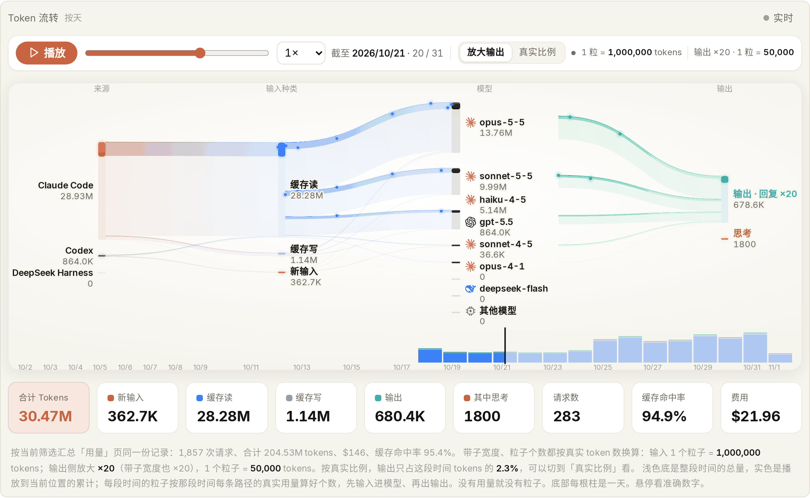

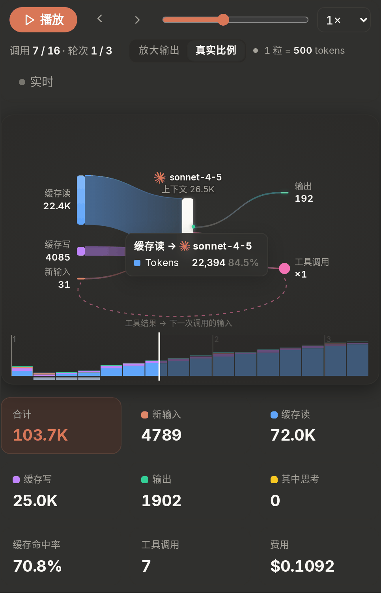

- **「关于」页**：顶栏右上角的 ⓘ、设置页标题下的链接、托盘菜单「关于…」都能打开。写着版本号、作者 [helefee](https://github.com/helefee)、仓库 [helefee/CC-SessionSync](https://github.com/helefee/CC-SessionSync)、MIT 许可证、问题反馈和发布页链接，还有系统和数据目录；能直接检查更新。

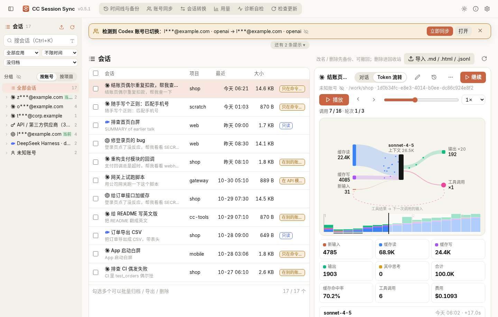

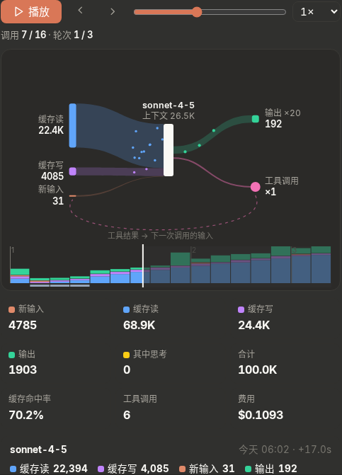

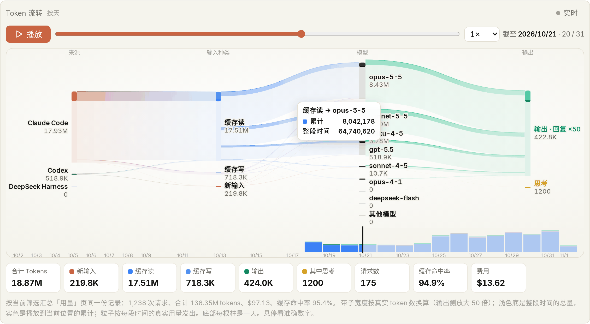

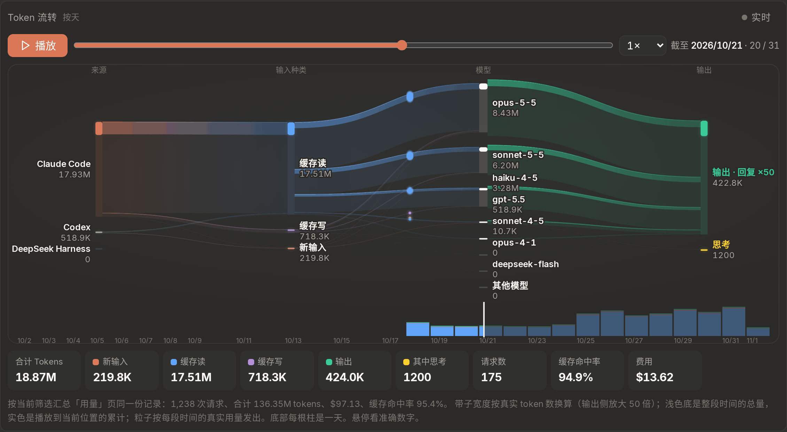

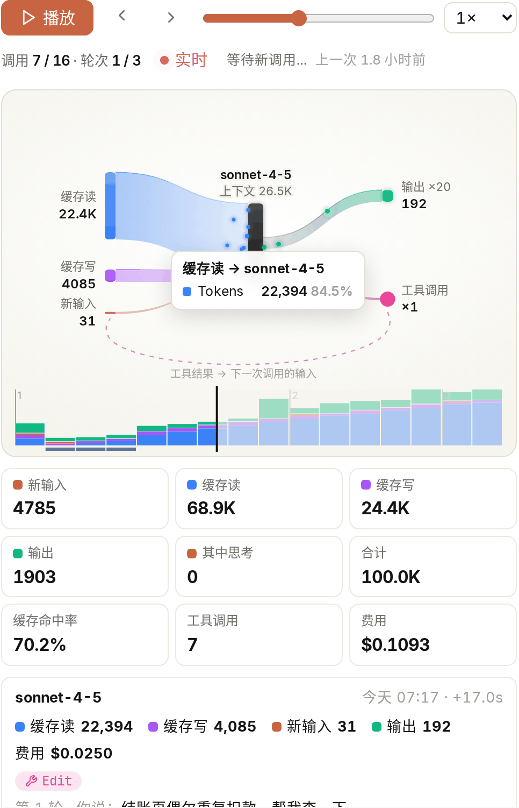

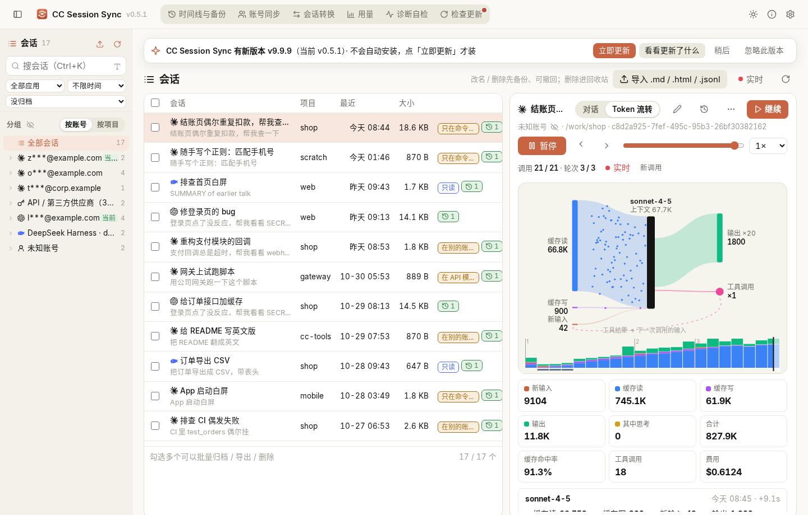

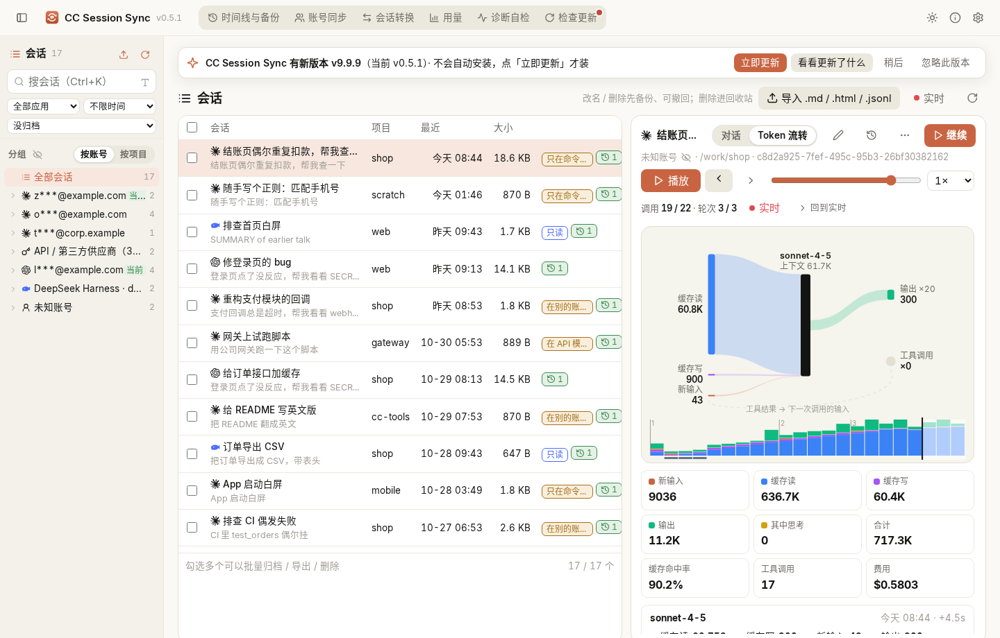

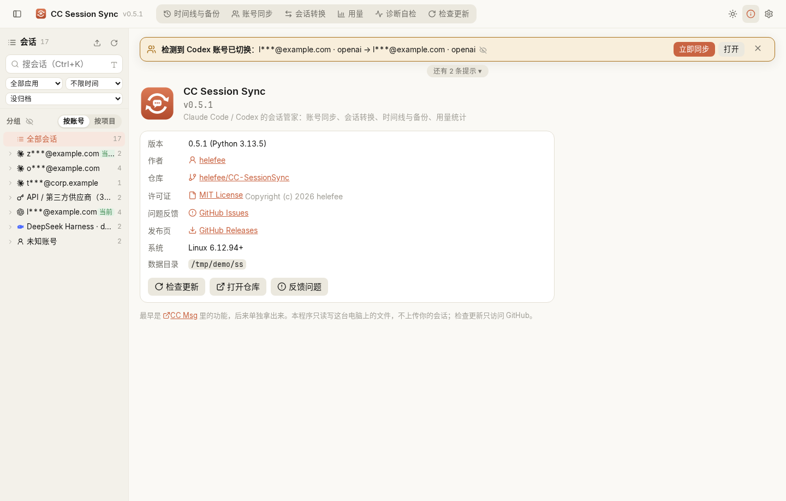

### 账号同步：删过的不复活、撤回按原样换回、同步 / 撤回之后自动核对（0.5.0）

- **在别的号里删过的会话不再被带回来**：以前只看当前号的「删除墓碑」，在 A 号删掉的会话，同步到 B 号时会从更早的 C 号文件夹里把旧登记又补回去。
  现在所有账号文件夹的墓碑都算：删了以后没再用过的不补（同步页写着「N 个在别的号里删过，不会带回来」）；删了以后又接着用过的照样补。
- **远程控制（Remote Control）的字段不再带到新号**：`bridgeSessionIds` 是在原来那个号下开的，带过去桌面端会报「Previous session is unavailable」。
  补进来时去掉；刷新已有的会话时留新号自己的。
- **撤回按原样换回**：每次同步逐个文件记下「同步前 / 同步后」的指纹；撤回时新建的挪进回收站，改过的按备份里的原样（一个字节不差，先核对指纹）换回，
  同步后又被 Claude 改过的也换回，结果里说明。撤回过的再点一次什么都不做，备份列表里标「已撤回」；撤回前的那份备份标出来，不能当同步撤。
- **同步 / 撤回之后自动核对**：逐个文件对指纹，再算一遍同步计划。都对上就一句话（「都到位了」「撤回干净了」），对不上的列出哪个、哪里不一样；
  同步后在 Claude 里点开 / 接着聊过的算正常，单独说。「账号同步 → 同步记录」里每次同步都有「核对」按钮；命令行 `cc-sessionsync verify <备份号>`。
- 再同步一次不会重复写、不多出备份（幂等）。

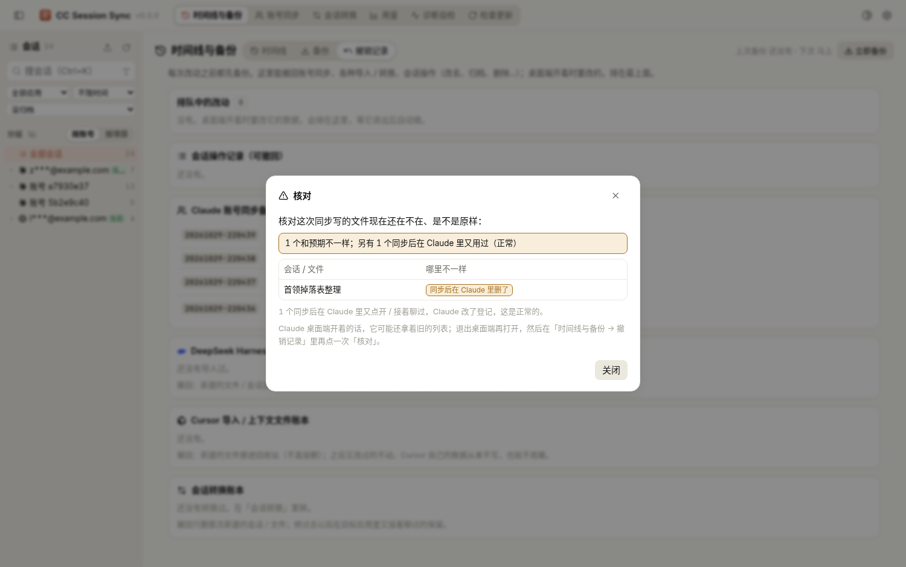

### 主会话 / 子会话按隶属关系显示；对话改成聊天样式（0.4.9）

- **会话列表像 Claude 桌面端那样分层**：侧边会话、任务派生的会话（桌面端登记里的 `spawnedFrom`）和 Codex 的子线程，缩进挂在父会话下面，
  左边一条细竖线；父会话旁边写着有几个子会话，点小箭头收起 / 展开（记住）。左侧「按账号 / 按项目」分组和右边的列表都是这样。
  父会话不在（删了 / 被筛掉）的子会话照常放在顶层，标一个「子会话」；搜到子会话时父会话也淡淡地带出来，看得出是谁的。数目不变；
  勾选、批量归档 / 导出 / 删除、改名照旧，勾了主会话还可以一键「加上子会话」。
- **对话改成聊天样式**（照 CC Msg / Claude 桌面端）：你的话是右边的气泡；回复按 Markdown 排版（代码块高亮、列表、表格、引用）；
  工具调用收成一行（图标 + 工具名 + 命令 / 文件），连着的几个合成「运行了 2 个命令，读了 1 个文件…」，点开看完整输入和结果，出错的标红；
  思考过程收起来；派出去的子代理可以直接点开看它自己的记录；悬停出现复制按钮。大会话先显示最近 300 条，「加载更早的」再往前翻。

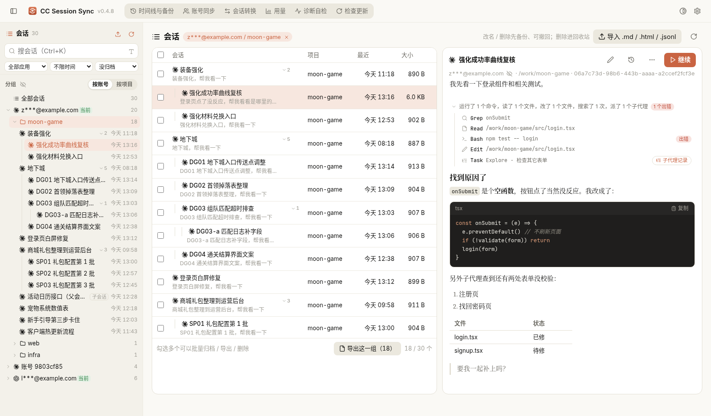

### 大文件、批量、文件夹导入；子会话跟着走（0.4.8）

- **不再限制 200 MB**，几百 MB 的会话也能导：桌面版用系统的「选文件 / 选文件夹」对话框，页面只拿到路径，文件内容不经过页面；
  浏览器里退回到分块上传（8 MB 一块，原样字节）。0.4.7 是页面把整份文件读成字符串再发过去，十几个上百 MB 的文件一起选会把窗口撑崩。
- **批量 / 文件夹**：「导入文件夹…」列出文件夹第一层能导的文件（大小、哪个应用、标题、类型、含几个子会话；消息条数后台慢慢数），
  全选 / 全不选；导入在后台一个一个做，显示「正在导入第 3/17 个」、能取消（做完的留下，正在做的不留半截）；一个出错不影响别的；整批一笔账，一次撤回。
- **省内存**：Claude Code → Claude Code 是一行一行流式复制（只换会话号），一次一个文件；17 个共 989 MB 的假会话，本机测导入 13 秒、
  本程序内存峰值约 90 MB（窗口里约 240 MB）。命令行也能导：`cc-sessionsync import <文件或文件夹> [--apply]`。
- **子会话（子代理）**：「导出原始 jsonl」会把会话的子代理记录（`<会话号>/subagents/agent-*.jsonl`、meta、tool-results）一起放进旁边同名的
  `<导出文件>.ccss/` 文件夹（带 `manifest.json`：类型 主会话 / 子会话、父会话号、agentId、标题、工作目录）；.md / .html 导出把它们也藏进文件里。
  导入时写到新会话的 `<新会话号>/subagents/` 下，sessionId 换成新的、agentId 不动，Claude Code 里照样是主会话 + 子代理；
  批量 / 文件夹导入时子会话文件归到主会话下面，不会被当成单独的会话。Codex 的子代理线程（rollout 里记着父线程）也一起导出、导回成 Claude Code 的子代理记录。
- **标题保持原样**，不再加「（导入）」。
- **账号同步带上会话关系**：桌面端登记里的 `spawnedFrom`（侧边会话 / 任务派生的子会话）——同步子会话时父会话一起补，只挑子会话也会自动带上父会话；
  父会话带不过来（不在 / 在当前号里删过）的照样补，但预览里写明「会显示为独立会话」；子会话引用的任务记录（`tasks.json` / `scheduled-tasks.json`）
  按 id 合并过去，先备份、撤回时一起还原。

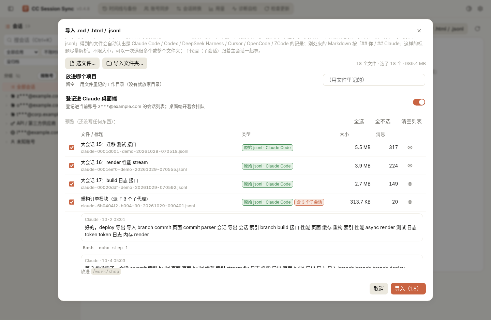

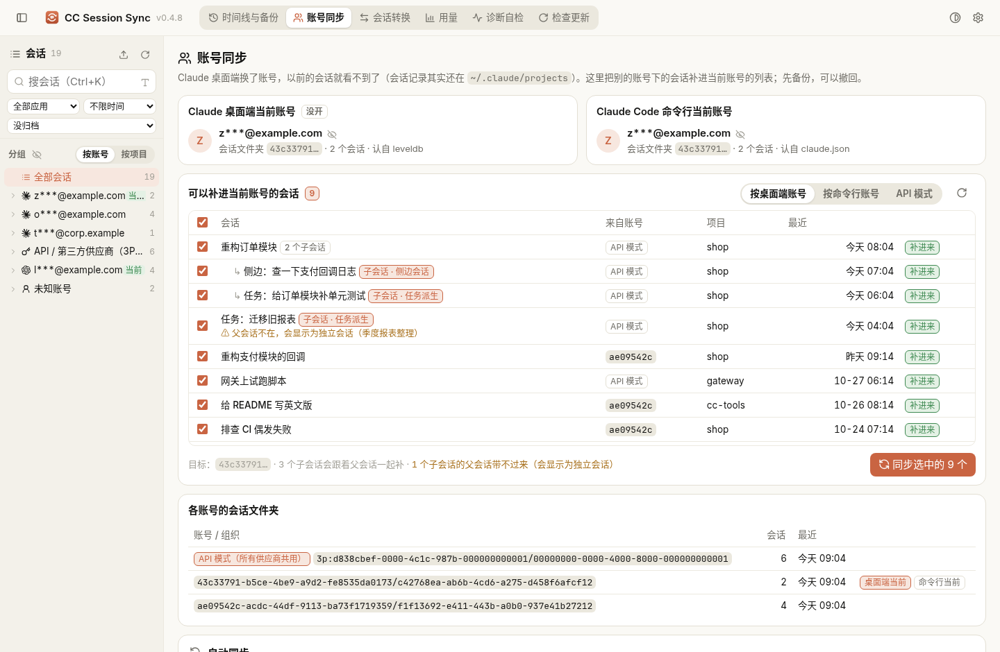

### 检测到换号

每 10 秒看一眼 Claude 桌面端 / 命令行 / Codex 的登录信息（只看文件修改时间，变了才读，几乎不占 CPU），确认稳定后弹一次通知
「检测到 Claude Code/Codex 账号已切换：旧 → 新」，窗口顶部出现提示条，带「立即同步」「打开」。通知和界面里只显示打码的账号（`z***@example.com`），
从不读、不显示 token。Windows 的托盘气泡不能放按钮，所以点通知 = 打开窗口，按钮在窗口的提示条上。

0.2.5 修了「明明同步过了还一直提示检测到切换账号」：桌面端 Local Storage 里有个几个月前的旧文件，里面是以前那个账号的记录，一直没删；
当前账号的记录发出去以后会被删掉 / 压缩走，那一会儿「最新的一条」就落到旧文件上，于是报「换号」，过一会儿又「换回来」。现在：
记住上一次认出的桌面端账号，旧文件里时间更早的记录不会盖过它；变化要连续两次读到（至少隔 9 秒）才算；基线存在 `~/.cc-sessionsync/watch-state.json`，
重启不丢；桌面端切到 / 切回 API 模式（3P）算「模式切换」，不算换号；同步完（或者当前账号本来就有全部会话、没什么可补）就记成「处理过了」，
不再提醒。提示条上写明是哪一端、从哪个号换到哪个号（打码）。

### 桌面端开着时：关闭并同步（完成后重启）

同步、撤回、删除 / 归档 / 改名、从回收站还原等要改桌面端数据的操作，遇到 Claude 桌面端（安装版或商店版 MSIX）正开着，
会弹出「Claude 正在运行，需要关闭后才能同步。」，三个按钮：

- **关闭并同步（完成后重启）**（缺省）：
  1. 先记下它是怎么开的：商店版记 AUMID（`Get-AppxPackage` 读包清单，不行再查开始菜单，都不行用 `Claude_pzs8sxrjxfjjc!Claude`），
     安装版记外层的 `…\AnthropicClaude\claude.exe`（Squirrel 会打开最新的 `app-x.y.z`）。
  2. 请它正常退出：给主窗口发关闭消息，再 `taskkill /PID`（**不带 /F**）。最多等 15 秒，有进度。
  3. 15 秒还没退干净（比如缩到了托盘）：可以去托盘里点「退出」（这边接着等），或者改成排队，或者「强制结束…」，要**再确认一次**才会强制结束。
     强制结束只结束桌面端自己的进程和它开的子进程。
  4. 退干净后做同步，再按原来的方式重新打开（商店版 `explorer.exe shell:AppsFolder\<AUMID>`，安装版运行外层 `claude.exe`），并确认它真的起来了。
     结果显示在对话框里，同时弹系统通知；没能打开就明说，请你从开始菜单手动打开。
- **等它退出后自动同步**：和以前一样排队，你自己退出桌面端后（托盘里也要退）后台做，做完自动重新打开。
- **取消**：什么都不改。

关之前会列出：由桌面端启动、正在跑的 Claude Code 会话（`claude.exe`）有几个，关闭桌面端会中断它们；不是桌面端开的命令行
`claude` 进程也会列出来，**永远不会动它们**。顶部「N 个改动在排队」提示条和「账号同步」页里也有「关闭并执行（完成后重启）」。
托盘里「立即同步」遇到桌面端开着，会打开窗口直接问。

| | |
|---|---|
| 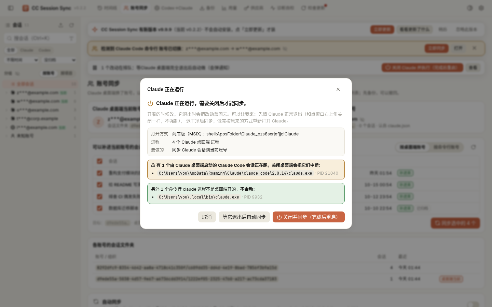 | 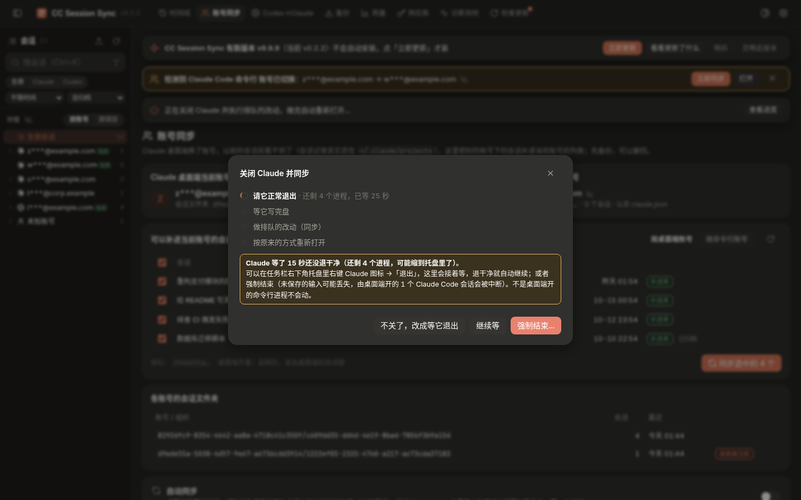 |
| 点同步时 Claude 开着：怎么开的、会中断哪些 Claude Code 会话、哪些命令行进程不动。 | 15 秒没退干净：去托盘退出 / 改成排队 / 强制结束（要再确认一次）。 |
| 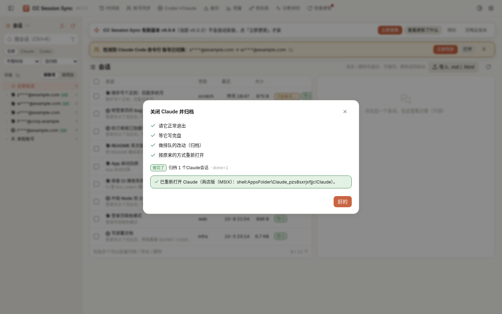 | |
| 做完后按原来的方式重新打开，并确认它已经起来了。 | |

### API 模式（第三方供应商 / 3P，0.2.4）

Claude 桌面端可以不用订阅登录，改走自己的推理网关 / 第三方供应商（API 模式）。这时它把数据放在另一个目录：

- 目录：`%LOCALAPPDATA%\Claude-3p`（旧位置 `%APPDATA%\Claude-3p`；商店版在 `Packages\Claude_*\LocalCache\{Local,Roaming}\Claude-3p`）；
  设了 `CLAUDE_USER_DATA_DIR` 也认（签名版桌面端会忽略它，诊断里会注明）。
- 会话列表在 `Claude-3p\claude-code-sessions\<设备号>\<组织>\`：设备号来自 `ant-did`，组织一般是占位的 `00000000-0000-4000-8000-000000000001`，
  **所有供应商共用这一个**。
- 会话页多一个分组「API / 第三方供应商（3P）· 供应商类型」：只显示类型（比如 gateway），**不显示 key 和网关地址**。只在 API 模式里登记过的会话归到这组，不算「未知账号」。
- 登记着但对话文件已经没了的条目照样列出来，标「无法打开（对话文件不存在）」：不能继续 / 导出 / 复制命令，可以改显示名、归档、删掉这条登记（进回收站）。
- 「账号同步」多一个目标「API 模式」：只写进桌面端**已经建好**的那个文件夹，本程序不会自己建设备号文件或文件夹。缺省目标跟着桌面端的
  `deploymentMode`（再看哪边最近写过），可以手动换。会话用的模型在另一边可能没有时，每一行会提醒。关闭并同步、撤回、自动同步都支持。
- 诊断 / 自检里有一节「Claude 桌面端 API 模式」：现在是什么模式、怎么判断的、用的哪个目录、候选目录。

| | |
|---|---|
| 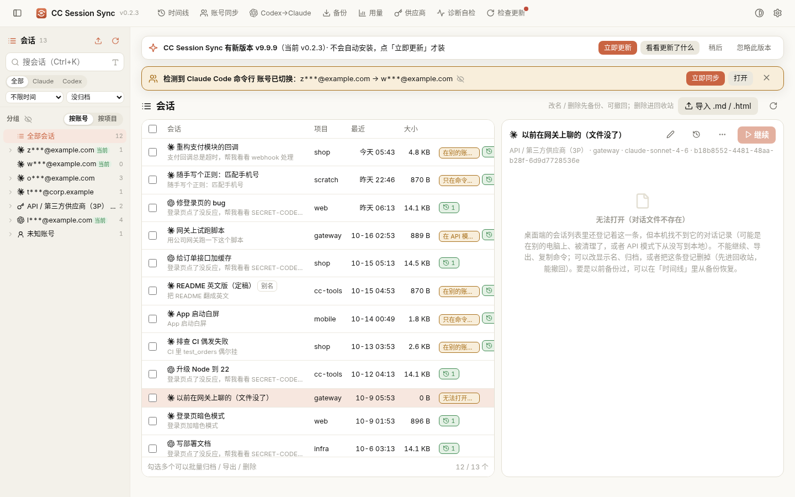 | 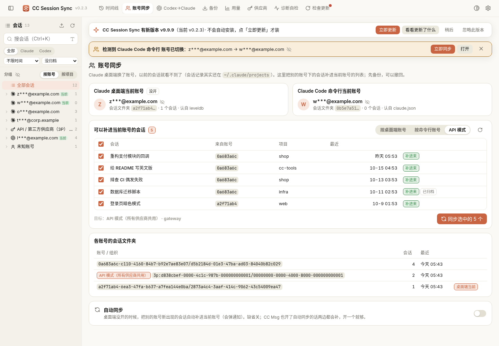 |
| 分组「API / 第三方供应商（3P）」；对话文件不在的条目照样显示、只给能做的操作。 | 同步目标「API 模式（所有供应商共用）」。 |
| 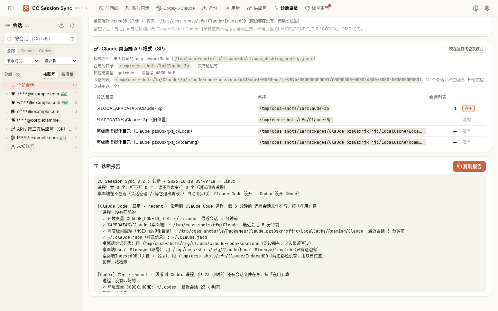 | |
| 诊断：模式、在用的目录、候选目录；只有供应商类型。 | |

### 用量怎么算（0.2.4）

- **Claude 缓存写**分 5 分钟 / 1 小时两种（`usage.cache_creation.ephemeral_5m/1h_input_tokens`）：5 分钟按输入价 1.25 倍、1 小时按 2 倍；日志里没拆分才全按 5 分钟，拆分比合计大就封顶。
- **Claude Code 去重**：同一个 `message.id` + `requestId` 流式写了好几行时，留**最完整**的那份（用量最大 / 有 `stop_reason`），不是第一行；没有 `requestId` 的行按 `message.id` 算，不丢。
- **Codex**：按累计值 `total_token_usage` 算每次的差值（累计没变算 0；变小了就退回这一次的 `last_token_usage` 并以它为新基线），不直接把 `last_token_usage` 加起来；续接 / 分叉文件重放的旧记录只算一次。
  新输入 = 输入 − 缓存读 − 缓存写；reasoning 已经在输出里，不另加。
- **长上下文**按每次请求的提示长度分档、整条请求加价：OpenAI 超过 272K 输入侧 2 倍、输出 1.5 倍；Haiku 5.5 超过 100K 全部 5 倍；Sonnet 4 / 4.5 超过 200K 输入 2 倍、输出 1.5 倍。
- **fast / priority / flex / batch** 档、Claude `inference_geo=us` 按官方倍率；没有官方倍率的档按标准价算并标「估」。
- **价格表**每一条带「核对日期」（按 Anthropic / OpenAI 官方价格页核对），价格页看得到；模型名先规范化（日期、`-thinking`、`[1m]`、档位后缀、Bedrock / Vertex 前缀）再精确查。
  没价格的显示「—」，总数里有没价格的部分就标「部分」。
- 按本机时区的**日历日**汇总；每条记录存好费用拆分（新输入 / 缓存读 / 缓存写 5m / 1h / 输出），悬停能看到。
- 也扫桌面端 Cowork 自带的 `local-agent-mode-sessions\…\.claude\projects`；API 模式里的会话算到「API 模式 · 供应商类型」，不算订阅。
- 升级时自动把老的用量库按新口径重读一遍；已经删掉的会话文件留下的老记录保留、按新价格表重算。
- 图表：「用量趋势」和新加的「按模型 / 按项目分布」都可以在「原样式 / 曲线图」之间切换（缺省原样式，会记住）。曲线图是平滑曲线 + 渐变填充，
  可以按类型（新输入 / 输出 / 缓存读 / 缓存写 / 费用）、Claude / Codex、按模型分，悬停显示准确数值和费用拆分，点图例开关，跟着时间范围、深浅色走。

| | |
|---|---|
| 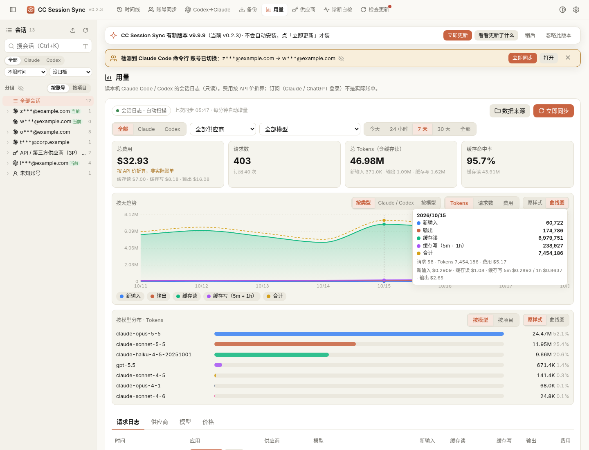 | 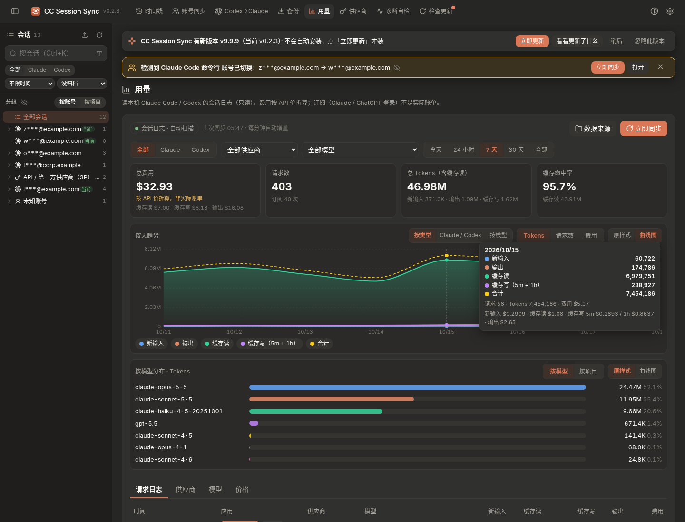 |
| 用量趋势 · 曲线图：按类型，悬停看准确数值和费用拆分。 | 深色。 |
| 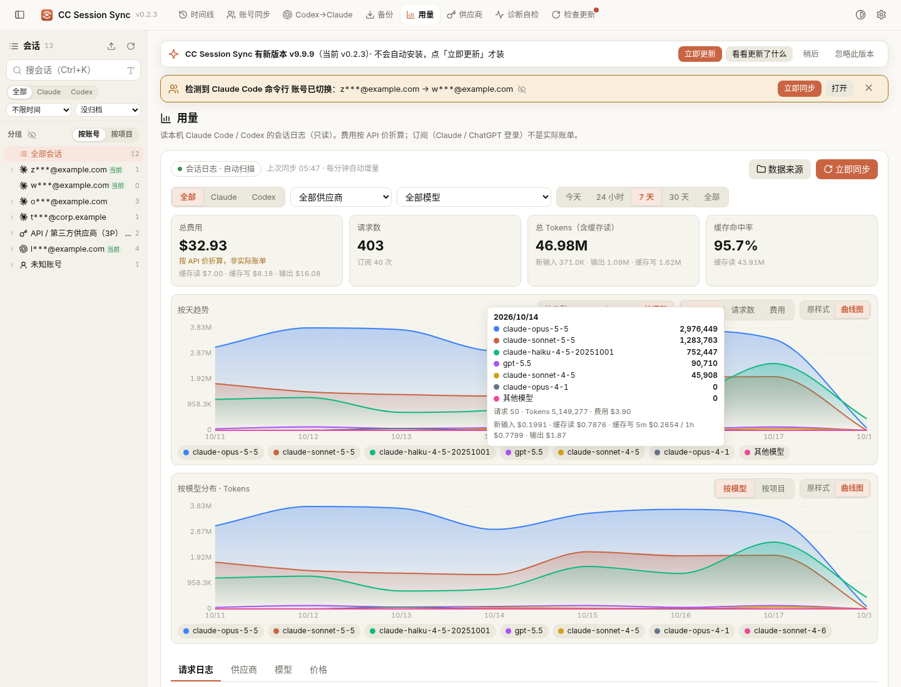 | 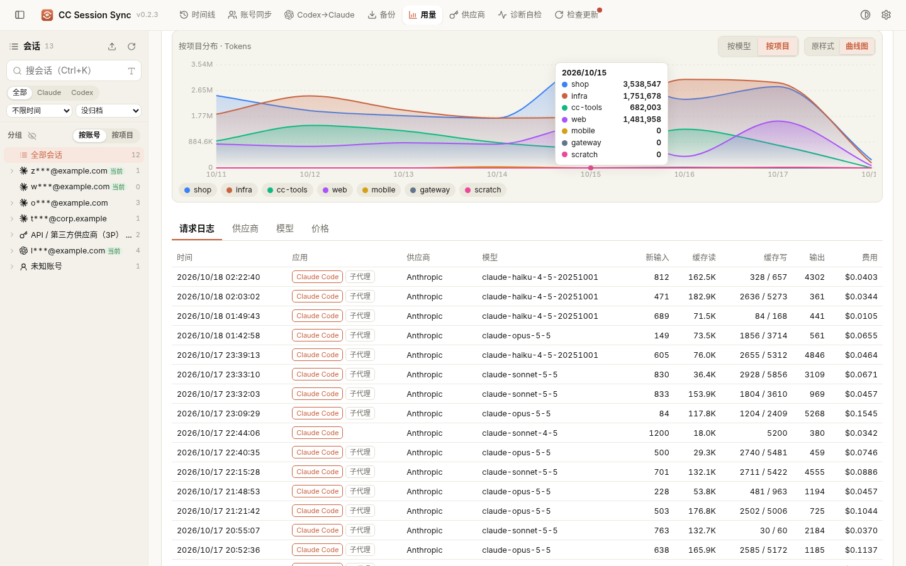 |
| 按模型的趋势和分布。 | 按项目分布 · 曲线图。 |


### 用量页提速（0.4.6）

- 矩阵图不再每次把一年的原始请求记录全扫一遍：程序维护一张**按天的汇总表**（随新记录增量更新，改价格后重算），矩阵图只读它，
  同样的筛选、数据没变时直接用上次的结果。返回的数据也改成紧凑的每天一行。
- **切换「今天 / 24 小时 / 7 天 / 30 天 / 全部」不再重新读、重画矩阵图**（它总是看最近一年）；快速连点时只认最后一次，前面没回来的请求会被取消。
- 打开用量页时先画上次的矩阵图（本机缓存），等卡片和日志出来后再在后台刷新；读取出错或超时会显示原因和「重试」，不会一直停在「读取中…」。
- 卡片的统计也更快了：不再逐条换算时区、少扫几遍；各来源条数、筛选选项读汇总表；每来一条模型路由请求的增量汇总按时间范围查（走索引）。
- 在约 57 万条假记录（一年，最近 35 天每天 1.2–1.7 万条）上实测：切到「7 天」从 3.4 秒降到 0.3 秒，「30 天」从 3.9 秒降到 1.2 秒，
  连点 5 次从 17 秒降到 0.7 秒；矩阵图读取从约 2 秒降到 15–40 毫秒（缓存命中不到 1 毫秒）。

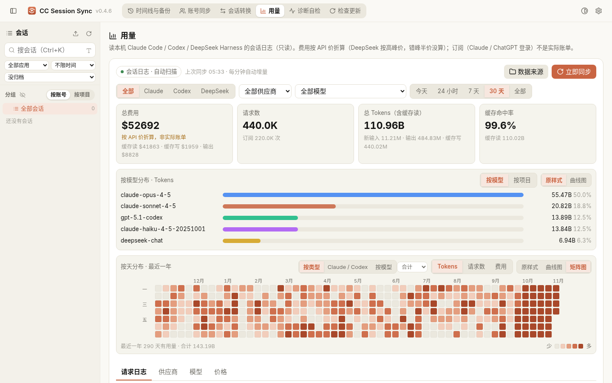

### 用量：按天分布的矩阵图（0.4.4 / 0.4.5）

- 「用量」页现在是两张卡片：上面是**按模型分布**（和以前一样，原样式 / 曲线图），下面是**按天分布**。
- 「按天分布」的样式切换多了一个 **矩阵图**，并且是**缺省**（原样式 / 曲线图 / 矩阵图，切换后会记住）：像 GitHub 贡献图那样的日历热力图，
  一列是一周，一行是星期几（标 一 / 三 / 五），上面标月份，显示**最近一年**、自动滚到最新一周（窗口窄时可以左右滚）。
  颜色分 5 档（少 → 多），按有用量那些天的四分位分档，浅色 / 深色主题都用程序的主色。
- 鼠标放到格子上：那天的日期、Tokens、请求数、费用，和当天用得最多的模型。
- 这张卡片原来的控件照样生效：**Tokens / 请求数 / 费用**；**按类型**（合计 / 新输入 / 输出 / 缓存读 / 缓存写）、**Claude / Codex**（只看一个应用）、
  **按模型**（只看一个模型）。页面上方的应用 / 供应商 / 模型筛选也生效；矩阵图总是看最近一年，不跟着「今天 / 7 天 / 30 天」变。

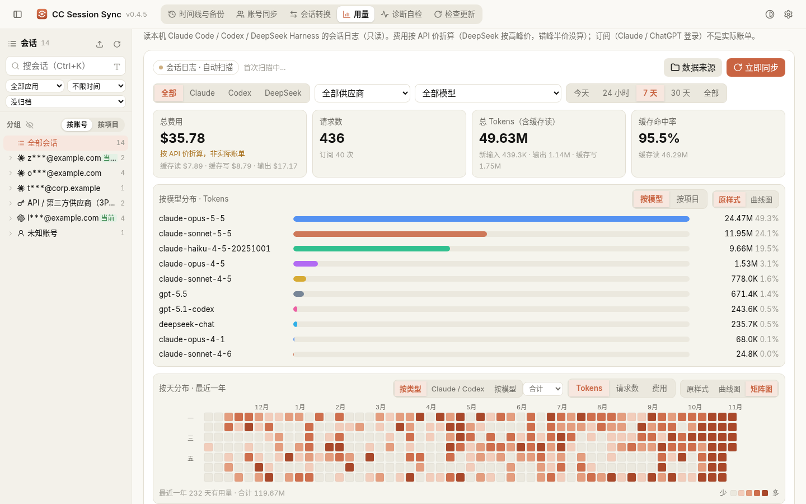

### 中文 / English 界面（0.4.3）

- 界面有**中文和英文**两种。缺省**跟随系统语言**（中文 Windows 是中文，别的语言是英文）；在「设置 → 外观与窗口 → 界面语言 · Language」里能改：
  跟随系统 / 中文 / English，切换后窗口马上重新载入。托盘菜单、提示和系统通知也跟着变。
- 只翻程序自己的文字，**你的会话标题和对话内容不会被翻译**。命令行输出还是中文。
- 英文说明见 [README.en.md](README.en.md)。
- 开发：界面文字在代码里还是中文写；`cc_sessionsync/i18n/en.json` 是「中文片段 → 英文」对照表（约 2080 条）。
  `python tools/i18n_extract.py` 把新加的文字补进去（值为 null），`--check` 有没翻的就失败（测试里会跑）。

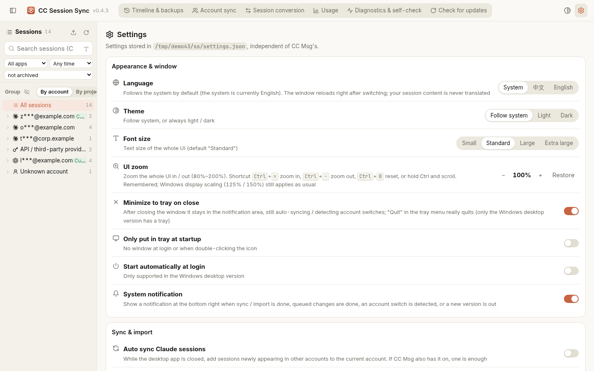

### 安装包更小 + 更新失败自动换回（0.4.2）

- **安装包更小**：打包时不再带用不着的模块（asyncio、multiprocessing、调试 / 性能分析工具、zstandard 和 PyYAML 的备用实现等），
  打开链接时优化（LTO），去掉断言，安装包用更强的压缩。实测（GitHub Actions 同一台 Windows 构建机）：

  | | 0.4.1 | 0.4.2 |
  |---|---|---|
  | 安装包 `CCSessionSync-Setup-*.exe` | 12.87 MB（12,866,801 字节） | 11.94 MB（11,936,051 字节，−7%） |
  | 装好后的程序目录 | 39.4 MB，64 个文件 | 36.1 MB，55 个文件 |
  | `CCSessionSync.exe` | 21.3 MB | 19.1 MB |

  最大的几块是 Python 本身（python311.dll 5.8 MB）、OpenSSL（libcrypto 5.2 MB，检查更新 / 下载要用 HTTPS）和 WebView2 的组件，
  这些省不掉。每次构建都会在日志里列出最大的 40 个文件，并上传 Nuitka 的模块报告（`nuitka-report`），方便以后继续瘦身。
- **更新失败自动换回**：点「立即更新」后，安装程序会**先把现在的版本留一份**（`CCSessionSync.prev`），装完新版本马上跑一次
  启动自检（程序文件完整、模块能加载、窗口组件在、本机界面服务能起来）。自检不通过 → **自动换回原来的版本**、
  卸载信息里的版本号也改回来，弹一个通知「更新到 x 后没能正常启动，已经自动换回 y」。你的数据（`~/.cc-sessionsync`）不动。
  自检通过就把留的那份删掉。
- 换回过之后，「检查更新」里会显示一条「换回过」的说明（30 天内），可以再试一次或到发布页手动下载。
- 更新仍然**只提示、不会自动安装**（红点 + 一次通知），点了才装。

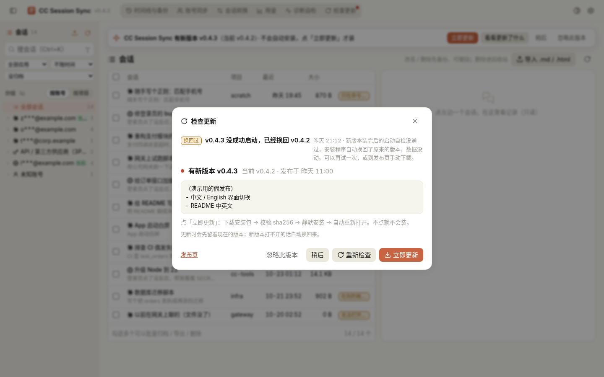

### 打开更快、内存更省（0.4.0）

- **一打开就有列表**：先显示上次的会话列表（标「上次的列表 · 正在刷新…」），后台再看有没有新的 / 改过的会话，看完悄悄换成新的。
- **只重读改过的**：每个会话文件记下修改时间和大小（`~/.cc-sessionsync/cache/`），没变的不再打开读标题，只读改过的和新的。
- **点开才读详情**：列表只带标题、项目、时间这些；点开一个会话时才去读它的内容和「继续」命令。很长的会话只留最后要看的那几条在内存里。
- **内存有上限**：缓存最多记 6 万个会话；空闲 3 分钟后把列表缓存放掉，下次用时再从磁盘缓存拿。
- 缓存坏了、被删了都没关系，会自动重建；缓存里不存账号邮箱这类原文（和界面一样先遮住）。

在测试机上用脚本生成的假数据（6 个应用）量的，「再次启动」= 第二次打开：

| 场景 | 启动到列表出来 | 再要一次列表 | 内存峰值 |
|---|---|---|---|
| 5 006 个会话，0.3.9 再次启动 | 1.17 秒 | 0.217 秒 | 61 MB |
| 5 006 个会话，0.4.0 再次启动 | **0.10 秒**（先显示上次的列表） | **0.022 秒** | **53 MB** |
| 15 006 个会话，0.3.9 再次启动 | 4.39 秒 | 0.696 秒 | 143 MB |
| 15 006 个会话，0.4.0 再次启动 | **0.15 秒**（先显示上次的列表） | **0.064 秒** | **101 MB** |

| 再次打开：先显示上次的列表 | 点开才读详情 |
|---|---|
| 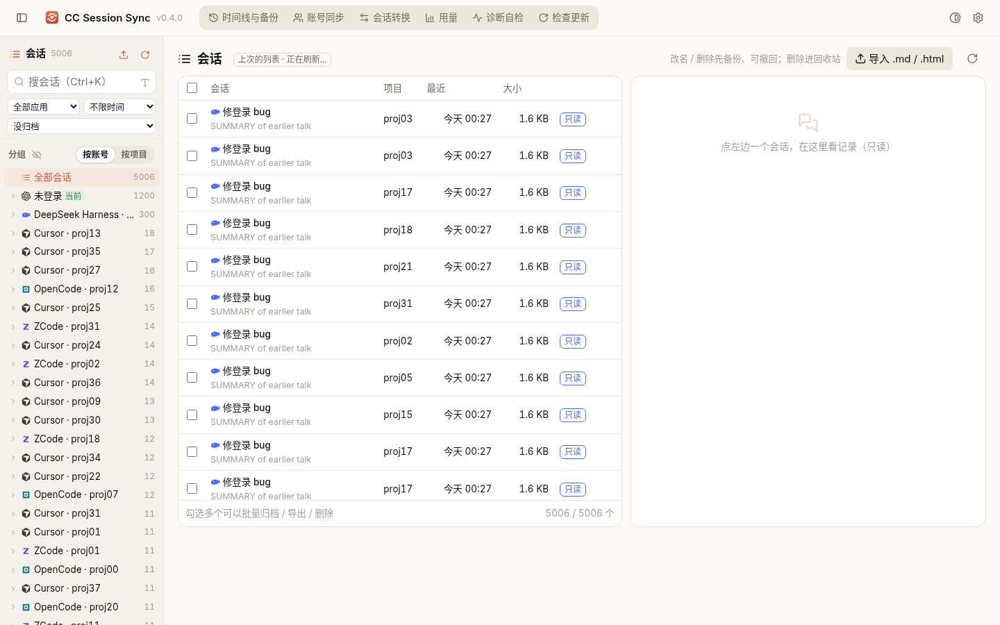 | 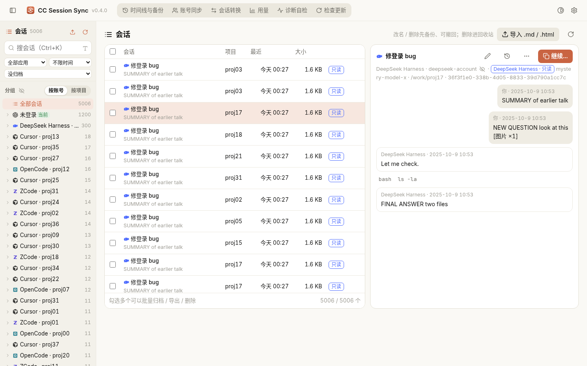 |

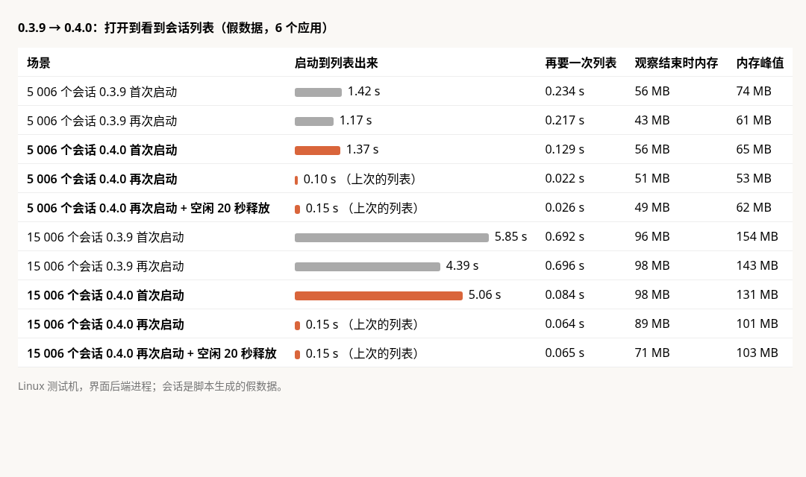

### 清理配置备份（0.3.9）

`~/.cc-sessionsync/backups` 里放的是改配置文件之前留的备份，来自 0.2–0.3.4 改 Codex / Claude Code 配置时，以及 0.3.5 收拾旧改动时。
时间久了会越攒越多。它和会话备份（`sessions.sqlite`）、Claude 同步备份（`claude-sync-bak`）无关，这里不碰那两样。

- **手动清理**：设置 → 数据 → 配置备份 →「清理…」。
  - 填规则：删比 N 天旧的，和 / 或总共超过 M MB 时从最旧的删（填 0 = 不按这一条删）。
  - 先列出**会删哪些**（备份时间、是哪个文件的、为什么备份、大小）和**能腾出多少**，确认了才删。
- **自动清理**：设置 → 高级 →「自动清理旧的配置备份」，**缺省关**。打开后每天最多清一次，规则同上。
- **每个文件最新的一份永远不删**：按 `index.jsonl` 里记的原文件分组；没有记录的，按标签和后缀分组。
- 只删 backups 文件夹第一层里认得出来的备份文件，`index.jsonl` 里对应的行会一起去掉。子文件夹和认不出来的文件都不动。
- 命令行：`cc-sessionsync clean-backups --days 90 [--mb 200]` 只预览，加 `--yes` 才删。

| 清理前预览 | 设置 → 高级 |
|---|---|
| 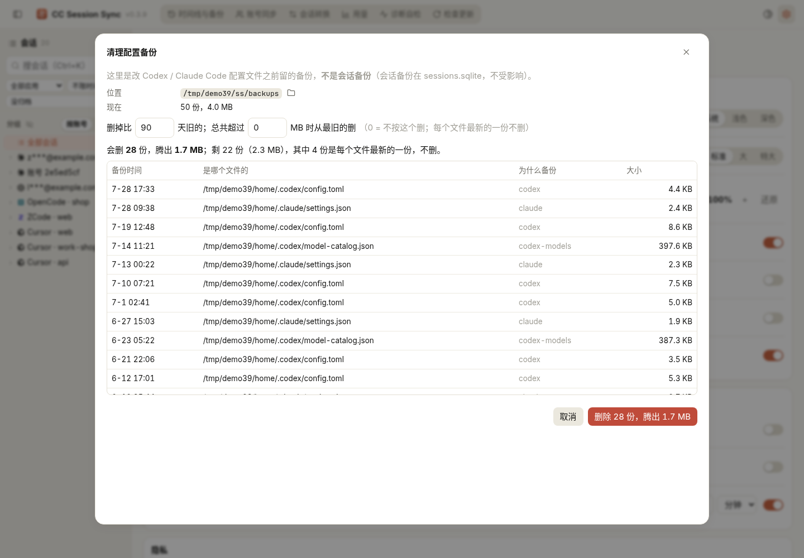 | 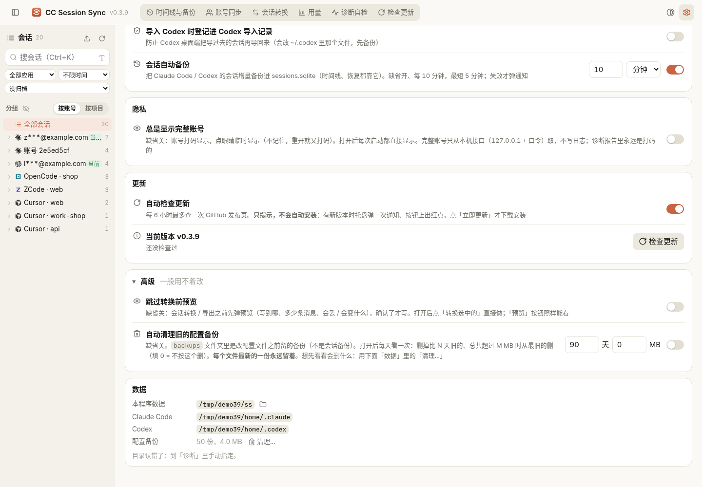 |

### 存储格式自检（0.3.8）

应用升级后可能改了存会话的格式：OpenCode 换了表、ZCode 改了列名、Cursor 的 `_v` 版本变了、Codex 的 rollout 多了新的记录类型等等。
以前遇到这种情况，会话就悄悄从列表里少了几个；现在会**明确告诉你**。

- 启动 1 分钟后在后台查一次，之后每 6 小时查一次，**只读**：只看表名、列名、记录类型、格式版本和条数，不读账号或凭据表。
- 有问题时**顶上出提示条**：哪些应用、有几个会话读不出来。点「看诊断」看细节；点「知道了」后，同样的问题不再提示，出了新问题才会再提示。
  托盘也会弹一次通知，每种问题只弹一次。
- **诊断自检 → 存储格式自检**：每个应用一行，写明认出的格式、读得出 / 读不出的会话数、发现了什么，并给出建议（一般是先升级 CC Session Sync；会话本身没坏）。可以点「重新检查」。
  「自检」列表里也有每个应用的「存储格式」一项。
- OpenCode / ZCode 缺了不认识的可选列时，照样把能读的会话读出来，不再整库读失败。

| 顶上提示 | 诊断里的存储格式自检 |
|---|---|
| 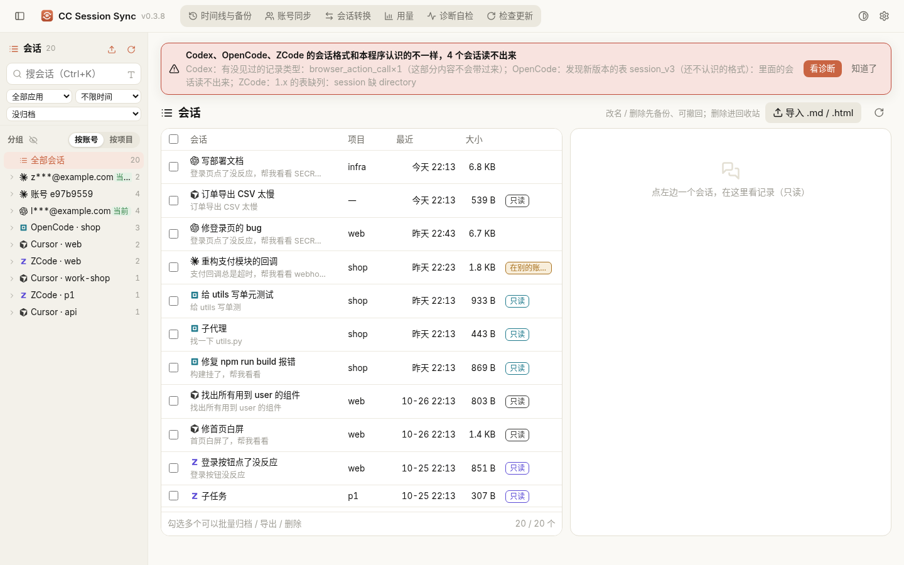 | 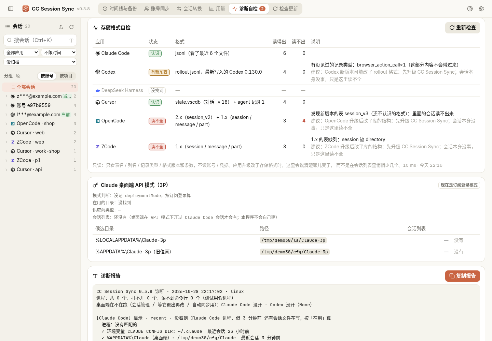 |

### 拿掉了「供应商」（0.3.5）

「供应商」页（Agent / 服务商 / 高级）、模型路由（本机协议转换代理、Anthropic ⇄ OpenAI Responses / Chat 转换、多 key 轮换）、
给 Codex 写的模型目录、配置提醒 / 一键修复、托盘里的「供应商…」、命令行 `route`，**全部拿掉了**：太重，也不好懂。
要换模型 / 服务商，直接用 Codex / Claude Code 自己的配置（或 CC Switch 之类专门的工具）。

**更新到 0.3.5 后第一次启动**（打开窗口，或旧的开机自启项先跑到也一样），程序把 0.3.0–0.3.4 改过的东西收拾干净，只做一次，做完在窗口顶上提示一次
「供应商功能已移除，已把 Codex / Claude Code 配置恢复原样」并列出做了什么：

- **Codex `~/.codex/config.toml`**：启用时记下的原值放回去（`model_provider`、`model`、`model_catalog_json`、推理等级等）；文件启用后没被动过就**按字节还原**，
  动过就只把「现在还是我们写的值」的那几项放回，别的键（包括你后来加的）不碰。删掉 `[model_providers.cc-route]`、`[profiles.cc-route]`。
  **没有记录时**（老版本 / 记录丢了）只删我们写的：`model_provider = "cc-route"` 连同给它用的 `model` 一起删（回到 Codex 默认的 ChatGPT 登录和默认模型），
  `model_catalog_json` 指着 `ccss-models-*.json` 就删掉这个键。**不会留下 `model_provider` 指向 cc-route。** `auth.json`（ChatGPT 登录）从来不动。
- **Codex 其他文件**：删 `cc-route.config.toml`（profile）、我们生成的模型目录 `ccss-models-*.json`（`ccss-models-cc-route.json`、0.2 供应商列表写的 `ccss-models-<id>.json`，
  比如 `ccss-models-cpa.json`；这个前缀只有本程序用）、Codex 的模型列表缓存 `models_cache.json`（让它马上按恢复后的设置重新拉）。
- **Claude Code `~/.claude/settings.json`**：同样按记录还原；没有记录时删掉指向本机代理的 `ANTHROPIC_BASE_URL` / `ANTHROPIC_AUTH_TOKEN`，
  和取本机代理口令的 `apiKeyHelper`（`… key get route-token`）。你自己的代理、自己的 `apiKeyHelper` 不碰。删 `~/.cc-sessionsync/route/claude-settings.json`。
- 停掉后台代理进程，删开机自启项「CC Session Sync Route」（HKCU\…\Run），删凭据管理器里的本机代理口令 `route-token`。
- 每个要改的文件**先备份**进 `~/.cc-sessionsync/backups`（和以前改配置时的备份同一处），做了什么记在 `~/.cc-sessionsync/legacy-0.3.5.json` / `legacy-0.3.5.log`；
  旧记录 `route.json` 改名成 `route.json.removed-0.3.5`。「诊断自检」里会检查还有没有残留。

| 第一次启动 0.3.5 | 之后（顶栏没有「供应商」了） |
|---|---|
| 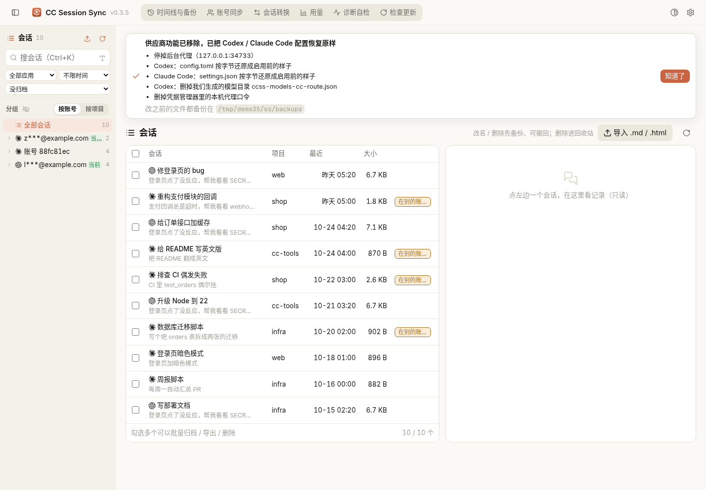 | 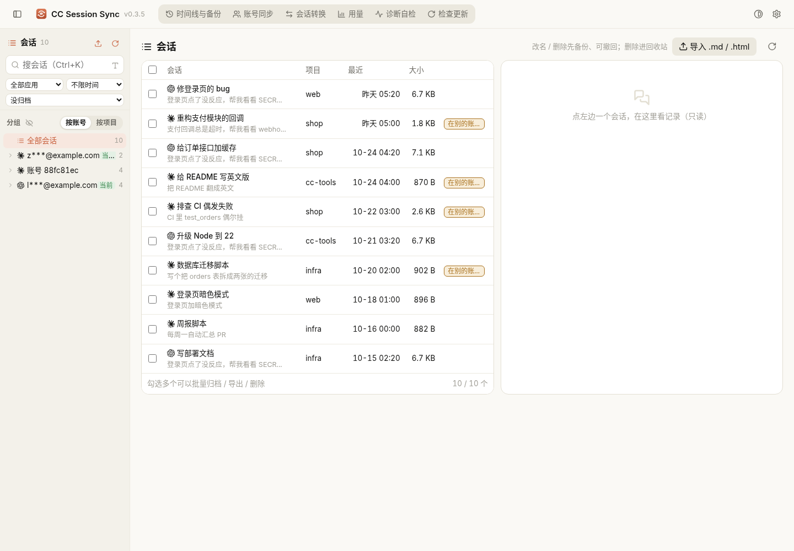 |

**没动的**：你存在凭据管理器里的服务商 key（`prov-…` / `card-…` / 0.2 的 `claude-…` / `codex-…`）留着；`CCSessionSync.exe key get <名字>` 命令也留着——
0.2 的「供应商列表」切换过去、或者直连卡片写的取 key 命令还指着它，删了那些配置会断。不想要了就在 Codex / Claude Code 里改回自己的设置，再到 Windows 凭据管理器里删 `CCSessionSync/key/…`。

### 字号与界面缩放（0.2.6）

- 缺省字号调大了一号（正文 15px，最小的标签 12px）。
- 「设置 → 外观与窗口」：**字号** 小 / 标准 / 大 / 特大；**界面缩放** 80%–200%（每次 10%），快捷键 `Ctrl` + `=` 放大、`Ctrl` + `-` 缩小、
  `Ctrl` + `0` 还原，也可以按住 `Ctrl` 滚滚轮。两个都会记住。
- Windows 桌面版按显示器的缩放（125% / 150%）清晰显示（DPI 感知），上面的缩放是在这之外再放大。顶栏放不下时只留图标（鼠标停上去看名字）。

| 100% | 125% | 150% |
|---|---|---|
|  |  | 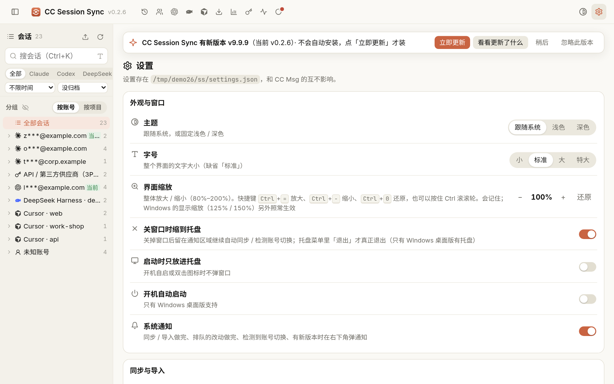 |

| 界面缩放 150% | 字号「特大」 |
|---|---|
| 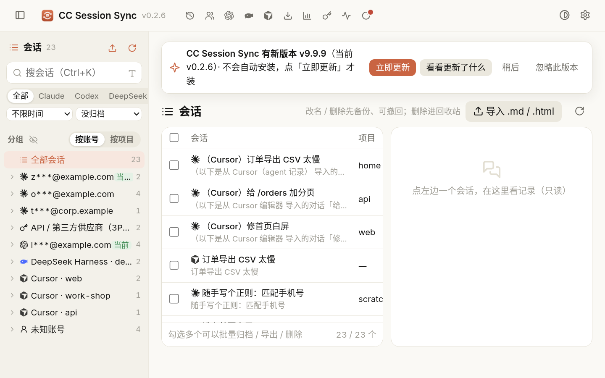 | 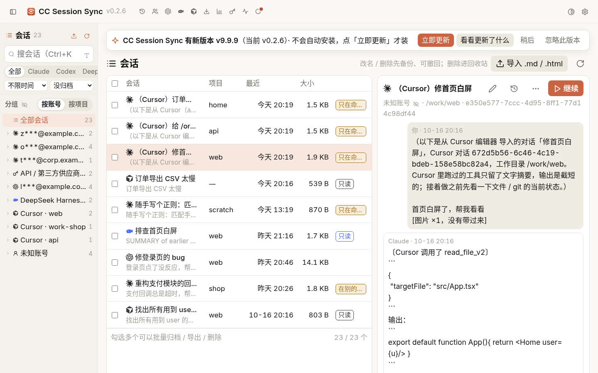 |

### 检查更新（不会自动安装）

- 启动后、之后每 6 小时最多查一次 GitHub 的最新发布（公开接口，不用登录）。
- 有新版本：**同一个版本只弹一次**托盘通知；顶栏「检查更新」按钮和设置里的检查更新上出现**小红点**，托盘菜单那一项变成
  「● 有新版本 x.y.z…」、托盘图标也带红点，
  窗口顶部有提示条（「立即更新」「看看更新了什么」「稍后」「忽略此版本」）。红点一直在，直到你装了这个版本或点了「忽略此版本」。
- **只有你点「立即更新」才装**：下载安装包 → 核对 sha256（对不上就不装）→ 静默安装 → 重新打开。pip 装的版本只提示 `pip install -U` 命令。

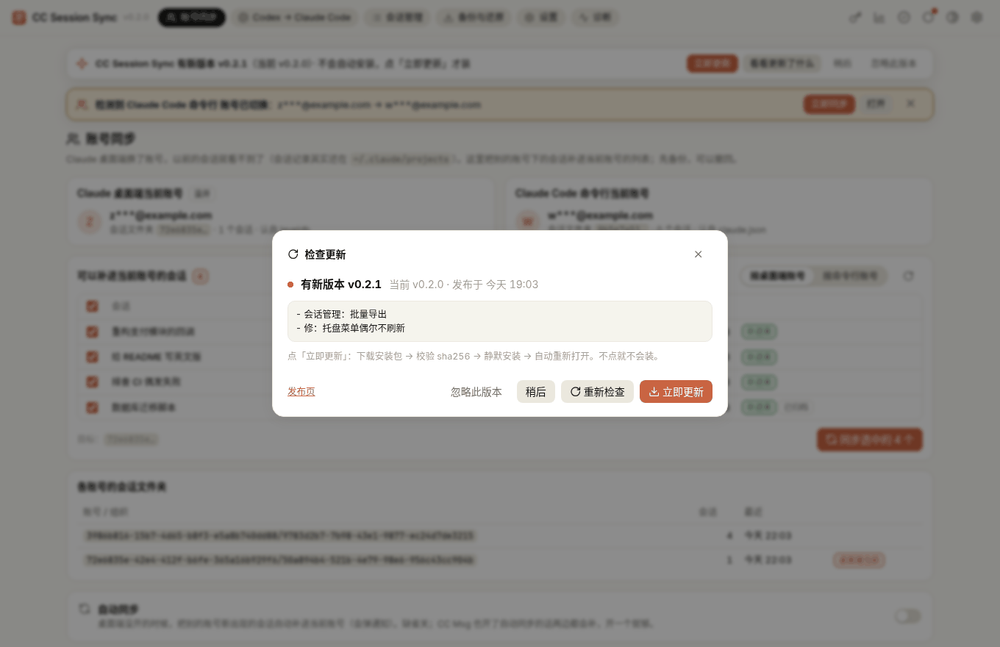

### 各页

| | |
|---|---|
| 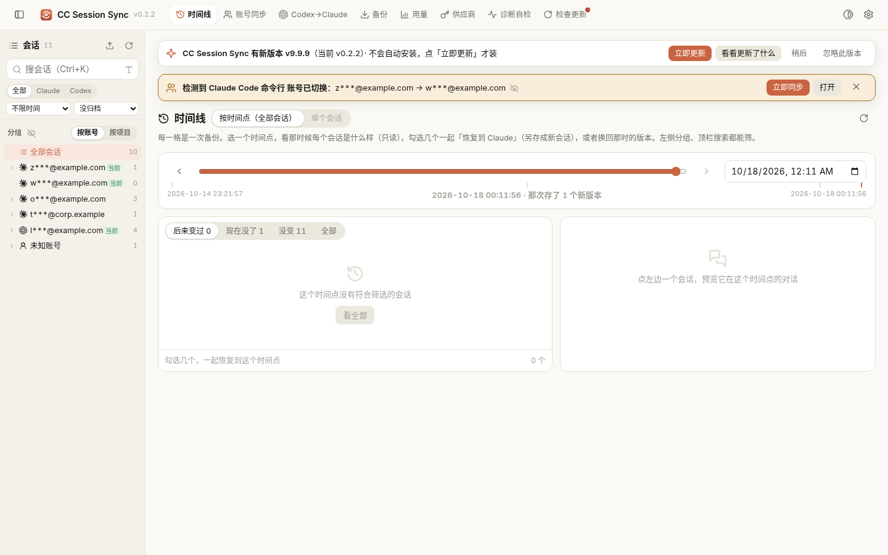 | 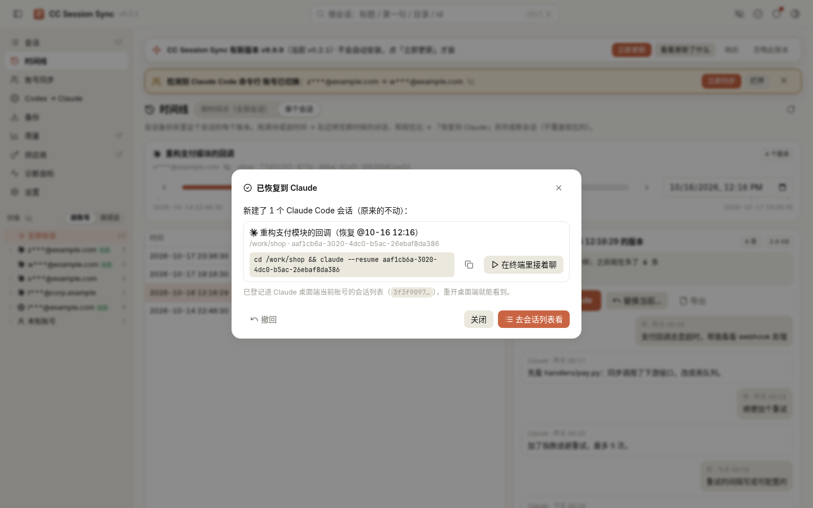 |
| （时间线与快照恢复已移除；请用会话页的导出 / 导入。） | （账号同步仍有同步前备份与同步记录一键撤销。） |
| 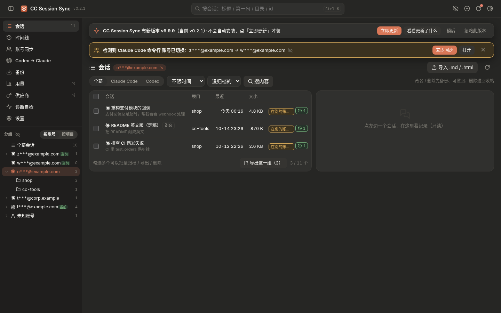 | 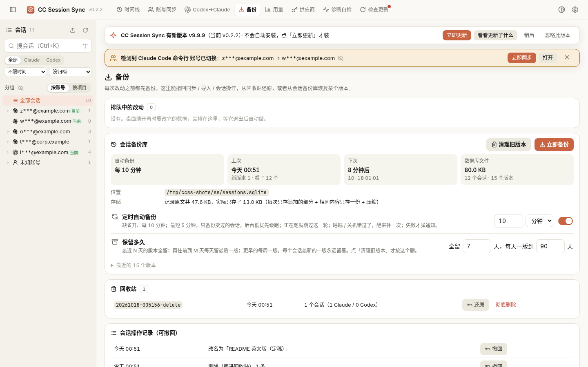 |
| **按账号分组**（深色）：账号下再按项目分，选中一组可以整组导出。 | **备份**：自动备份的上次 / 下次 / 结果、数据库大小、保留规则、清理。 |
| 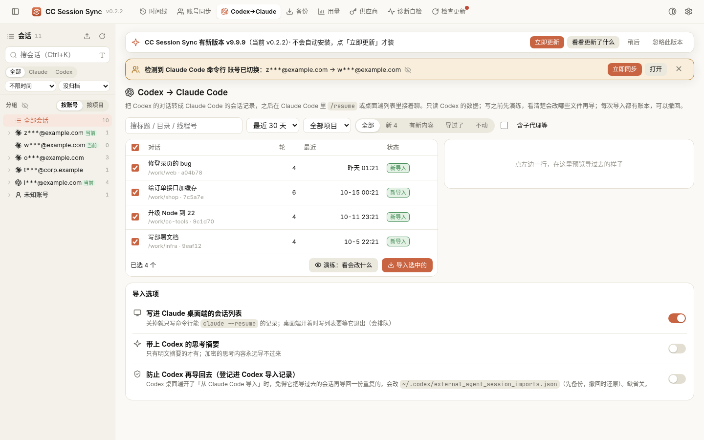 | 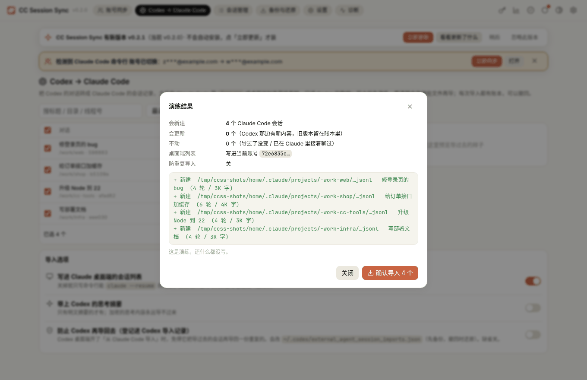 |
| **会话**（深色）：只读查看、改名、归档、导出、在终端里接着聊、删除进回收站，可批量。 | **导入 .md / .html**：先预览，无损 / 按标题解析一目了然。 |
| 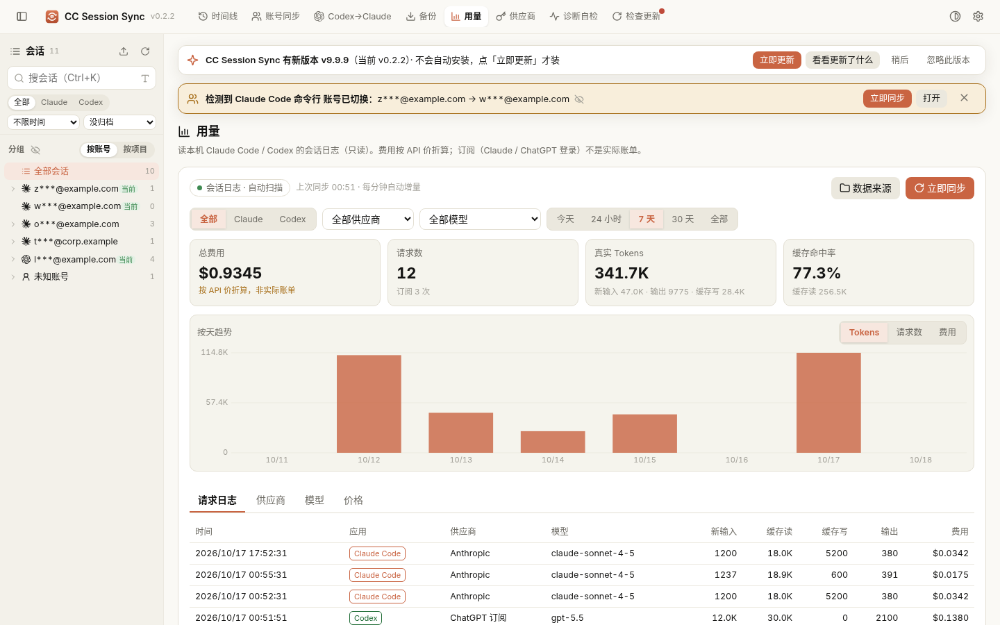 | |
| **用量**（页面，不是弹窗）：读本机会话日志（同一次请求只算一次），缓存读 / 写分开算；费用「按 API 价折算」，不是实际账单；没价格的模型显示「—」。 | |
|  |  |
| **设置**：主题、托盘、开机自启、通知、自动同步、自动备份、总是显示完整账号、检查更新。 | **诊断 / 自检**：每一项通过 / 注意 / 没通过，附建议；第一次启动自动跑一次。报告里账号打码，可以直接复制发出来。 |

### 会话管理怎么改文件

- **改名**：缺省只改本程序里的显示名（别名），什么文件都不动。勾「也改 Claude/Codex 自己显示的名字」才写：Claude 在会话记录末尾追加一条
  `custom-title`（Claude Code 自己的改名格式），登记过的再改桌面端列表标题；Codex 在 `session_index.jsonl` 追加一条、并改 state 数据库里的名字
  （和 Codex 自己改名的做法一样）。改之前先备份。
- **归档**：Claude 改桌面端列表里的「已归档」；Codex 跟 Codex 自己一样，把会话文件挪进 `archived_sessions/` 并更新数据库。
- **删除**：先把会话记录完整存进会话备份库，再把文件（和桌面端列表那一条）挪进 `~/.cc-sessionsync/trash/`。回收站里「彻底删除」要再输入 `DELETE` 确认。
- **还原**：原位置空着就放回原位；原位置已经有文件了就另存一份新的，不覆盖。
- 要改 Claude 桌面端列表、它又开着：排队，等它退出后再做（见下文「怎么保证安全」）。每一步都进操作记录，可以撤回。

## 命令行

```bash
cc-sessionsync                            # 打开桌面窗口（= cc-sessionsync desktop）
cc-sessionsync ui --port 8766 --no-browser  # 只起本地网页界面，不开窗口
cc-sessionsync status                     # 桌面端 / 命令行当前登的号、各账号文件夹、Codex 对话数

# ① 换号后补齐
cc-sessionsync sync --dry-run             # 演练：两边（桌面端 / 命令行）各算一遍会补哪些
cc-sessionsync sync                       # 按桌面端当前账号补齐
cc-sessionsync sync --source cli          # 按命令行（~/.claude.json）当前账号补齐
cc-sessionsync sync --to <账号>/<组织>     # 手动指定目标文件夹
cc-sessionsync backups                    # 每次同步前的备份
cc-sessionsync clean-backups --days 90    # 清理旧的配置备份：先预览，加 --yes 才删；每个文件最新的一份不删（0.3.9）
cc-sessionsync restore 20261017-101500    # 撤回某次同步（撤回前也先备份）
cc-sessionsync auto                       # 前台常驻：桌面端没开时自动补齐（Ctrl+C 停）

# ② Codex → Claude Code
cc-sessionsync codex list --days 0                     # 列出 Codex 对话（0 = 不限时间）
cc-sessionsync codex import                            # 演练（缺省就是演练，什么都不写）
cc-sessionsync codex import --only 3f9a1c,77b0de --apply   # 只导这两个（线程号末几位）
cc-sessionsync codex import --cwd D:\work\shop --apply     # 只导这个项目下的
cc-sessionsync codex import --no-desktop --apply       # 只写命令行用的会话记录，不碰桌面端列表
cc-sessionsync codex import --mark-codex-imported --apply   # 同时登记进 Codex 导入记录（防止 Codex 再导回去，见下文）
cc-sessionsync settings --codex-mark-imported on       # 以后缺省就登记（off 关掉；单次用 --no-mark-codex-imported）
cc-sessionsync codex ledgers                           # 导入账本
cc-sessionsync codex undo 20261017-101800              # 撤回一次导入

# ⑤ 会话管理（命令行只读；改名 / 删除 / 还原请在窗口里做）
cc-sessionsync sessions list [--agent claude|codex] [-n 50]
cc-sessionsync sessions backup            # 增量备份进 ~/.cc-sessionsync/sessions.sqlite
cc-sessionsync sessions export claude <会话号> --fmt md
cc-sessionsync sessions trash             # 回收站
cc-sessionsync sessions ops               # 操作记录
cc-sessionsync usage [--full]             # 用量汇总
```

导入后命令行会打印每个会话的打开方式，例如：

```
cd D:\work\shop && claude --resume 8d7c1c3e-…
```

（Claude Code 按工作目录找会话，要先进到 Codex 对话当时的工作目录。）桌面端：打开 / 重启 Claude 桌面端，列表里标题前带「（Codex）」的就是。

## 怎么保证安全

- **先演练**：`sync --dry-run`、`codex import`（不加 `--apply`）只算不写；界面上也是先「演练」才能点执行。
- **桌面端开着不写它的数据**：Claude 桌面端把会话列表放在内存里，退出时写回磁盘，开着的时候改会被盖掉。所以要改桌面端列表时，
  如果它开着，先问你：「关闭并执行（完成后重启）」会请它正常退出（不强制；强制结束要再确认一次），或者排队等你自己退出，
  后台等它完全退出后再做，做完按原来的方式把它重新打开（`jobs` 能看、能取消）。只写命令行会话（`--no-desktop`）不用等。
- **备份 + 撤回**：
  - 同步：每次写之前把目标账号文件夹整个拷到 `~/.cc-sessionsync/claude-sync-bak/<时间>/`，旁边 `ledger.json` 记补了哪些、刷新了哪些；
    `restore` 把补进来的挪进回收站、刷新过的换回原版本。撤回过的会话，自动同步不会再补回来。
  - Codex 导入：`~/.cc-sessionsync/codex-import/<时间>/ledger.json` 记这次新建 / 更新了哪些文件，更新前的版本拷在旁边；
    `codex undo` 把新建的挪进回收站（`~/.cc-sessionsync/trash/`，不直接删）、更新过的换回原版本。导过去之后你在 Claude 里接着聊过的会话不动。
- **只补不删**：同步只补缺的、刷新旧的，不删除；在当前账号里删过的会话（桌面端留了墓碑）不复活；对话记录文件已经没了的不补。
- **再导一次**：Codex 那边又聊了 → 更新同一份 Claude 会话（先备份）；你已经在 Claude 里接着聊过 → 不覆盖。
- 所有写都是「写临时文件再一步换上」，不会写出半个文件。

## 目录怎么认

| | 缺省 | 改 |
|---|---|---|
| Claude Code 数据 | `~/.claude` | `CLAUDE_CONFIG_DIR` |
| Codex 数据 | `~/.codex`（商店版 Codex 的虚拟化目录里有会话、`~/.codex` 没有时用那边） | `CODEX_HOME` |
| Claude 桌面端数据 | Windows `%APPDATA%\Claude`；商店（MSIX）版 `%LOCALAPPDATA%\Packages\Claude_*\LocalCache\Roaming\Claude`；macOS `~/Library/Application Support/Claude`；Linux `~/.config/Claude` | 界面「检测 / 目录」里手动选 |
| Claude 桌面端 API 模式（3P） | `%LOCALAPPDATA%\Claude-3p`（旧位置 `%APPDATA%\Claude-3p`，商店版虚拟化目录里的也认） | `CLAUDE_USER_DATA_DIR`（签名版桌面端会忽略） |
| 本工具自己的数据 | `~/.cc-sessionsync` | `CC_SESSIONSYNC_HOME` |

两个桌面端目录都有时：会话列表、Local Storage（账号）、IndexedDB 各自看哪边最近有写入；一样新时，桌面端是从 WindowsApps（商店版）跑的就用 MSIX 那边。
`status` / `diag` 会写明每一项用的是哪边、为什么。

## Codex → Claude Code 的限制


- **工具调用折成文字**：Codex 的 shell / exec_command / apply_patch / update_plan / web_search / MCP 调用，写成助手回复里的一段
  「〔Codex 调用了 …〕+ 命令 + 截短的输出（缺省每个 20 行 / 2000 字符）」，不是 Claude 的 `tool_use` / `tool_result`。
  原因：两边工具名和参数格式不一样，硬塞成 Claude 的工具调用可能被 API 拒掉，整份会话就续不上。所以 Claude 接手后要自己再看一下文件 / git 状态（导入的第一条消息里也这么提示了）。
- **思考过程（reasoning）缺省不带**：Codex 的大多是加密的，读不出来；有明文摘要的可以用 `--reasoning` 带上。
- **图片不带**：用户贴的图、工具返回的图、生成的图都换成「[图片…]」占位。
- **Codex 注入的上下文不带**：AGENTS.md、环境信息、权限说明等（Claude Code 自己会重新带上它的）。
- **只导用户自己开的对话**：子代理、`codex exec` 一次性任务、从 Claude 导进 Codex 的线程缺省跳过（免得来回套娃）；`--all` 可以都算上。
- **很长的对话**：全部历史都会导进来，太长时 Claude Code 第一次接着聊可能提示上下文太长，用 `/compact` 压一下即可。
- **模型显示**：导入的助手消息模型名记为 `codex-import`，费用 / token 统计为 0。
- Claude Code 的会话文件格式不是官方公开格式，这里按本机 Claude Code（测试用 2.1.302）实际写出的文件来拼；CI 每次都用最新版 Claude Code
  真的 `claude --resume` 一遍（连本机假 API）确认能打开。Claude Code 以后改格式可能需要跟着更新。
- Codex 桌面端如果开了「从 Claude Code 导入会话」，可能会把导过去的这份当成 Claude 会话再导回 Codex 一份。缺省不处理（不碰 Codex 的文件），
  要防止就打开下面的「登记进 Codex 导入记录」。

## 登记进 Codex 导入记录（可选，缺省关）

Codex 桌面端「从 Claude Code 导入会话」会扫 `~/.claude/projects`，用 `<CODEX_HOME>/external_agent_session_imports.json` 记哪些已经导过。
打开这个开关后，每导一个会话，就在这个文件里加一条记录：「这份 Claude 会话 = 原来那个 Codex 线程」，Codex 看到就不会再导一份重复的。

- 打开方式：命令行 `--mark-codex-imported`（单次）、`cc-sessionsync settings --codex-mark-imported on`（以后缺省），
  或界面「Codex → Claude Code」页的「登记进 Codex 导入记录」勾选（会记住）。缺省关。
- 记录格式和 Codex 自己写的一样（对照 Codex 开源代码 `codex-rs/external-agent-migration/src/sessions/ledger.rs`）：
  `{"records": [{"source_path", "content_sha256", "imported_thread_id", "imported_at", "source_modified_at", "connector_names", "title"}],
  "detected_connector_records": [...]}`；`source_path` 按 Codex 的写法（Windows 是 `\\?\C:\…`），`imported_thread_id` 是原来的 Codex 线程号。
- **只动这一个文件**，Codex 的其它文件（对话、索引、数据库、配置）一概不碰。改之前把原文件拷进这次导入的账本，写临时文件再一步换上；
  文件里原有的记录和其它字段原样保留，只增 / 改我们自己那几条。文件不存在就按 Codex 的格式新建。
- **格式不对就整个不动**：文件不是合法 JSON、或者不是 `{"records": [...]}` 的样子 → 报错，这次导入一个文件都不写（演练时就会提示）。
  修好它，或者这次用 `--no-mark-codex-imported` 不登记。
- **撤回**：`codex undo` 一起还原。文件从导入以后没变过 → 原样换回备份（导入前没有这个文件 → 挪进回收站）；
  之后 Codex 自己又往里加过记录 → 只把我们那几条换回原样，Codex 后来加的保留。你在 Claude 里接着聊过、被保留下来的会话，登记也保留。
- 你在 Claude 里接着聊了以后，这份会话的内容和登记的不一样了，Codex 会试着把新增的部分接到原来那个 Codex 线程后面
  （它要求内容严格对得上，转换过的文字版一般对不上，就放弃）；不会再新建一份重复的。
- Codex 桌面端开着时也可以导：写之前会重新读一遍文件再原子替换，窗口很短；保险起见可以先退出 Codex 再导。

## 开发

```bash
pip install -e . pytest
python -m pytest -v                                    # 场景测试，全在临时目录里跑
npm i -g @anthropic-ai/claude-code
python tools/verify_resume.py "$(command -v claude)"   # 真的 claude --resume 打开导入的会话（本机假 API，不联网不登录）
python tests/demo_env.py /tmp/demo --serve 8797        # 假数据 + 界面，截图用（只写 /tmp/demo）
```

Windows 安装包：`tools/build_desktop.ps1`（Nuitka 编译 + 隐藏窗口冒烟测试 + Inno Setup），CI 里还会真装一遍、跑自检、再卸载。

发版：改 `cc_sessionsync/__init__.py` 的 `__version__`，打 `v<版本>` 标签，`release` 工作流会出 `CCSessionSync-Setup-<版本>.exe`（+ `.sha256`）、
wheel、sdist 和 `SHA256SUMS.txt`。

许可：MIT，见 [LICENSE](LICENSE)；第三方声明见 [THIRD_PARTY_NOTICES.
## English

See **[README.en.md](README.en.md)** for the full English README. The app itself also has an English UI since 0.4.3
(设置 / Settings → Language).
