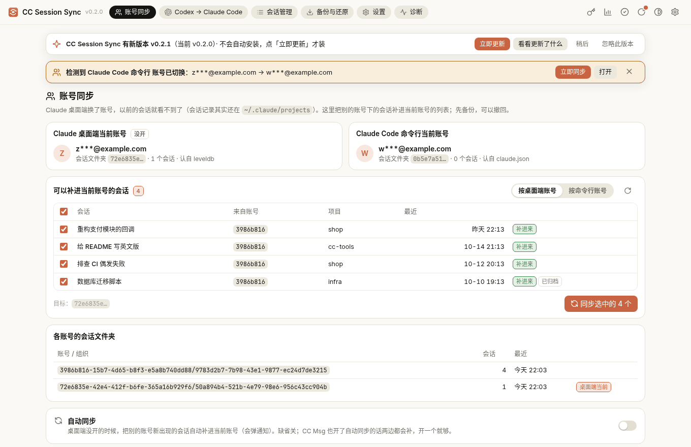
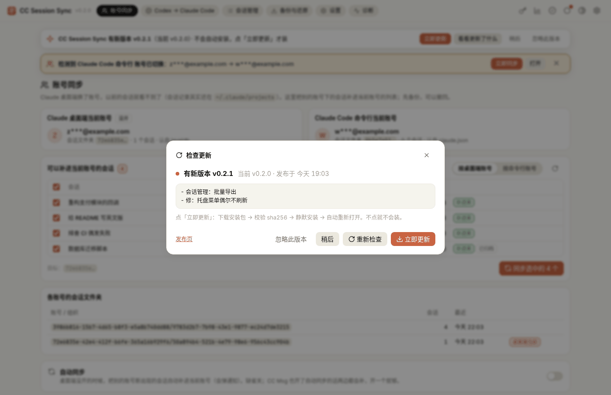
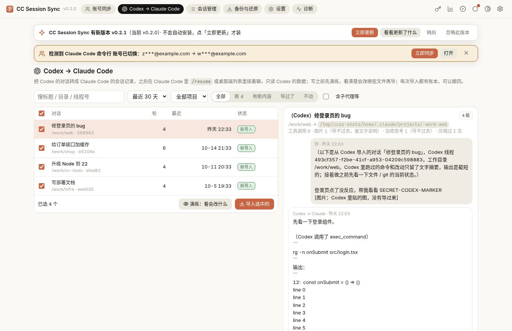
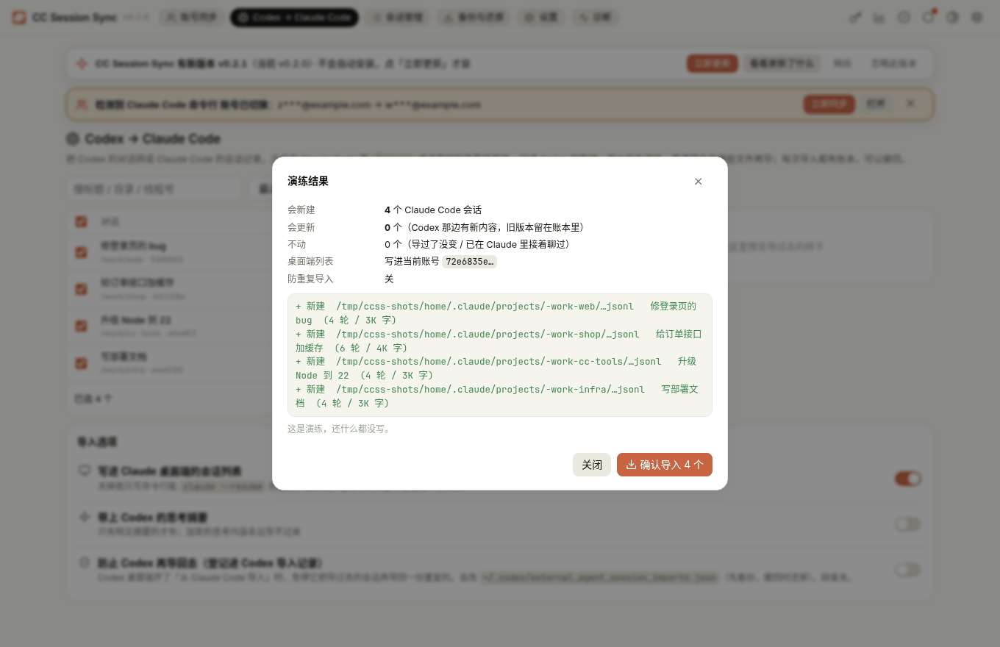
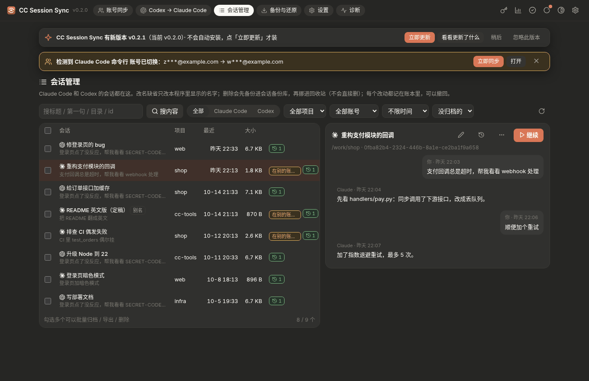
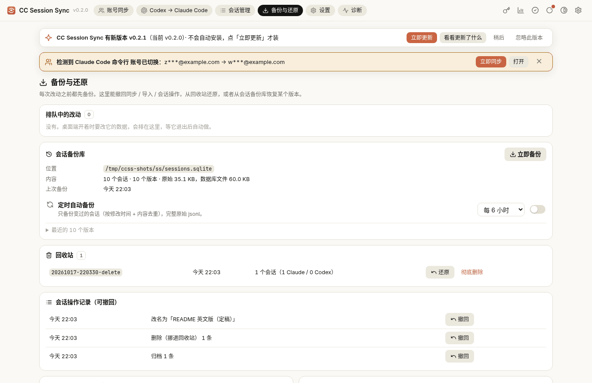
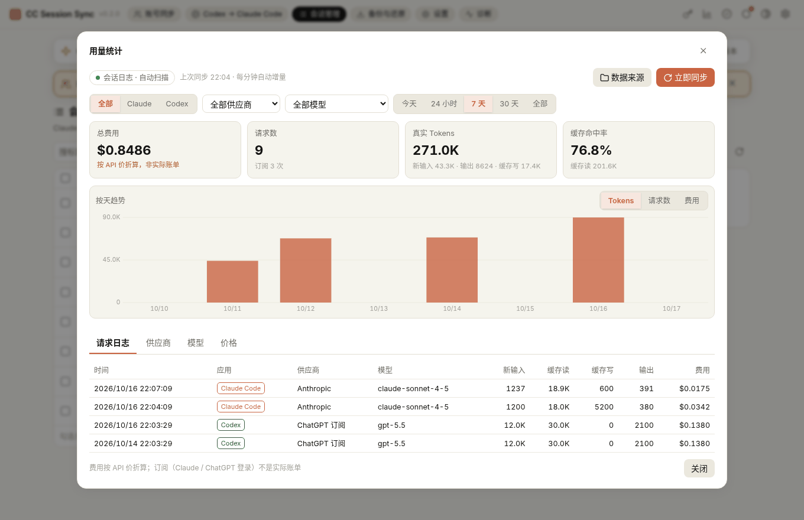
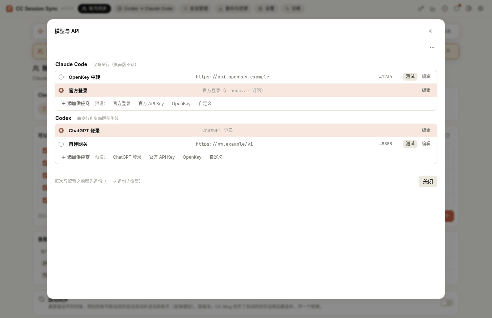
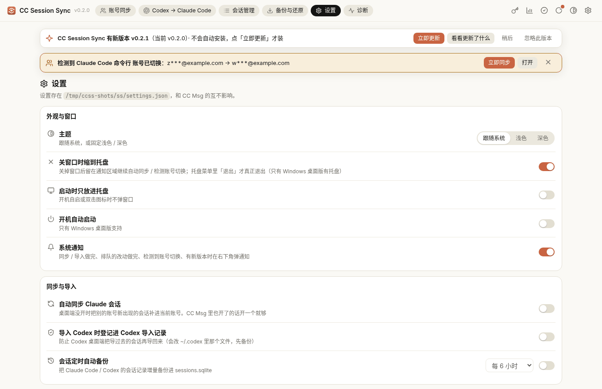
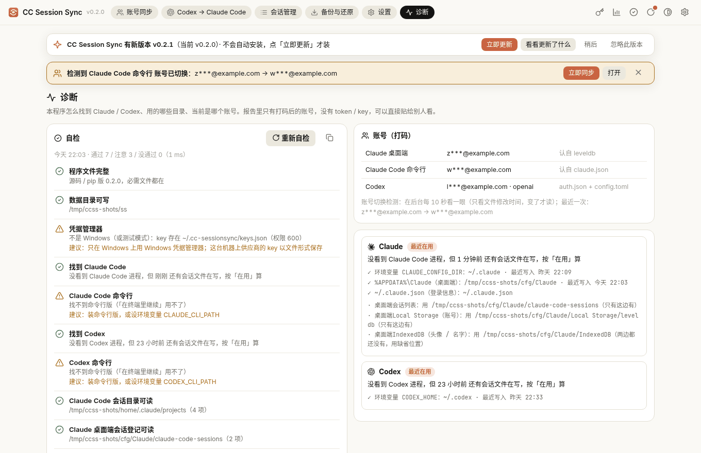

# CC Session Sync

Claude Code / Codex 的会话管家，Windows 桌面程序（也能 pip 装、命令行用）。所有改动都先备份、记账本、能撤回，能演练的先演练：

1. **账号同步**：Claude Code 换账号后，旧会话「不见了」→ 补回来。Claude 桌面端的会话列表按「账号 / 组织」分文件夹存，换号后新号的列表是空的，
   但对话内容其实都还在本机。这里把别的账号文件夹里的会话登记补进当前账号（桌面端 + 命令行两套登录都能认）。**检测到换号会弹通知**。
2. **Codex → Claude Code**：把 Codex 的线程（`~/.codex/sessions/**/rollout-*.jsonl`）转成一份 Claude Code 会话
   （`~/.claude/projects/<项目>/<会话号>.jsonl`，可选再加一条桌面端会话列表登记），然后 `claude --resume` 或在桌面端里接着聊。
   **Codex 的对话文件只读，一个字节都不改**；只写新文件。（唯一的例外是可选的「登记进 Codex 导入记录」，缺省关，见下文。）
3. **会话管理**：Claude Code 和 Codex 的会话放一起看、搜（标题 / 全文）、筛，只读查看对话；改名、归档、导出 md / jsonl、在终端里接着聊、
   删除（先备份进会话备份库，再挪进回收站，不直接删）。
4. **备份与还原**：会话备份库（`~/.cc-sessionsync/sessions.sqlite`，增量、去重、可定时）、回收站、操作记录（每一步都能撤回）。
5. **用量统计**、**模型与 API**（Claude Code / Codex 供应商切换，key 存 Windows 凭据管理器）、**诊断 / 自检**、**检查更新**、托盘和系统通知。

> 最早是 [CC Msg](https://github.com/helefee/CCMessage) 里的功能，这里单独拿出来，不需要装 CC Msg；两个程序的数据和设置互不影响
> （本程序的数据都在 `~/.cc-sessionsync`）。



## 安装

- **Windows（推荐）**：在 [Releases](https://github.com/helefee/CC-SessionSync/releases) 下载 `CCSessionSync-Setup-<版本>.exe`，双击安装。
  - 装到当前用户目录 `%LOCALAPPDATA%\Programs\CCSessionSync`，**不要管理员权限**；开始菜单（可选桌面）有快捷方式；「设置 → 应用」里能卸载。
  - 界面用系统自带的 Edge WebView2（Windows 10/11 一般都有）。不弹任何黑框。
  - 安装包没签名，SmartScreen 可能提示，点「更多信息 → 仍要运行」。发布页有 `.sha256` 可以核对。
  - 装好的 `CCSessionSync.exe` 也是命令行：`"%LOCALAPPDATA%\Programs\CCSessionSync\CCSessionSync.exe" status`。
- **pip**（Python 3.10+，Windows / Linux / macOS）：
  ```bash
  pip install "cc-sessionsync[desktop] @ https://github.com/helefee/CC-SessionSync/releases/download/v0.2.0/cc_sessionsync-0.2.0-py3-none-any.whl"
  # 只要命令行 / 浏览器界面，不要窗口：去掉 [desktop]
  pip install git+https://github.com/helefee/CC-SessionSync
  ```
  装完有 `cc-sessionsync` 命令；也可以 `python -m cc_sessionsync`。Linux 上窗口要 pywebview 的 GTK 或 Qt 后端；没有就自动用浏览器打开。

## 桌面程序

- 只开一个：再点快捷方式会把已经开着的窗口叫出来。关窗口缺省缩到托盘（设置里能改），托盘菜单：显示 / 隐藏窗口、立即同步 Claude 会话、
  自动同步、Codex → Claude Code、会话管理、用量统计、模型与 API、排队中的改动（有的时候）、开机自启、关窗口到托盘、启动时到托盘、通知、
  检查更新、自检、退出。
- 界面只听 `127.0.0.1:8766`，每个请求都要带页面里的一次性口令（别的网页 / 程序调不了）。
- **系统通知**：同步 / 导入做完、排队的改动做完、检测到换号、有新版本。可以在设置里关。

### 检测到换号

每 10 秒看一眼 Claude 桌面端 / 命令行 / Codex 的登录信息（只看文件修改时间，变了才读，几乎不占 CPU），确认稳定后弹一次通知
「检测到 Claude Code/Codex 账号已切换：旧 → 新」，窗口顶部出现提示条，带「立即同步」「打开」。通知和界面里只显示打码的账号（`z***@example.com`），
从不读、不显示 token。Windows 的托盘气泡不能放按钮，所以点通知 = 打开窗口，按钮在窗口的提示条上。

### 检查更新（不会自动安装）

- 启动后、之后每 6 小时最多查一次 GitHub 的最新发布（公开接口，不用登录）。
- 有新版本：**同一个版本只弹一次**托盘通知；顶栏「检查更新」按钮和设置里的检查更新上出现**小红点**，托盘菜单那一项变成
  「● 有新版本 x.y.z…」、托盘图标也带红点，
  窗口顶部有提示条（「立即更新」「看看更新了什么」「稍后」「忽略此版本」）。红点一直在，直到你装了这个版本或点了「忽略此版本」。
- **只有你点「立即更新」才装**：下载安装包 → 核对 sha256（对不上就不装）→ 静默安装 → 重新打开。pip 装的版本只提示 `pip install -U` 命令。



### 各页

| | |
|---|---|
|  |  |
| **Codex → Claude Code**：搜索 / 按时间、项目、状态筛，勾选，右边预览转换后的样子；先「演练」看会新建 / 更新哪些文件，再确认导入。 | 演练结果：每个要写的文件、桌面端列表写进哪个账号、防重复导入开没开。 |
|  |  |
| **会话管理**（深色）：只读查看、改名、归档、导出、在终端里接着聊、删除进回收站，可批量。 | **备份与还原**：排队中的改动、会话备份库、回收站、操作记录、同步备份、导入账本，都能撤回。 |
|  |  |
| **用量统计**：读本机会话日志（同一次请求只算一次），缓存读 / 写分开算；费用「按 API 价折算」，不是实际账单；没价格的模型显示「—」。 | **模型与 API**：Claude Code / Codex 的供应商、模型映射、连通测试；key 存 Windows 凭据管理器，配置文件改之前先备份。 |
|  |  |
| **设置**：主题、托盘、开机自启、通知、自动同步、定时备份、检查更新。 | **诊断 / 自检**：每一项通过 / 注意 / 没通过，附建议；第一次启动自动跑一次。报告里账号打码，可以直接复制发出来。 |

### 会话管理怎么改文件

- **改名**：缺省只改本程序里的显示名（别名），什么文件都不动。勾「也改 Claude/Codex 自己显示的名字」才写：Claude 在会话记录末尾追加一条
  `custom-title`（Claude Code 自己的改名格式），登记过的再改桌面端列表标题；Codex 在 `session_index.jsonl` 追加一条、并改 state 数据库里的名字
  （和 Codex 自己改名的做法一样）。改之前先备份。
- **归档**：Claude 改桌面端列表里的「已归档」；Codex 跟 Codex 自己一样，把会话文件挪进 `archived_sessions/` 并更新数据库。
- **删除**：先把会话记录完整存进会话备份库，再把文件（和桌面端列表那一条）挪进 `~/.cc-sessionsync/trash/`。回收站里「彻底删除」要再输入 `DELETE` 确认。
- **还原**：原位置空着就放回原位；原位置已经有文件了就另存一份新的，不覆盖。
- 要改 Claude 桌面端列表、它又开着：排队，等它退出后再做（见下文「怎么保证安全」）。每一步都进操作记录，可以撤回。

## 命令行

```bash
cc-sessionsync                            # 打开桌面窗口（= cc-sessionsync desktop）
cc-sessionsync ui --port 8766 --no-browser  # 只起本地网页界面，不开窗口
cc-sessionsync status                     # 桌面端 / 命令行当前登的号、各账号文件夹、Codex 对话数

# ① 换号后补齐
cc-sessionsync sync --dry-run             # 演练：两边（桌面端 / 命令行）各算一遍会补哪些
cc-sessionsync sync                       # 按桌面端当前账号补齐
cc-sessionsync sync --source cli          # 按命令行（~/.claude.json）当前账号补齐
cc-sessionsync sync --to <账号>/<组织>     # 手动指定目标文件夹
cc-sessionsync backups                    # 每次同步前的备份
cc-sessionsync restore 20261017-101500    # 撤回某次同步（撤回前也先备份）
cc-sessionsync auto                       # 前台常驻：桌面端没开时自动补齐（Ctrl+C 停）

# ② Codex → Claude Code
cc-sessionsync codex list --days 0                     # 列出 Codex 对话（0 = 不限时间）
cc-sessionsync codex import                            # 演练（缺省就是演练，什么都不写）
cc-sessionsync codex import --only 3f9a1c,77b0de --apply   # 只导这两个（线程号末几位）
cc-sessionsync codex import --cwd D:\work\shop --apply     # 只导这个项目下的
cc-sessionsync codex import --no-desktop --apply       # 只写命令行用的会话记录，不碰桌面端列表
cc-sessionsync codex import --mark-codex-imported --apply   # 同时登记进 Codex 导入记录（防止 Codex 再导回去，见下文）
cc-sessionsync settings --codex-mark-imported on       # 以后缺省就登记（off 关掉；单次用 --no-mark-codex-imported）
cc-sessionsync codex ledgers                           # 导入账本
cc-sessionsync codex undo 20261017-101800              # 撤回一次导入

cc-sessionsync jobs [--cancel ID]         # 等桌面端退出再做的任务
cc-sessionsync diag                       # 检测报告（家目录已打码，可以直接发出来）
cc-sessionsync selfcheck [--offline] [--json]   # 自检；有没通过的项返回 1

# ③ 会话管理（命令行只读；改名 / 删除 / 还原请在窗口里做）
cc-sessionsync sessions list [--agent claude|codex] [-n 50]
cc-sessionsync sessions backup            # 增量备份进 ~/.cc-sessionsync/sessions.sqlite
cc-sessionsync sessions export claude <会话号> --fmt md
cc-sessionsync sessions trash             # 回收站
cc-sessionsync sessions ops               # 操作记录
cc-sessionsync usage [--full]             # 用量汇总
```

导入后命令行会打印每个会话的打开方式，例如：

```
cd D:\work\shop && claude --resume 8d7c1c3e-…
```

（Claude Code 按工作目录找会话，要先进到 Codex 对话当时的工作目录。）桌面端：打开 / 重启 Claude 桌面端，列表里标题前带「（Codex）」的就是。

## 怎么保证安全

- **先演练**：`sync --dry-run`、`codex import`（不加 `--apply`）只算不写；界面上也是先「演练」才能点执行。
- **桌面端开着不写它的数据**：Claude 桌面端把会话列表放在内存里，退出时写回磁盘，开着的时候改会被盖掉。所以要改桌面端列表时，
  如果它开着，就排队，后台等它完全退出后再做，做完把它重新打开（`jobs` 能看、能取消）。只写命令行会话（`--no-desktop`）不用等。
- **备份 + 撤回**：
  - 同步：每次写之前把目标账号文件夹整个拷到 `~/.cc-sessionsync/claude-sync-bak/<时间>/`，旁边 `ledger.json` 记补了哪些、刷新了哪些；
    `restore` 把补进来的挪进回收站、刷新过的换回原版本。撤回过的会话，自动同步不会再补回来。
  - Codex 导入：`~/.cc-sessionsync/codex-import/<时间>/ledger.json` 记这次新建 / 更新了哪些文件，更新前的版本拷在旁边；
    `codex undo` 把新建的挪进回收站（`~/.cc-sessionsync/trash/`，不直接删）、更新过的换回原版本。导过去之后你在 Claude 里接着聊过的会话不动。
- **只补不删**：同步只补缺的、刷新旧的，不删除；在当前账号里删过的会话（桌面端留了墓碑）不复活；对话记录文件已经没了的不补。
- **再导一次**：Codex 那边又聊了 → 更新同一份 Claude 会话（先备份）；你已经在 Claude 里接着聊过 → 不覆盖。
- 所有写都是「写临时文件再一步换上」，不会写出半个文件。

## 目录怎么认

| | 缺省 | 改 |
|---|---|---|
| Claude Code 数据 | `~/.claude` | `CLAUDE_CONFIG_DIR` |
| Codex 数据 | `~/.codex`（商店版 Codex 的虚拟化目录里有会话、`~/.codex` 没有时用那边） | `CODEX_HOME` |
| Claude 桌面端数据 | Windows `%APPDATA%\Claude`；商店（MSIX）版 `%LOCALAPPDATA%\Packages\Claude_*\LocalCache\Roaming\Claude`；macOS `~/Library/Application Support/Claude`；Linux `~/.config/Claude` | 界面「检测 / 目录」里手动选 |
| 本工具自己的数据 | `~/.cc-sessionsync` | `CC_SESSIONSYNC_HOME` |

两个桌面端目录都有时：会话列表、Local Storage（账号）、IndexedDB 各自看哪边最近有写入；一样新时，桌面端是从 WindowsApps（商店版）跑的就用 MSIX 那边。
`status` / `diag` 会写明每一项用的是哪边、为什么。

## Codex → Claude Code 的限制

转换出来的是「文字版」的对话，能接着聊、上下文都在，但不是 1:1 的原样：

- **工具调用折成文字**：Codex 的 shell / exec_command / apply_patch / update_plan / web_search / MCP 调用，写成助手回复里的一段
  「〔Codex 调用了 …〕+ 命令 + 截短的输出（缺省每个 20 行 / 2000 字符）」，不是 Claude 的 `tool_use` / `tool_result`。
  原因：两边工具名和参数格式不一样，硬塞成 Claude 的工具调用可能被 API 拒掉，整份会话就续不上。所以 Claude 接手后要自己再看一下文件 / git 状态（导入的第一条消息里也这么提示了）。
- **思考过程（reasoning）缺省不带**：Codex 的大多是加密的，读不出来；有明文摘要的可以用 `--reasoning` 带上。
- **图片不带**：用户贴的图、工具返回的图、生成的图都换成「[图片…]」占位。
- **Codex 注入的上下文不带**：AGENTS.md、环境信息、权限说明等（Claude Code 自己会重新带上它的）。
- **只导用户自己开的对话**：子代理、`codex exec` 一次性任务、从 Claude 导进 Codex 的线程缺省跳过（免得来回套娃）；`--all` 可以都算上。
- **很长的对话**：全部历史都会导进来，太长时 Claude Code 第一次接着聊可能提示上下文太长，用 `/compact` 压一下即可。
- **模型显示**：导入的助手消息模型名记为 `codex-import`，费用 / token 统计为 0。
- Claude Code 的会话文件格式不是官方公开格式，这里按本机 Claude Code（测试用 2.1.302）实际写出的文件来拼；CI 每次都用最新版 Claude Code
  真的 `claude --resume` 一遍（连本机假 API）确认能打开。Claude Code 以后改格式可能需要跟着更新。
- Codex 桌面端如果开了「从 Claude Code 导入会话」，可能会把导过去的这份当成 Claude 会话再导回 Codex 一份。缺省不处理（不碰 Codex 的文件），
  要防止就打开下面的「登记进 Codex 导入记录」。

## 登记进 Codex 导入记录（可选，缺省关）

Codex 桌面端「从 Claude Code 导入会话」会扫 `~/.claude/projects`，用 `<CODEX_HOME>/external_agent_session_imports.json` 记哪些已经导过。
打开这个开关后，每导一个会话，就在这个文件里加一条记录：「这份 Claude 会话 = 原来那个 Codex 线程」，Codex 看到就不会再导一份重复的。

- 打开方式：命令行 `--mark-codex-imported`（单次）、`cc-sessionsync settings --codex-mark-imported on`（以后缺省），
  或界面「Codex → Claude Code」页的「登记进 Codex 导入记录」勾选（会记住）。缺省关。
- 记录格式和 Codex 自己写的一样（对照 Codex 开源代码 `codex-rs/external-agent-migration/src/sessions/ledger.rs`）：
  `{"records": [{"source_path", "content_sha256", "imported_thread_id", "imported_at", "source_modified_at", "connector_names", "title"}],
  "detected_connector_records": [...]}`；`source_path` 按 Codex 的写法（Windows 是 `\\?\C:\…`），`imported_thread_id` 是原来的 Codex 线程号。
- **只动这一个文件**，Codex 的其它文件（对话、索引、数据库、配置）一概不碰。改之前把原文件拷进这次导入的账本，写临时文件再一步换上；
  文件里原有的记录和其它字段原样保留，只增 / 改我们自己那几条。文件不存在就按 Codex 的格式新建。
- **格式不对就整个不动**：文件不是合法 JSON、或者不是 `{"records": [...]}` 的样子 → 报错，这次导入一个文件都不写（演练时就会提示）。
  修好它，或者这次用 `--no-mark-codex-imported` 不登记。
- **撤回**：`codex undo` 一起还原。文件从导入以后没变过 → 原样换回备份（导入前没有这个文件 → 挪进回收站）；
  之后 Codex 自己又往里加过记录 → 只把我们那几条换回原样，Codex 后来加的保留。你在 Claude 里接着聊过、被保留下来的会话，登记也保留。
- 你在 Claude 里接着聊了以后，这份会话的内容和登记的不一样了，Codex 会试着把新增的部分接到原来那个 Codex 线程后面
  （它要求内容严格对得上，转换过的文字版一般对不上，就放弃）；不会再新建一份重复的。
- Codex 桌面端开着时也可以导：写之前会重新读一遍文件再原子替换，窗口很短；保险起见可以先退出 Codex 再导。

## 开发

```bash
pip install -e . pytest
python -m pytest -v                                    # 场景测试，全在临时目录里跑
npm i -g @anthropic-ai/claude-code
python tools/verify_resume.py "$(command -v claude)"   # 真的 claude --resume 打开导入的会话（本机假 API，不联网不登录）
python tests/demo_env.py /tmp/demo --serve 8797        # 假数据 + 界面，截图用（只写 /tmp/demo）
```

Windows 安装包：`tools/build_desktop.ps1`（Nuitka 编译 + 隐藏窗口冒烟测试 + Inno Setup），CI 里还会真装一遍、跑自检、再卸载。

发版：改 `cc_sessionsync/__init__.py` 的 `__version__`，打 `v<版本>` 标签，`release` 工作流会出 `CCSessionSync-Setup-<版本>.exe`（+ `.sha256`）、
wheel、sdist 和 `SHA256SUMS.txt`。

许可：MIT，见 [LICENSE](LICENSE)；第三方声明见 [THIRD_PARTY_NOTICES.md](THIRD_PARTY_NOTICES.md)。

---

## English

**CC Session Sync** is a Windows desktop app (also a pip-installable CLI for Windows / Linux / macOS) that manages Claude Code and
Codex sessions. Everything is backed up, recorded in a ledger and undoable; anything that can be dry-run is.

**Install:** download `CCSessionSync-Setup-<version>.exe` from Releases (per-user install to `%LOCALAPPDATA%\Programs\CCSessionSync`,
no admin, Start-menu shortcut, uninstaller; uses the system Edge WebView2; unsigned, so SmartScreen may warn; a `.sha256` is published).
Or `pip install "cc-sessionsync[desktop]"` from the wheel / `pip install git+https://github.com/helefee/CC-SessionSync` (CLI + browser UI).

**Desktop app:** single instance, tray icon (minimize/close to tray, autostart, start hidden), system notifications. The UI listens on
127.0.0.1:8766 only and every request needs a per-launch token. Pages: Account sync, Codex → Claude Code, Sessions, Backups & restore,
Settings, Diagnostics; dialogs for Usage, Model & API and Self-check.

- **Account-switch detection:** polls login files by mtime (cheap), debounces, then shows one notification
  "检测到 Claude Code/Codex 账号已切换：old → new" plus an in-window banner with Sync now / Open. Only masked emails are shown; tokens are
  never read. Tray balloons cannot carry buttons, so clicking the notification opens the window where the banner has the actions.
- **Updates are never installed automatically.** At most every 6 hours the app checks the latest GitHub release. A new version gives one tray
  notification per version, a red dot on the top-bar / settings "Check for updates" buttons and the tray icon, "● 有新版本 …" in the tray menu, and a banner (Update now / What's new /
  Later / Ignore this version) until you install or ignore it. Only **Update now** downloads the installer, verifies its SHA-256, installs
  silently and restarts.
- **Sessions:** list/search/filter Claude Code and Codex sessions, read-only viewer, rename (alias by default; optionally the tool's own
  title via `custom-title` / Codex `session_index.jsonl` + state DB), archive, export md/jsonl, resume in a terminal, delete (backed up to
  the session DB, then moved to `~/.cc-sessionsync/trash`; purging needs typing `DELETE`), restore to the original path only if it is free,
  otherwise as a new copy. Claude Desktop index edits are queued while Desktop runs.
- **Backups:** incremental, de-duplicated SQLite session backup (`~/.cc-sessionsync/sessions.sqlite`, optional schedule), recycle bin,
  operation ledger with undo.
- **Usage** (session-log based, request de-dup, cache tokens, costs "at API prices", "—" for unpriced models), **Model & API** (Claude Code
  and Codex providers, keys in Windows Credential Manager, `apiKeyHelper` / `model_providers`, model list, mapping, connection test, backups
  before every config write), **Diagnostics / Self-check** (pass / warn / fail with suggested fixes; runs on first launch).

The original two features:

1. **Bring back Claude Code sessions after switching accounts.** Claude Desktop keeps its session list per account/organization
   folder (`claude-code-sessions/<account>/<org>/local_*.json`); after an account switch the new folder is empty although the
   transcripts are still on disk. `cc-sessionsync sync` copies the missing entries into the current account's folder (Desktop or CLI
   login, MSIX/Store install supported). It never deletes, keeps tombstoned (deleted) sessions deleted, backs up the target folder
   first, and `restore` undoes a sync.
2. **Import Codex conversations into Claude Code.** `cc-sessionsync codex import` converts Codex rollouts
   (`~/.codex/sessions/**/rollout-*.jsonl`) into new Claude Code transcripts (`~/.claude/projects/<slug>/<uuid>.jsonl`) plus,
   optionally, a Claude Desktop session-list entry, so you can `claude --resume <id>` or open it in Desktop. Codex files are only
   read. It is a dry run unless you pass `--apply`; every run writes a ledger and `codex undo <ledger>` moves created files to a
   trash folder and restores updated ones.

**Optional `--mark-codex-imported` (default off):** also records each imported session in Codex's own
`<CODEX_HOME>/external_agent_session_imports.json` (same schema Codex writes: `records[]` with `source_path` in Rust-canonical form,
`content_sha256`, `imported_thread_id` = the original Codex thread, `imported_at`, `source_modified_at` in ns, `connector_names`, `title`),
so Codex Desktop's "import from Claude Code" does not re-import it as a duplicate. Enable per run with the flag, persistently with
`cc-sessionsync settings --codex-mark-imported on`, or with the toggle in the UI. It is the only Codex file ever written: the original is
backed up into the import ledger, the write is atomic, existing records and keys are preserved, and a malformed file is left untouched
(the import is refused with a clear error). `codex undo` restores the file byte-for-byte if it has not changed since, otherwise it reverts
only our records.

Changes to Claude Desktop's data are deferred while Desktop is running (it would overwrite them on exit): the job is queued,
a background process waits for Desktop to quit, applies it and relaunches Desktop.

Run `cc-sessionsync` for the desktop window (falls back to the browser without pywebview) or see the command list above.

**Conversion limitations:** tool calls are rendered as text (command + truncated output) rather than native `tool_use` blocks;
reasoning is dropped by default (mostly encrypted; `--reasoning` keeps plaintext summaries); images become placeholders;
Codex-injected context (AGENTS.md, environment) is skipped; sub-agent / `codex exec` / imported-from-Claude threads are skipped
unless `--all`. The Claude Code transcript format is undocumented; CI verifies with the latest Claude Code that an imported
session opens with `claude --resume` (against a local mock API).

License: MIT.
