# CC Session Sync

Claude Code / Codex 的会话管家，Windows 桌面程序（也能 pip 装、命令行用）。所有改动都先备份、记账本、能撤回，能演练的先演练：

1. **账号同步**：Claude Code 换账号后，旧会话「不见了」→ 补回来。Claude 桌面端的会话列表按「账号 / 组织」分文件夹存，换号后新号的列表是空的，
   但对话内容其实都还在本机。这里把别的账号文件夹里的会话登记补进当前账号（桌面端 + 命令行两套登录都能认）。**检测到换号会弹通知**。
2. **Codex → Claude Code**：把 Codex 的线程（`~/.codex/sessions/**/rollout-*.jsonl`）转成一份 Claude Code 会话
   （`~/.claude/projects/<项目>/<会话号>.jsonl`，可选再加一条桌面端会话列表登记），然后 `claude --resume` 或在桌面端里接着聊。
   **Codex 的对话文件只读，一个字节都不改**；只写新文件。（唯一的例外是可选的「登记进 Codex 导入记录」，缺省关，见下文。）
3. **会话管理**：Claude Code 和 Codex 的会话放一起看；左侧按**账号**（这台电脑上所有 Claude 桌面端账号 / 组织文件夹，含商店版目录、
   命令行账号、Codex 账号 / 供应商）或按**项目**分组，搜（标题 / 全文）、筛，只读查看对话；改名、归档、在终端里接着聊、
   删除（先备份进会话备份库，再挪进回收站，不直接删）；**导出 .md / .html 再导回来**（文件里带原始记录，无损）。
4. **时间线与备份**（0.2.9 起是同一个页面）：会话备份库**缺省每 10 分钟自动增量备份**一次；选一个时间点，预览那时候的对话、和现在比，一键**「恢复到 Claude」**另存成新会话
   （也能换回那一版、恢复到 Codex）。单个会话、或一批会话恢复到同一个时间点。
5. **备份与撤销记录**（「时间线与备份」页的「备份」「撤销记录」分栏）：会话备份库（`~/.cc-sessionsync/sessions.sqlite`：只存追加的部分 + 相同内容只存一份 + 压缩，保留规则可调）、回收站、
   操作记录（每一步都能撤回）。
6. **DeepSeek Harness ⇄ Claude Code（0.2.5）**：DeepSeek Harness（dsh）的会话也在会话管理里（只读），能导成 Claude Code 会话接着聊，
   也能把 Claude Code 会话导成一个**新的** dsh 会话；dsh 已有的会话一个字节都不改。用量统计也算 dsh 的。
7. **Cursor ⇄ Claude Code（0.2.6）**：Cursor 的对话（编辑器里的 Agent / Chat、agent 记录、`cursor-agent` 命令行）也在会话管理里（只读），
   能导成 Claude Code 会话接着聊；反方向导出一份给 Cursor 的上下文文件（不写 Cursor 的数据库，原因见下）。界面字号和缩放可调（0.2.6）。
8. **会话转换（0.2.7）**：0.3.7 起可以在「全部应用」里跨应用搜索、勾好几个应用的会话一起转；Claude Code、Codex、DeepSeek Harness、Cursor、**OpenCode**、**ZCode** 任意两个之间转会话；能安全原生写的写成目标的新会话，
   写不了的（Cursor、ZCode）导出上下文文件 + 粘贴提示。OpenCode / ZCode 的会话也进会话管理（只读）、备份和时间线。
9. **0.3.5 拿掉了「供应商」**（模型路由 / 卡片 / 服务商）：太重、不好懂。第一次启动 0.3.5 会把它改过的 Codex / Claude Code 配置**恢复原样**，见下文。
10. **用量**、**诊断 / 自检**、**检查更新**、托盘和系统通知。

> 最早是 [CC Msg](https://github.com/helefee/CCMessage) 里的功能，这里单独拿出来，不需要装 CC Msg；两个程序的数据和设置互不影响
> （本程序的数据都在 `~/.cc-sessionsync`）。

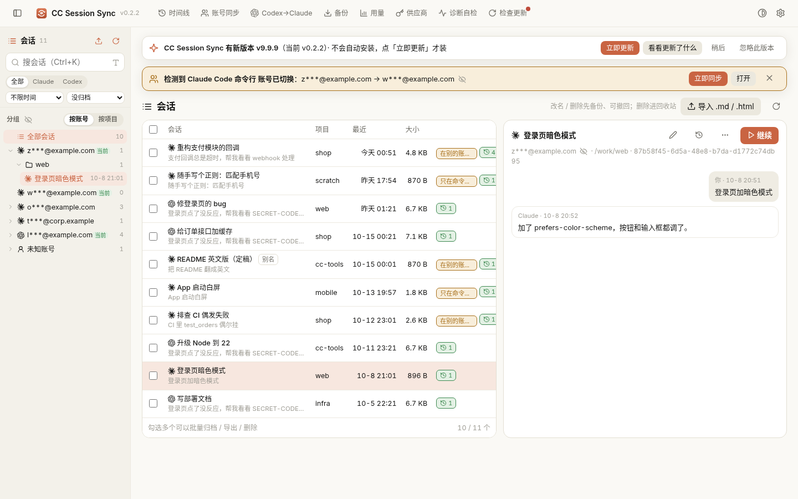

## 安装

- **Windows（推荐）**：在 [Releases](https://github.com/helefee/CC-SessionSync/releases) 下载 `CCSessionSync-Setup-<版本>.exe`，双击安装。
  - 装到当前用户目录 `%LOCALAPPDATA%\Programs\CCSessionSync`，**不要管理员权限**；开始菜单（可选桌面）有快捷方式；「设置 → 应用」里能卸载。
  - 界面用系统自带的 Edge WebView2（Windows 10/11 一般都有）。不弹任何黑框。
  - 安装包没签名，SmartScreen 可能提示，点「更多信息 → 仍要运行」。发布页有 `.sha256` 可以核对。
  - 装好的 `CCSessionSync.exe` 也是命令行：`"%LOCALAPPDATA%\Programs\CCSessionSync\CCSessionSync.exe" status`。
- **pip**（Python 3.10+，Windows / Linux / macOS）：
  ```bash
  pip install "cc-sessionsync[desktop] @ https://github.com/helefee/CC-SessionSync/releases/download/v0.2.2/cc_sessionsync-0.2.2-py3-none-any.whl"
  # 只要命令行 / 浏览器界面，不要窗口：去掉 [desktop]
  pip install git+https://github.com/helefee/CC-SessionSync
  ```
  装完有 `cc-sessionsync` 命令；也可以 `python -m cc_sessionsync`。Linux 上窗口要 pywebview 的 GTK 或 Qt 后端；没有就自动用浏览器打开。

## 桌面程序

- 只开一个：再点快捷方式会把已经开着的窗口叫出来。关窗口缺省缩到托盘（设置里能改），托盘菜单：显示 / 隐藏窗口、立即同步 Claude 会话、
  自动同步、会话转换（Codex → Claude Code）、会话管理、时间线与备份、用量、排队中的改动（有的时候）、开机自启、关窗口到托盘、启动时到托盘、通知、
  检查更新、诊断自检、退出。
- 界面只听 `127.0.0.1:8766`，每个请求都要带页面里的一次性口令（别的网页 / 程序调不了）。
- **系统通知**：同步 / 导入做完、排队的改动做完、检测到换号、有新版本。可以在设置里关。

### 界面

- **顶部按钮栏**（0.2.2；0.2.9 起）：时间线与备份 / 账号同步 / 会话转换 / 用量 / 诊断自检 / 检查更新（红点）/ 主题，当前页高亮；
  **设置（齿轮）在右上角**。点了在主区域显示那一页（**不是弹窗**，用量也一样）。
  点左上角标题、左侧「会话」或任何一个会话就回到会话页。窗口窄的时候按钮只显示图标（鼠标停上去有名字）。
- **左侧面板只放会话列表**：搜会话（Ctrl+K）、全文搜、Claude / Codex、时间、归档筛选，下面是**按账号 / 按项目**的分组树，最里层就是会话本身
  （数量、当前账号标「当前」、没在任何桌面端账号里登记的会话归到「未知账号」）。点一组 = 筛选，点一个会话 = 在右边打开。
  面板能拖宽度（会记住），**Ctrl+B** 收起 / 展开。
- 托盘菜单的「用量…」「诊断自检…」等会打开窗口并直接切到那一页。
- **显示完整账号**：账号缺省打码（`z***@example.com`）。点会话列表里的眼睛（分组旁边，或会话详情里的账号旁边）才从本机接口（127.0.0.1 + 口令）取完整邮箱 / 名字 / 组织，只放在页面内存里，
  不写日志、不存盘，重开就又打码；设置里可以开「总是显示完整账号」（缺省关）。诊断报告永远是打码的。

### 时间线与自动备份

- **自动备份**缺省开、每 10 分钟（设置 / 「时间线与备份 → 备份」能改：数字 + 分钟 / 小时 / 天，最短 5 分钟）。只备份变过的会话，后台低优先级；正在跑就跳过这一轮；
  睡眠 / 关机错过了，醒来补一次；**失败才弹通知**。0.2.0 里没改过这个设置的，升级后就是新的缺省；改过小时数的照旧。
- 存法：同一个会话的新版本如果只是在后面追加，就只存追加的那段（每隔 30 版存一次完整的）；相同内容只存一份；zlib 压缩。
  保留：最近 7 天全留，90 天内每天留最后一版，更早的每周一版（天数可调），每个会话最新一版永远留；「清理旧版本」才删。
- **恢复到 Claude**（缺省）：另存成一个新的 Claude Code 会话（新 id，标题带「（恢复 @时间）」），原来的不动；登记进 Claude 桌面端当前账号的
  会话列表（桌面端开着就排队，会话文件马上能用）；给出 `claude --resume` 命令和「在终端里接着聊」。Codex 的版本经转换器变成 Claude Code 会话。
- **替换当前** / **恢复到 Codex**：先把现在的版本存进备份库，要多勾一次确认；对应的桌面端开着就排队。都进操作记录，可以撤回。

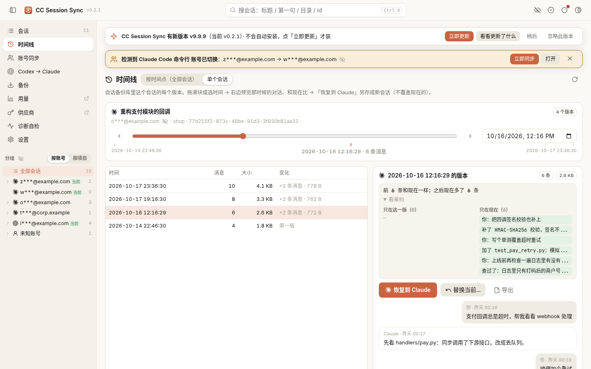

### 导出 / 导入 .md / .html

- 单个、批量、左侧一整组、或时间线上的某一版都能导出。Markdown / HTML 好读（角色、时间、代码块；HTML 单文件、自带浅色 / 深色样式，工具调用折叠），
  并且**内嵌完整的原始记录**（md 里是一段隐藏注释，html 里是 `<script type="application/json">`），导回来一模一样。
- 导入：先预览（不写任何东西），再变成一个新的 Claude Code 会话，放进你选的项目、登记进桌面端当前账号；可以撤回。别处来的 Markdown 按标题尽量解析。

### 检测到换号

每 10 秒看一眼 Claude 桌面端 / 命令行 / Codex 的登录信息（只看文件修改时间，变了才读，几乎不占 CPU），确认稳定后弹一次通知
「检测到 Claude Code/Codex 账号已切换：旧 → 新」，窗口顶部出现提示条，带「立即同步」「打开」。通知和界面里只显示打码的账号（`z***@example.com`），
从不读、不显示 token。Windows 的托盘气泡不能放按钮，所以点通知 = 打开窗口，按钮在窗口的提示条上。

0.2.5 修了「明明同步过了还一直提示检测到切换账号」：桌面端 Local Storage 里有个几个月前的旧文件，里面是以前那个账号的记录，一直没删；
当前账号的记录发出去以后会被删掉 / 压缩走，那一会儿「最新的一条」就落到旧文件上，于是报「换号」，过一会儿又「换回来」。现在：
记住上一次认出的桌面端账号，旧文件里时间更早的记录不会盖过它；变化要连续两次读到（至少隔 9 秒）才算；基线存在 `~/.cc-sessionsync/watch-state.json`，
重启不丢；桌面端切到 / 切回 API 模式（3P）算「模式切换」，不算换号；同步完（或者当前账号本来就有全部会话、没什么可补）就记成「处理过了」，
不再提醒。提示条上写明是哪一端、从哪个号换到哪个号（打码）。

### 桌面端开着时：关闭并同步（完成后重启）

同步、撤回、删除 / 归档 / 改名、从回收站还原、时间线「替换当前」等要改桌面端数据的操作，遇到 Claude 桌面端（安装版或商店版 MSIX）正开着，
会弹出「Claude 正在运行，需要关闭后才能同步。」，三个按钮：

- **关闭并同步（完成后重启）**（缺省）：
  1. 先记下它是怎么开的：商店版记 AUMID（`Get-AppxPackage` 读包清单，不行再查开始菜单，都不行用 `Claude_pzs8sxrjxfjjc!Claude`），
     安装版记外层的 `…\AnthropicClaude\claude.exe`（Squirrel 会打开最新的 `app-x.y.z`）。
  2. 请它正常退出：给主窗口发关闭消息，再 `taskkill /PID`（**不带 /F**）。最多等 15 秒，有进度。
  3. 15 秒还没退干净（比如缩到了托盘）：可以去托盘里点「退出」（这边接着等），或者改成排队，或者「强制结束…」，要**再确认一次**才会强制结束。
     强制结束只结束桌面端自己的进程和它开的子进程。
  4. 退干净后做同步，再按原来的方式重新打开（商店版 `explorer.exe shell:AppsFolder\<AUMID>`，安装版运行外层 `claude.exe`），并确认它真的起来了。
     结果显示在对话框里，同时弹系统通知；没能打开就明说，请你从开始菜单手动打开。
- **等它退出后自动同步**：和以前一样排队，你自己退出桌面端后（托盘里也要退）后台做，做完自动重新打开。
- **取消**：什么都不改。

关之前会列出：由桌面端启动、正在跑的 Claude Code 会话（`claude.exe`）有几个，关闭桌面端会中断它们；不是桌面端开的命令行
`claude` 进程也会列出来，**永远不会动它们**。顶部「N 个改动在排队」提示条和「时间线与备份 → 撤销记录 → 排队中的改动」里也有「关闭并执行（完成后重启）」。
托盘里「立即同步」遇到桌面端开着，会打开窗口直接问。

| | |
|---|---|
| 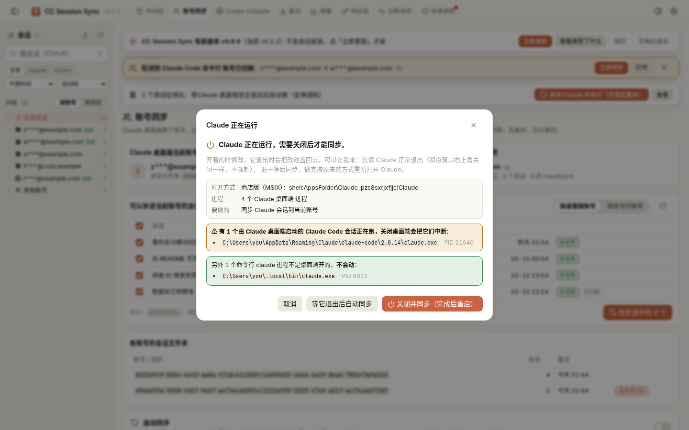 | 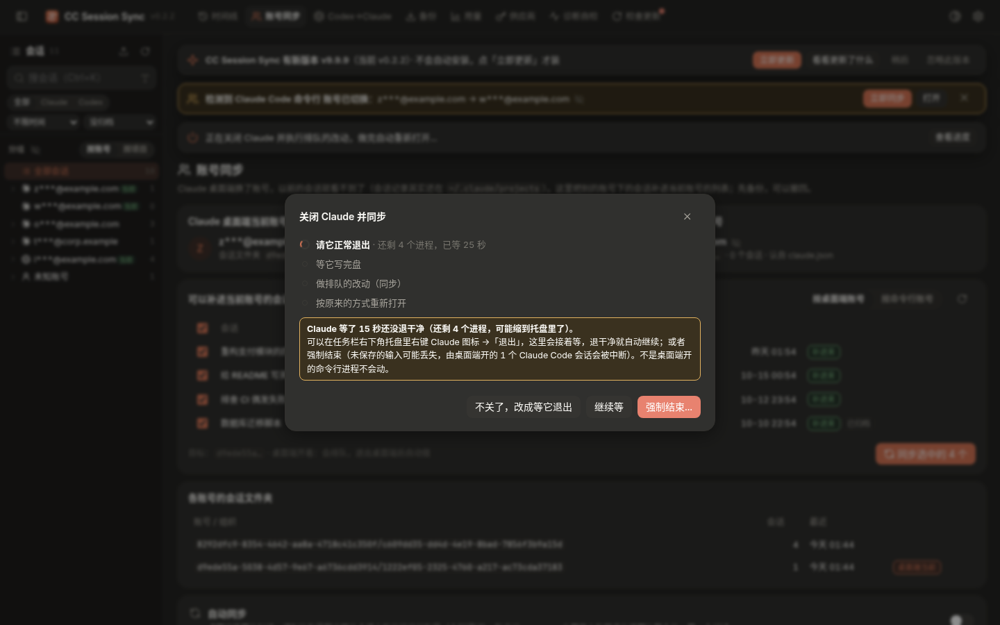 |
| 点同步时 Claude 开着：怎么开的、会中断哪些 Claude Code 会话、哪些命令行进程不动。 | 15 秒没退干净：去托盘退出 / 改成排队 / 强制结束（要再确认一次）。 |
| 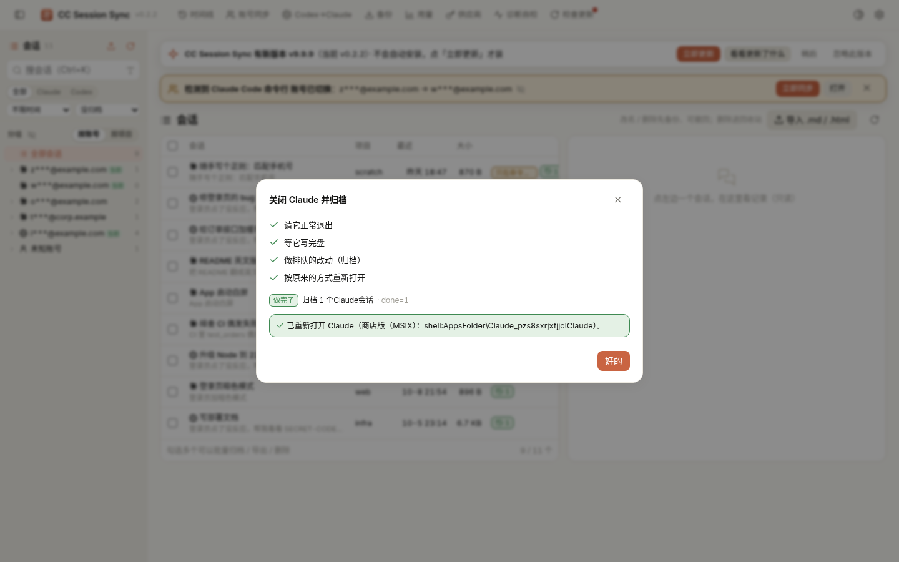 | |
| 做完后按原来的方式重新打开，并确认它已经起来了。 | |

### API 模式（第三方供应商 / 3P，0.2.4）

Claude 桌面端可以不用订阅登录，改走自己的推理网关 / 第三方供应商（API 模式）。这时它把数据放在另一个目录：

- 目录：`%LOCALAPPDATA%\Claude-3p`（旧位置 `%APPDATA%\Claude-3p`；商店版在 `Packages\Claude_*\LocalCache\{Local,Roaming}\Claude-3p`）；
  设了 `CLAUDE_USER_DATA_DIR` 也认（签名版桌面端会忽略它，诊断里会注明）。
- 会话列表在 `Claude-3p\claude-code-sessions\<设备号>\<组织>\`：设备号来自 `ant-did`，组织一般是占位的 `00000000-0000-4000-8000-000000000001`，
  **所有供应商共用这一个**。
- 会话页多一个分组「API / 第三方供应商（3P）· 供应商类型」：只显示类型（比如 gateway），**不显示 key 和网关地址**。只在 API 模式里登记过的会话归到这组，不算「未知账号」。
- 登记着但对话文件已经没了的条目照样列出来，标「无法打开（对话文件不存在）」：不能继续 / 导出 / 复制命令，可以改显示名、归档、删掉这条登记（进回收站）。
- 「账号同步」多一个目标「API 模式」：只写进桌面端**已经建好**的那个文件夹，本程序不会自己建设备号文件或文件夹。缺省目标跟着桌面端的
  `deploymentMode`（再看哪边最近写过），可以手动换。会话用的模型在另一边可能没有时，每一行会提醒。关闭并同步、撤回、自动同步都支持。
- 诊断 / 自检里有一节「Claude 桌面端 API 模式」：现在是什么模式、怎么判断的、用的哪个目录、候选目录。

| | |
|---|---|
| 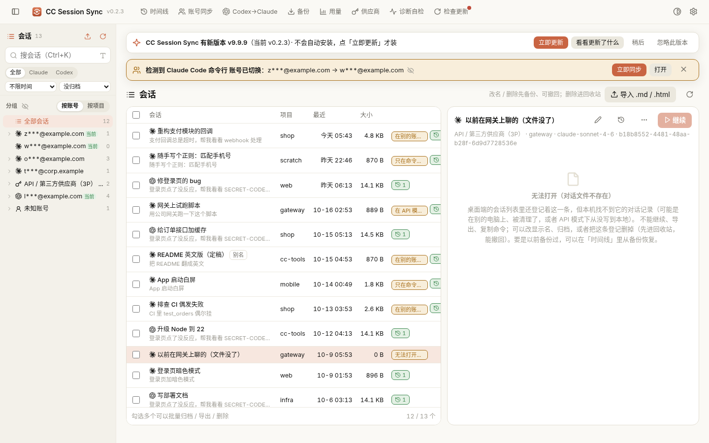 | 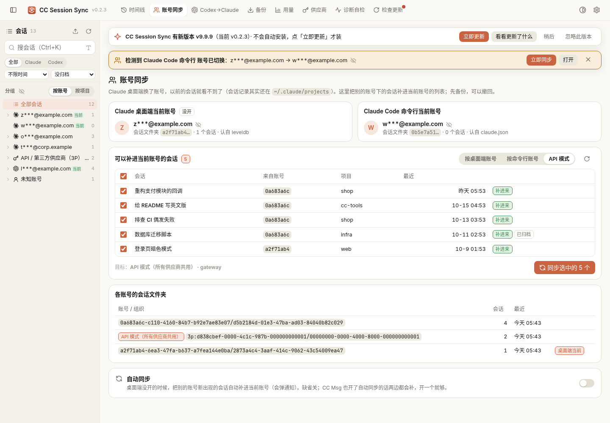 |
| 分组「API / 第三方供应商（3P）」；对话文件不在的条目照样显示、只给能做的操作。 | 同步目标「API 模式（所有供应商共用）」。 |
| 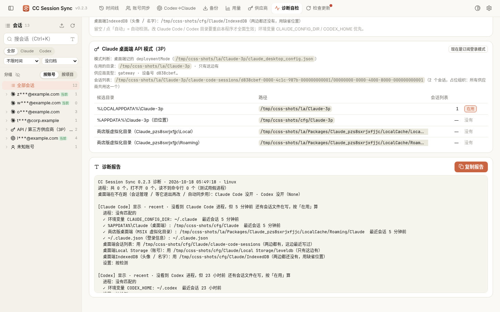 | |
| 诊断：模式、在用的目录、候选目录；只有供应商类型。 | |

### 用量怎么算（0.2.4）

- **Claude 缓存写**分 5 分钟 / 1 小时两种（`usage.cache_creation.ephemeral_5m/1h_input_tokens`）：5 分钟按输入价 1.25 倍、1 小时按 2 倍；日志里没拆分才全按 5 分钟，拆分比合计大就封顶。
- **Claude Code 去重**：同一个 `message.id` + `requestId` 流式写了好几行时，留**最完整**的那份（用量最大 / 有 `stop_reason`），不是第一行；没有 `requestId` 的行按 `message.id` 算，不丢。
- **Codex**：按累计值 `total_token_usage` 算每次的差值（累计没变算 0；变小了就退回这一次的 `last_token_usage` 并以它为新基线），不直接把 `last_token_usage` 加起来；续接 / 分叉文件重放的旧记录只算一次。
  新输入 = 输入 − 缓存读 − 缓存写；reasoning 已经在输出里，不另加。
- **长上下文**按每次请求的提示长度分档、整条请求加价：OpenAI 超过 272K 输入侧 2 倍、输出 1.5 倍；Haiku 5.5 超过 100K 全部 5 倍；Sonnet 4 / 4.5 超过 200K 输入 2 倍、输出 1.5 倍。
- **fast / priority / flex / batch** 档、Claude `inference_geo=us` 按官方倍率；没有官方倍率的档按标准价算并标「估」。
- **价格表**每一条带「核对日期」（按 Anthropic / OpenAI 官方价格页核对），价格页看得到；模型名先规范化（日期、`-thinking`、`[1m]`、档位后缀、Bedrock / Vertex 前缀）再精确查。
  没价格的显示「—」，总数里有没价格的部分就标「部分」。
- 按本机时区的**日历日**汇总；每条记录存好费用拆分（新输入 / 缓存读 / 缓存写 5m / 1h / 输出），悬停能看到。
- 也扫桌面端 Cowork 自带的 `local-agent-mode-sessions\…\.claude\projects`；API 模式里的会话算到「API 模式 · 供应商类型」，不算订阅。
- 升级时自动把老的用量库按新口径重读一遍；已经删掉的会话文件留下的老记录保留、按新价格表重算。
- 图表：「用量趋势」和新加的「按模型 / 按项目分布」都可以在「原样式 / 曲线图」之间切换（缺省原样式，会记住）。曲线图是平滑曲线 + 渐变填充，
  可以按类型（新输入 / 输出 / 缓存读 / 缓存写 / 费用）、Claude / Codex、按模型分，悬停显示准确数值和费用拆分，点图例开关，跟着时间范围、深浅色走。

| | |
|---|---|
| 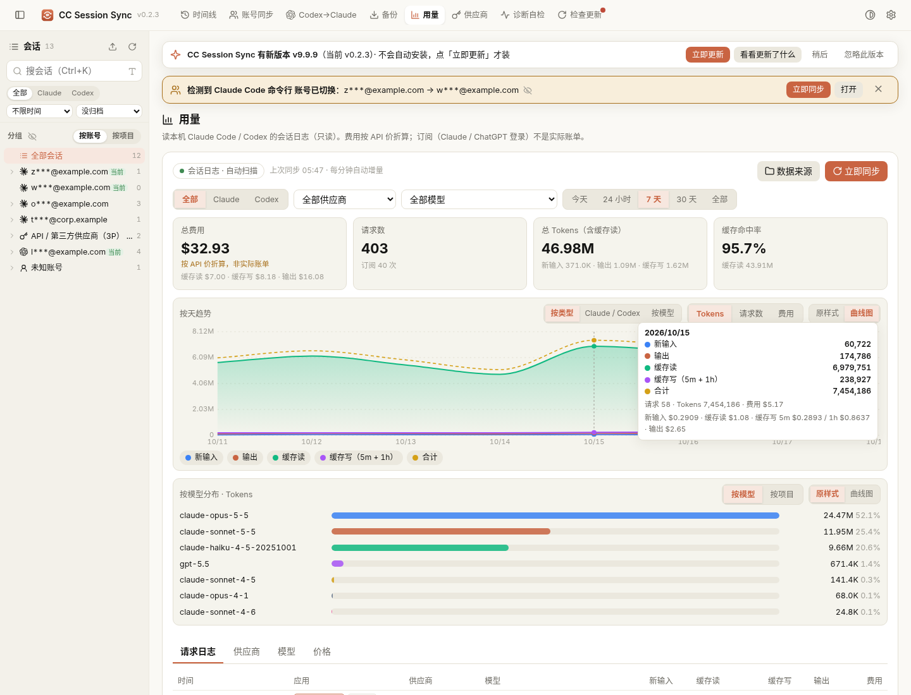 | 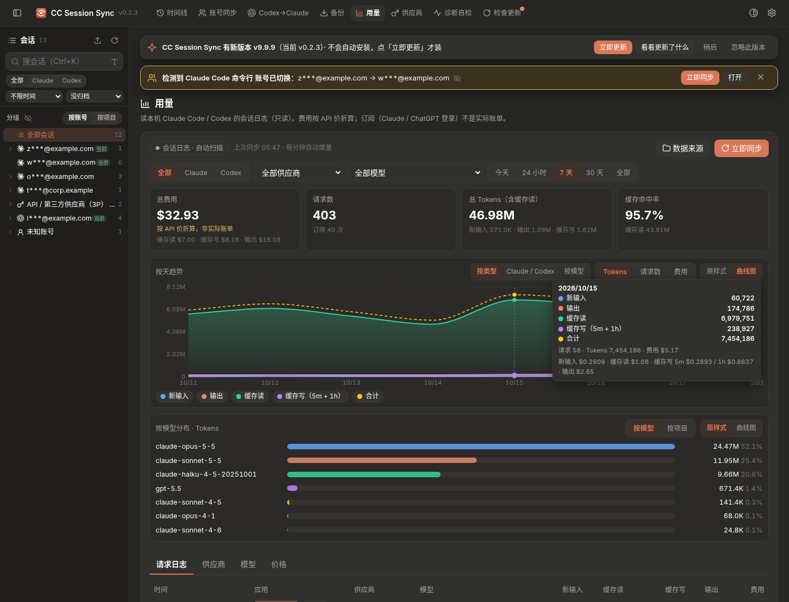 |
| 用量趋势 · 曲线图：按类型，悬停看准确数值和费用拆分。 | 深色。 |
| 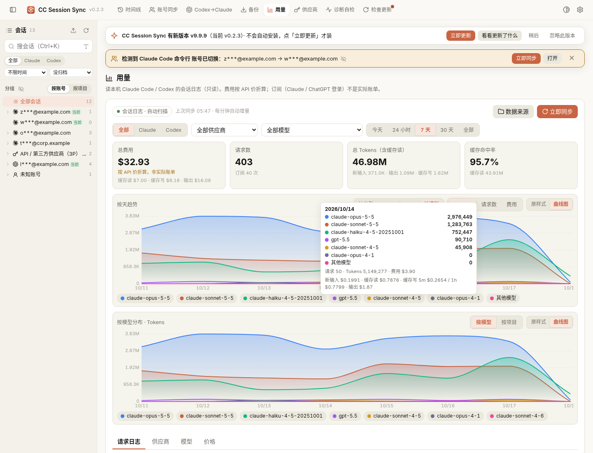 | 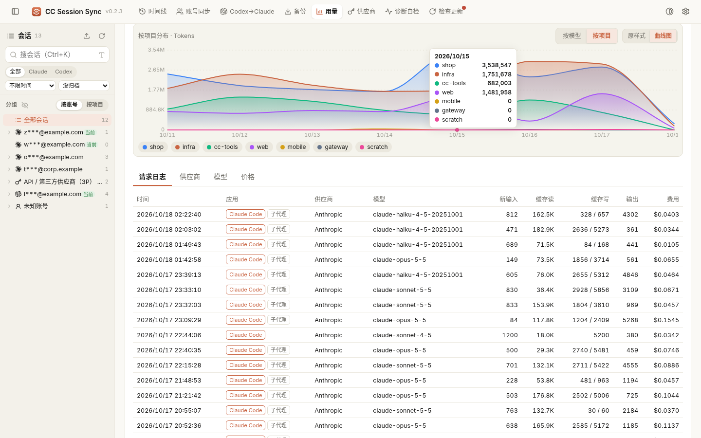 |
| 按模型的趋势和分布。 | 按项目分布 · 曲线图。 |

### 时间线（0.2.4 改进）

左边是按天分组的竖向时间线（今天 / 昨天 / 日期），上面可以显示对话增长曲线：每个版本一个点，拖竖线选版本；`←` / `→` 切换版本。
右边预览顶上就是「恢复到 Claude」（另存成新会话，现在的不动），下面的差别用一条「一样 / 只在这一版 / 只在现在」的比例条，加 −/+ 标记的对照。读取中有骨架屏，读不到有重试。

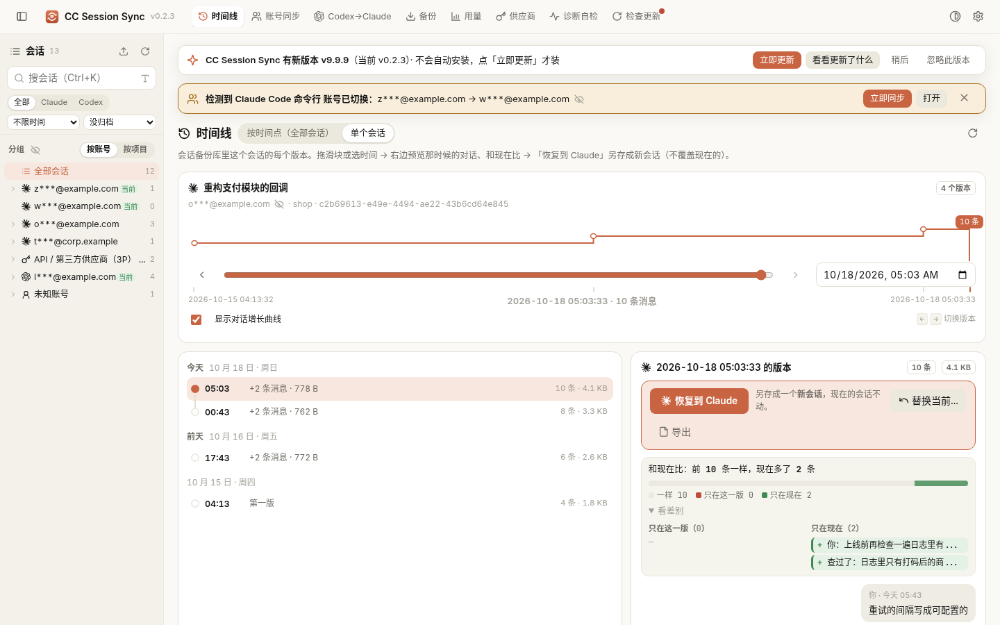

### DeepSeek Harness ⇄ Claude Code（0.2.5）

[DeepSeek Harness](https://github.com/deepseek-ai/deepseek-harness)（dsh，MIT）的会话存在 `$DSH_HOME/sessions`（缺省 `~/.dsh/sessions`；
profile 的 `cordis.patch.yml` 里改了 `session-persistence-jsonl` 的 root / compression 也认），每个会话一个目录
`--<项目>--/<会话号>/session.v4.jsonl.zstd`：一串各自独立、带校验和的 zstd 帧，头一行 + 事件。

- **检测**：数据目录、会话根和压缩方式、桌面版装在哪（版本）、开没开（只看进程名）。「诊断 → 数据目录」里可以手动指定 dsh 的目录；环境变量 `DSH_HOME` 优先。
- **会话管理**：多一个来源「DeepSeek」（筛选 + 左侧分组「DeepSeek Harness · 供应商」），只读看对话（按 dsh 的 `surfaceOp` 拼，压缩过的显示压缩后的样子；
  系统提示、运行时上下文、思考不显示）。可以导出、改显示名（只改本程序里的名字）；**不能**归档 / 删除 / 原地恢复（本程序不改 dsh 的文件）。
  dsh 的会话也进会话备份库和时间线；时间线里只能「另存为新的 Claude Code 会话」。
- **dsh → Claude Code**（页面「DeepSeek⇄Claude」或 `cc-sessionsync dsh to-claude`）：每个 dsh 会话写成一份新的 Claude Code 会话
  （标题带「（DeepSeek）」，可选登记进桌面端列表）。再导一次：dsh 那边有新内容 → 原地更新那份；没变 → 跳过；你已经在 Claude 里接着聊过 → 不动。
- **Claude Code → dsh**（`cc-sessionsync dsh from-claude`）：每个 Claude Code 会话**新建**一个 dsh 会话目录（新会话号，标题带「（Claude Code）」）。
  写之前在内存里按 dsh 的规则校验一遍（帧、校验和、序号连续、事件类型、第 4 版），先写临时文件、落盘、再改名；**绝不往已有的 / 锁着的 dsh 会话里写**，
  会话根里现有会话的压缩方式和设置不一致、会话号重复、格式不是第 4 版，都拒绝。Claude 那边又聊过的，缺省不再导；要的话用「再导一份新的」。
- 两个方向都是**先演练**，每次导入都有账本（`~/.cc-sessionsync/dsh-import/`），能撤回：新建的文件 / 目录挪进回收站（不直接删），sha 对不上
  （导过去之后又接着聊过）的、dsh 正开着（`session.lock` 被占着）的不动。
- **用量**：dsh 每次模型调用的 token（新输入 / 缓存读 / 缓存写 / 输出）按 DeepSeek 官方价格算（`deepseek-flash`、`deepseek-v4-pro` 等，按高峰价，
  错峰半价没算）；没价格的模型显示「—」。dsh 里用的其他供应商（比如走代理的 Claude 模型）按模型名查价。

**转换是有损的**：

| | dsh → Claude Code | Claude Code → dsh |
|---|---|---|
| 文字 | 带 | 带 |
| 工具调用 / 结果 | 变成文字（「〔DeepSeek Harness 调用了 …〕」+ 参数 + 截短的输出，缺省 20 行 / 2000 字） | 变成文字摘要 |
| 思考 | 缺省丢；可选当普通文字带上（不是 Claude 的思考块） | 丢 |
| 图片 | 缺省「[图片：…]」占位；可选从 dsh 附件库按 base64 内嵌（sha 对得上才用） | 「[图片]」占位 |
| 压缩过的上下文 | 按 `surfaceOp` 用压缩后的那一串 | — |
| 系统提示 / 运行时上下文 / 技能目录 | 不带（Claude Code 自己会带） | 不带；第一个节点是空的系统消息，接着聊时 dsh 会把自己的系统提示放在最前面 |
| 模型 | 助手消息记成 `deepseek-harness-import`，0 token | 记成供应商 `claude-code-import`，0 token；接着聊用 dsh 当前的模型 |

- 第 3 版及更早的 dsh 会话只列出来、不读（用 dsh 打开一次会自动升级）；同一个目录里留着的老 `session.jsonl.zstd` 不碰。
- 子代理的会话缺省不导（父会话里有它的结果）；空会话（开了没说话）不导。
- dsh 的格式不是稳定的公开接口，这里按 dsh 0.2.x 开源仓库里的定义来读写；CI 每次都用 npm 上的 dsh 命令行在临时 `DSH_HOME` 里、连本机的假模型
  真的接着聊一遍（`tools/verify_dsh.py`），同时用最新的 Claude Code `claude --resume` 打开 dsh 导过来的会话。dsh 以后改格式可能要跟着更新。

| | |
|---|---|
| 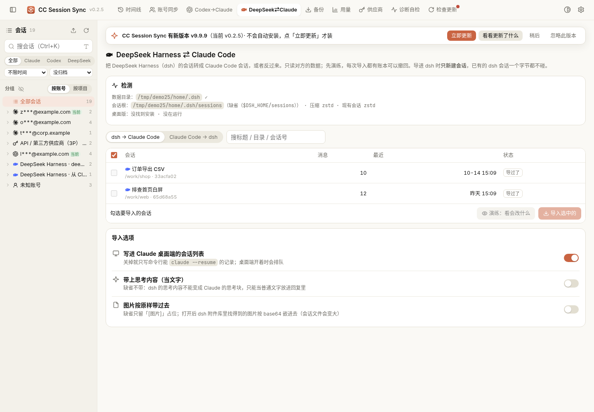 | 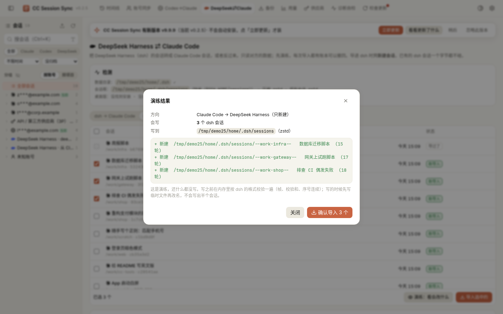 |
| 检测 + 选会话 + 选项。 | Claude Code → dsh 的演练：写到哪、几个，校验过了才给「确认导入」。 |
| 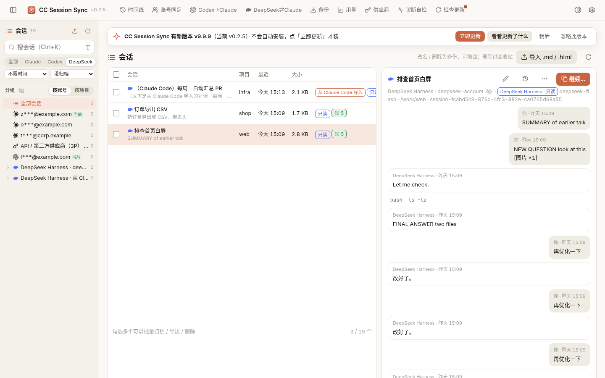 | 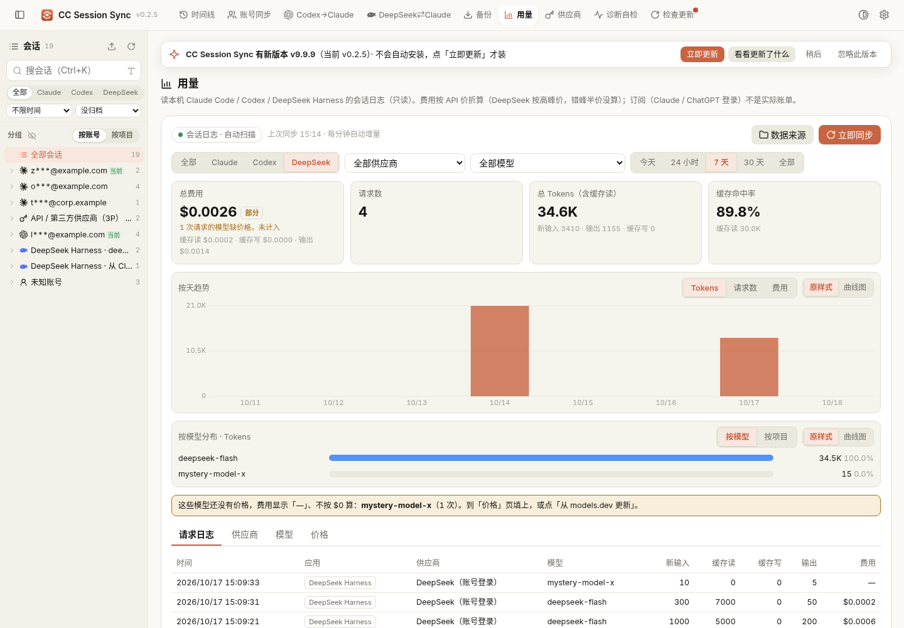 |
| 会话管理里的 dsh 会话（只读）。 | 用量：DeepSeek Harness，按 DeepSeek 价格；没价格的「—」。 |

### 时间线：全部会话的增长曲线（0.2.5）

「按时间点（全部会话）」上面多了一条曲线：每次备份时，备份库里所有会话（各取那时最新的一版）加起来有多少条消息，按 Claude / Codex /
DeepSeek Harness 分开的细线也画出来；每次备份一个点，拖竖线选时间点（松手才加载那一刻的列表），和下面的滑块、日期联动。左侧来源筛选选了某一家时只算那一家。
「显示对话增长曲线」的开关和单个会话的共用。

| | |
|---|---|
| 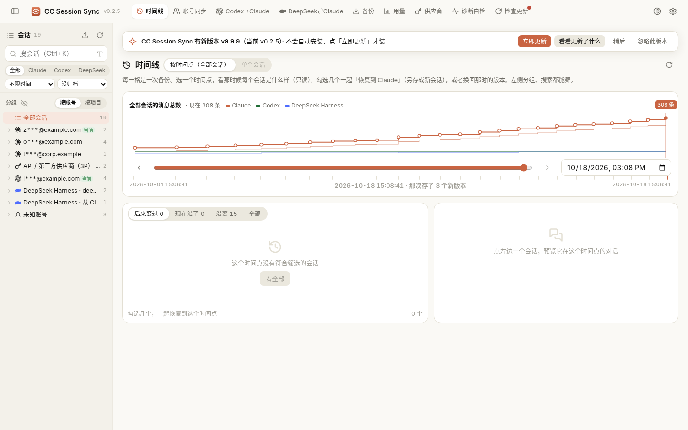 | 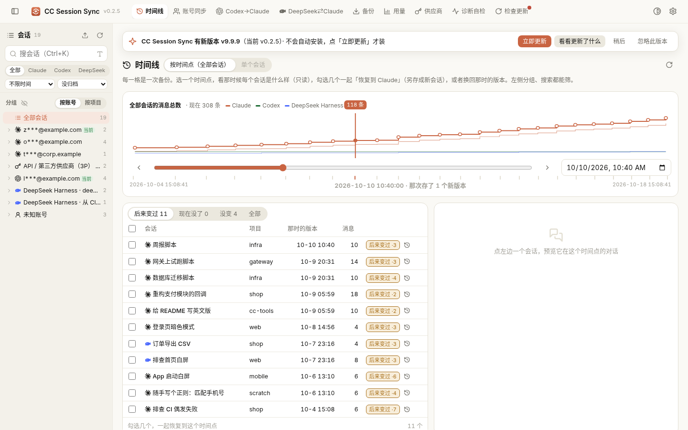 |

### Cursor ⇄ Claude Code（0.2.6）

**Cursor 把对话存在哪**（按本机 Cursor 3.25 看到的结构；只看键名 / 字段名，不看内容）：

- **编辑器**：`%APPDATA%\Cursor\User\globalStorage\state.vscdb`（macOS `~/Library/Application Support/Cursor/User/…`，Linux `~/.config/Cursor/User/…`），
  一个 SQLite（常常上 GB）。表 `cursorDiskKV` 里：`composerData:<对话号>` 是一个对话的头（标题、时间、模式 agent / chat、模型、所在工作区、
  子代理的父对话、按顺序的消息号列表 `fullConversationHeadersOnly`），`bubbleId:<对话号>:<消息号>` 是一条条消息（`type` 1 = 你、2 = Cursor；
  文字、思考、工具调用 `toolFormerData`（名字、参数、结果、状态）、图片、token 数）。表 `composerHeaders` 是列表用的索引（归档、子代理）。
  `agentKv:blob:<sha>` 是新版 agent 的内部状态（protobuf，按内容寻址），对话头里还有 `conversationState` / `blobEncryptionKey`——这些本程序不读也不碰。
- **工作区**：`…\User\workspaceStorage\<hash>\workspace.json` 记着这个工作区对应哪个文件夹，用来按项目分组。
- **agent 记录**：`~/.cursor/projects/<项目>/agent-transcripts/<对话号>/<对话号>.jsonl`（子代理在 `subagents/` 里），每行一条
  `{role, message:{content:[text | tool_use]}}`；只有文字和工具调用，没有工具结果、没有时间。编辑器数据库里找得到同一个对话时用数据库那份。
- **`cursor-agent` 命令行**：`~/.cursor/chats/<md5(目录)>/<对话号>/store.db`（`meta` 表 + 内容寻址的 `blobs`，根是 protobuf，消息是 JSON）。
  本机没装命令行，这个格式是照公开资料和样本做的，测试里有样本。

本程序只读这些文件：Cursor 没开时按 `immutable` 打开（不建锁文件、不碰 WAL），开着时按只读打开；每次只按键名前缀取需要的那几段。
读出来的东西整理成一份统一格式的副本 `~/.cc-sessionsync/cursor-mirror/`（没变就不重写），会话备份、时间线、查看、导入都用这份副本。

- **检测**：装在哪 / 版本、开没开（只看进程名）、数据库和 `~/.cursor` 在哪、找到几个对话。「诊断 → 数据目录」里可以手动指定；环境变量 `CURSOR_USER_DIR` /
  `CURSOR_CONFIG_DIR` 优先。
- **会话管理**：多一个来源「Cursor」（筛选 + 左侧分组「Cursor · 项目」），只读看对话；可以导出、改显示名（只改本程序里的名字）；
  **不能**归档 / 删除 / 原地恢复。Cursor 的对话也进会话备份库和时间线，时间线里只能「另存为新的 Claude Code 会话」。
- **Cursor → Claude Code**（页面「Cursor⇄Claude」、会话的「导进 Claude Code…」，或 `cc-sessionsync cursor to-claude`）：每个对话写成一份新的
  Claude Code 会话（标题带「（Cursor）」，可选登记进桌面端列表；桌面端开着时排队）。再导一次：Cursor 那边有新内容 → 原地更新；没变 → 跳过；
  你已经在 Claude 里接着聊过 → 不动。先演练，账本在 `~/.cc-sessionsync/cursor-import/`，能撤回（新建的挪进回收站，之后又聊过的不动）。
- **Claude Code / Codex / DeepSeek Harness → Cursor**：任何一个会话的「…」→「给 Cursor 用（导出上下文文件）…」（或 `cc-sessionsync cursor context`）。
  写一份 Markdown（对话文字 + 一行一个的工具摘要）：缺省写到 `~/.cc-sessionsync/exports/cursor/`；勾「写进项目」就写到项目里的
  `.cursor/sessionsync/<标题>-<号>.md`。然后在 Cursor 里新开一个对话，粘贴提示的那句（`@.cursor/sessionsync/….md 这是之前的对话记录…`，写好时自动复制）。
  也有账本、能撤回。要一直带着的话，可以自己把这份文件挪进 `.cursor/rules/`。

**为什么不直接写进 Cursor 的对话列表**：试过评估，结论是做不安全——

1. 格式没公开、每个版本都在变（本机这版的对话头是第 18 版），一个对话要同时改三处（`composerData` + 每条 `bubbleId`、`composerHeaders`、工作区里的
   `composer.composerData`），漏一处 Cursor 就不显示或显示不全；
2. 新版 agent 对话的真正状态在 `conversationState` / `agentKv` 里（protobuf + 加密 key），本程序造不出来；只有消息、没有这个状态的对话，
   就算列表里看得到，接着聊也接不上；
3. 数据库是 Cursor 自己的、常常上 GB，Cursor 一开就在写；写坏了影响的是 Cursor 本身；
4. 不登录 Cursor、不真调模型，没法验证「打开能接着聊」。

所以只给它一份能 @ 的文件：不碰 Cursor 的数据，效果是「新对话里带着之前的上下文」。

**转换是有损的**：

| | Cursor → Claude Code | Claude Code / Codex / dsh → Cursor（上下文文件） |
|---|---|---|
| 文字 | 带 | 带 |
| 工具调用 / 结果 | 变成文字（「〔Cursor 调用了 …〕」+ 参数 + 截短的输出，缺省 20 行 / 2000 字；出错的标「出错」） | 一行一个工具摘要 |
| 代码块 / 改动（diff） | 当文字带（在回复或工具结果里） | 当文字带 |
| 思考 | 缺省丢；可选当普通文字带上（不是 Claude 的思考块） | 丢 |
| 图片 | 「[图片 ×N，没有带过来]」占位 | 占位文字（和会话管理里看到的一样） |
| Cursor 塞的上下文（规则、打开的文件、`<user_info>` 等） | 不带 | — |
| 模型 / token | 助手消息记成 `cursor-import`，0 token | — |
| 接着聊 | `claude --resume` / 桌面端列表 | 在 Cursor 里新开对话 @ 这份文件 |

- agent 记录里没有工具结果和时间，导过去只有工具调用；只有 agent 记录的对话，工作目录按项目名去对编辑器里认识的工作区，对不上就记成家目录。
- 子代理的对话缺省不列（父对话里有它的结果）；只有 `agentKv` 状态、没有消息的对话（极少见）不读。
- Cursor 的用量 / 价格不算（本地没有可靠的数据）。
- CI 每次用最新的 Claude Code 在临时目录里、连本机的假模型，把编辑器 / agent 记录 / 命令行三种来源导过来的会话都 `claude --resume` 接着聊一遍
  （`tools/verify_cursor.py`），并检查 Cursor 的文件一个字节都没变。

| | |
|---|---|
| 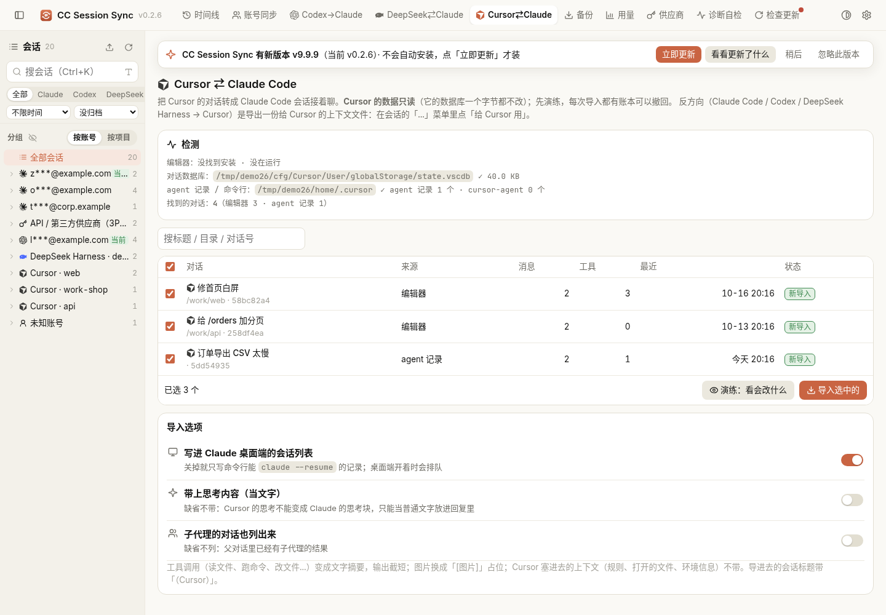 | 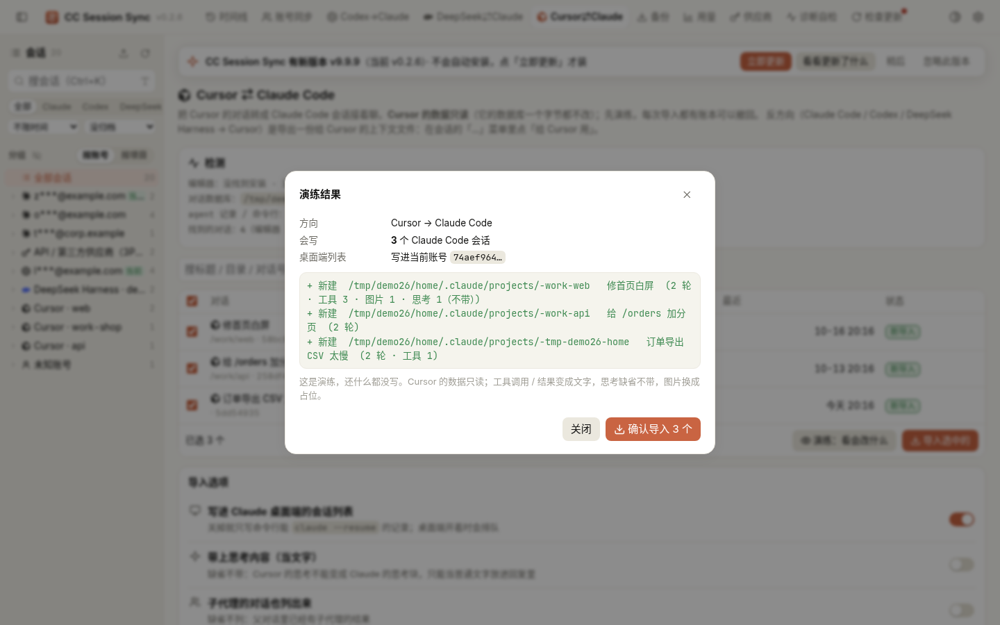 |
| 检测 + 选对话 + 选项。 | 演练：写到哪、几个、每个带了什么。 |
| 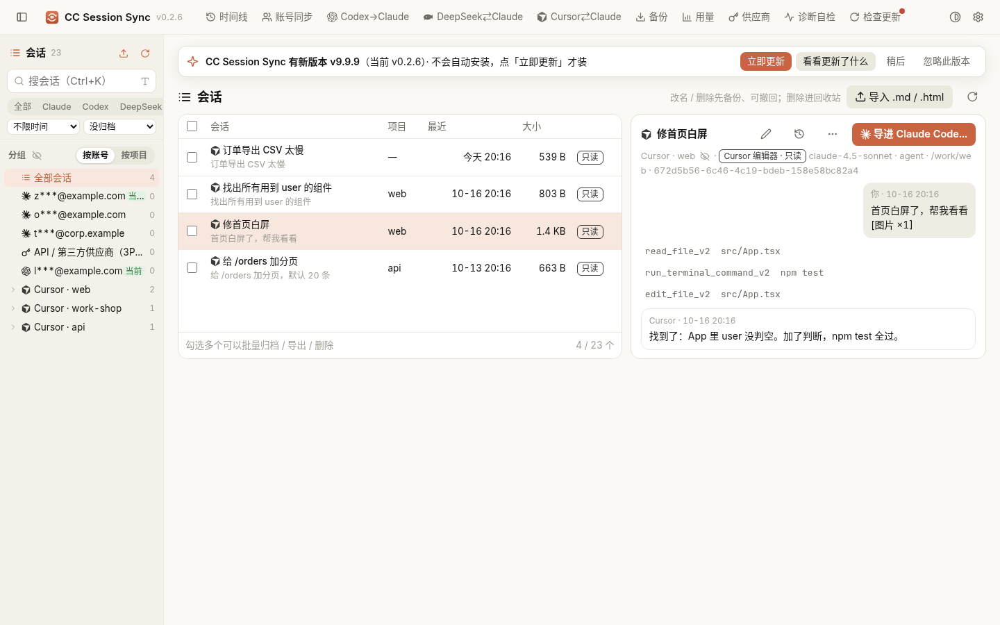 | 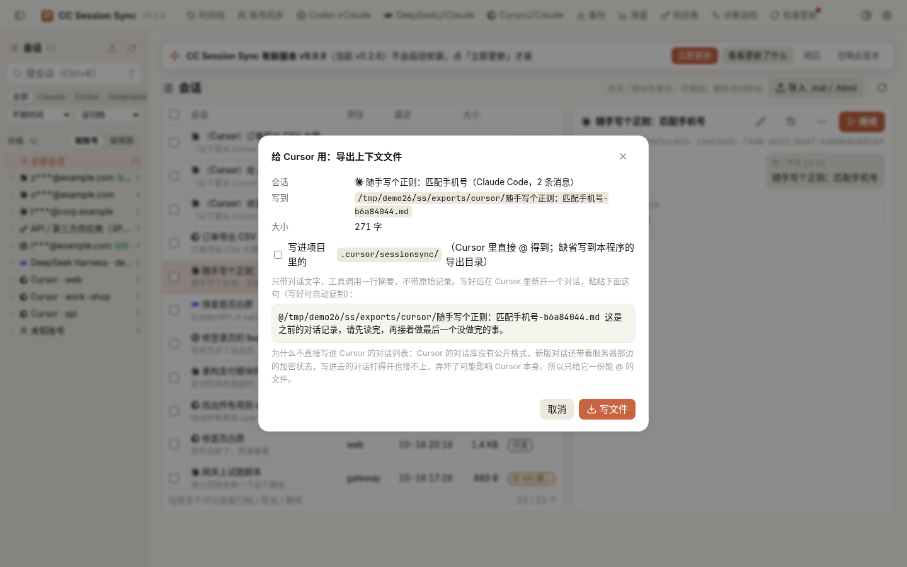 |
| 会话管理里的 Cursor 对话（只读）。 | 反方向：导出一份给 Cursor @ 的上下文文件。 |

### 会话转换：任意 → 任意，新增 OpenCode / ZCode（0.2.7）

左边会话列表多了 **OpenCode** 和 **ZCode** 的会话（只读，按项目目录分组），备份库 / 时间线也收它们。顶栏的「会话转换」页把以前的
DeepSeek⇄Claude、Cursor⇄Claude 合成一个：**选来源应用 → 勾会话 → 选目标应用**，Claude Code、Codex、DeepSeek Harness、Cursor、OpenCode、
ZCode 任意两个之间都能转。中间先转成统一的格式（`ccss-ir/1`：问 / 答 / 思考 / 工具调用 / 图片占位），再写成目标的格式。

| 到 → | Claude Code | Codex | DeepSeek Harness | OpenCode | Cursor | ZCode |
|---|---|---|---|---|---|---|
| 方式 | 原生 | 原生 | 原生 | 原生（找到它的命令行时） | 导出 | 导出 |

- **原生**：写成目标应用自己的**新**会话，能在里面接着聊：Claude Code（jsonl，可选登记进桌面端列表）、Codex（rollout + 标题）、
  dsh（新会话目录）、OpenCode（交给 OpenCode **自己的命令行** `opencode import` / `opencode session import` 导入，不直接写它的库；
  桌面版自带的 `opencode-cli` 也认）。目标应用开着时走「关闭并执行（完成后重启）」/ 等它退出后自动做。
- **导出**：Cursor 和 ZCode 不写它们的库（格式没公开、要几处一起改、写坏了可能影响应用本身），只写一份 Markdown 上下文文件 + 一句粘贴提示
  （写好自动复制）；可以写进项目里的 `.cc-sessionsync/`。原生方向也可以勾「只导出上下文文件」。
- 先**预览**（0.3.6 起写明写到哪、多少条、会丢 / 会变什么，见下文）；每次一本账，在「转换记录」里撤回（只删这次新建的；转过去以后又接着聊过的保留）。转过且没变的跳过，来源有新内容时标出来，
  勾「再转一份」才新建；从 A 转来的会话不会被原生转回 A（防止来回导）。标题带来源前缀，比如「（OpenCode）」。
- 工具调用变成文字摘要（输出截短），思考缺省不带（可以当文字带上），图片 / 附件换成占位。
- **OpenCode**（开源终端 / 桌面编码代理）：会话在 `~/.local/share/opencode/opencode.db`（Windows 也是 `%USERPROFILE%\.local\share\opencode`；
  `XDG_DATA_HOME` 优先），1.x 的 `session/message/part` 和 2.x 的 `session_v2/session_message` 都读。
  **ZCode**（智谱 Z.ai 的 GLM 编码桌面端，引擎是 OpenCode 的分支）：`~/.zcode/cli/db/db.sqlite`，标题 / 删除标记合并
  `~/.zcode/v2/tasks-index.sqlite`；提醒、通知这类系统消息不算对话。两个都是复制一份（连同 -wal）到临时目录再读，应用开着也能读；
  账号 / 凭据表和文件从不读。目录可在「诊断 → 数据目录」里改。

| | |
|---|---|
| 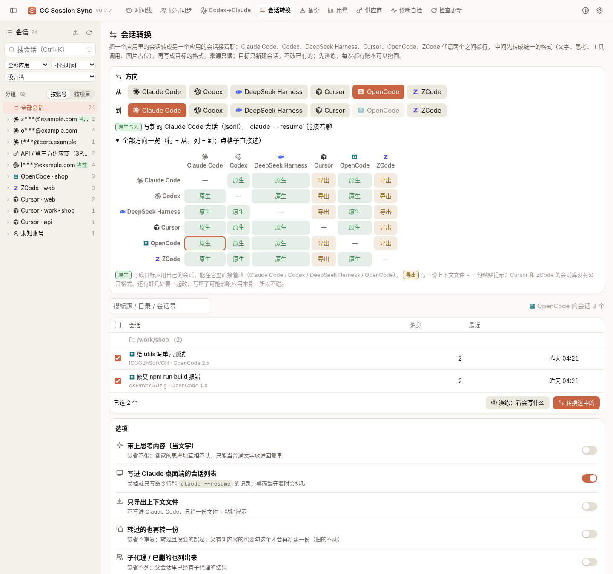 | 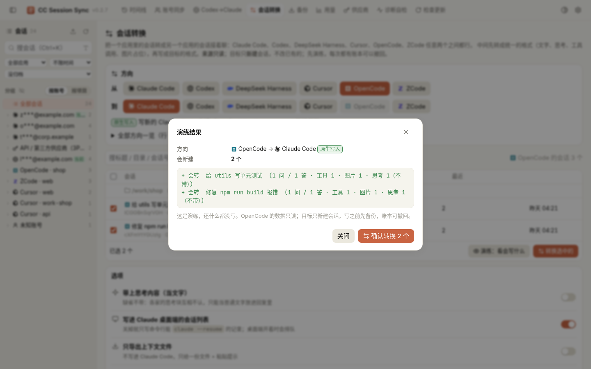 |
| 来源 → 目标 + 全部方向一览（原生 / 导出）+ 按项目分组的会话。 | 演练：会新建几个、每个带了什么。 |
| 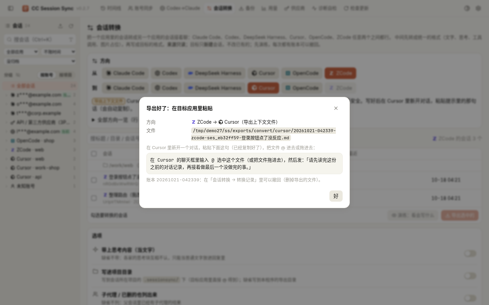 | 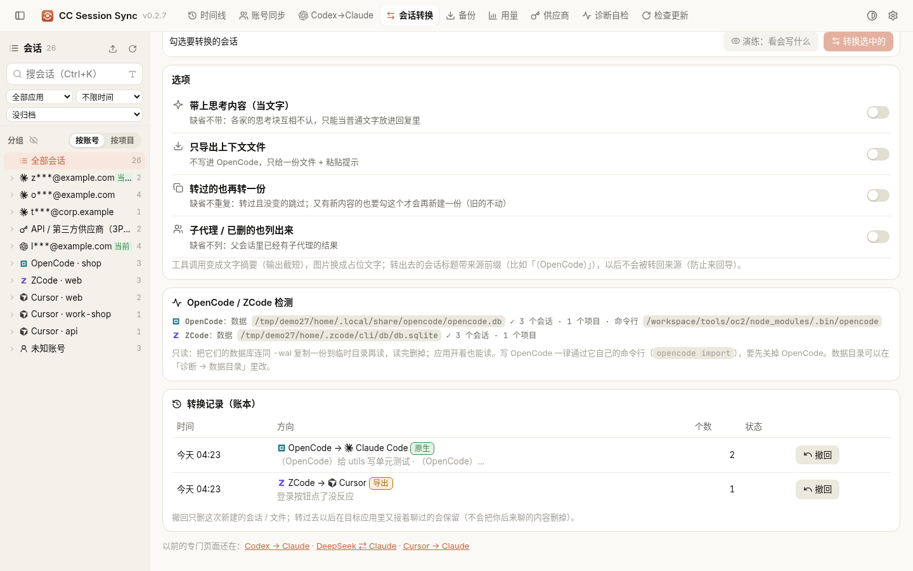 |
| 导出方向：文件 + 粘贴提示。 | OpenCode / ZCode 检测 + 转换记录（可撤回）。 |
| 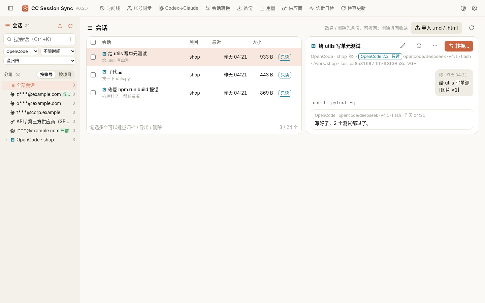 | 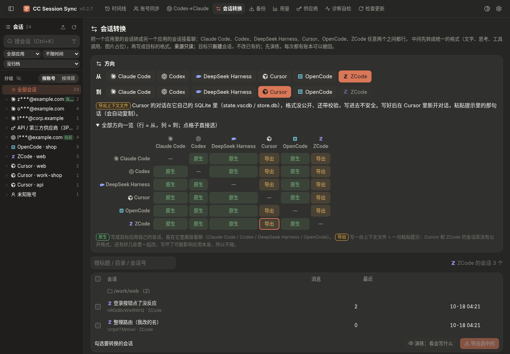 |
| 会话管理里的 OpenCode 会话（只读）。 | 深色主题。 |

**0.2.8**：顶栏的「Codex→Claude」也并进了「会话转换」——顶栏不再有任何一对一的转换页。在会话转换里选「从 Codex → 到 Claude Code」，
下面就是原来的 Codex 导入器（按天数 / 项目 / 状态筛选、含子代理等、预览、就地更新、「防止 Codex 再导回去」开关），账本在「时间线与备份 → 撤销记录」里撤回（0.2.9 前叫「备份」页）。
原来的 Codex→Claude、DeepSeek⇄Claude、Cursor⇄Claude 单独页面只留在会话转换页底的链接里；托盘菜单、通知、`?page=codex` 这类深链接和
记住的上次页面会打开会话转换并预选对应方向。

| 之前（0.2.7） | 之后（0.2.8） |
|---|---|
| 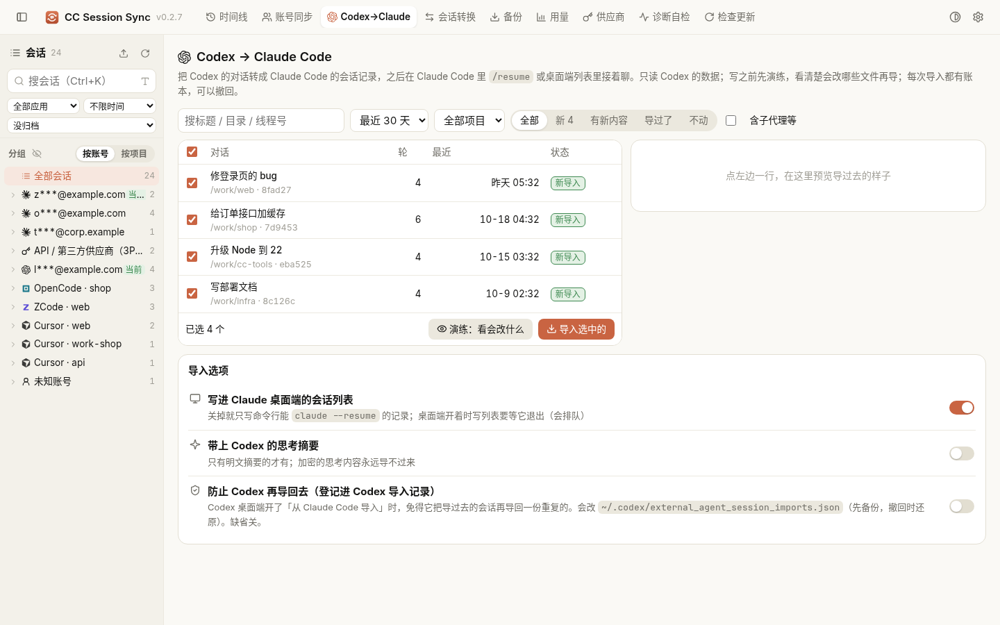 | 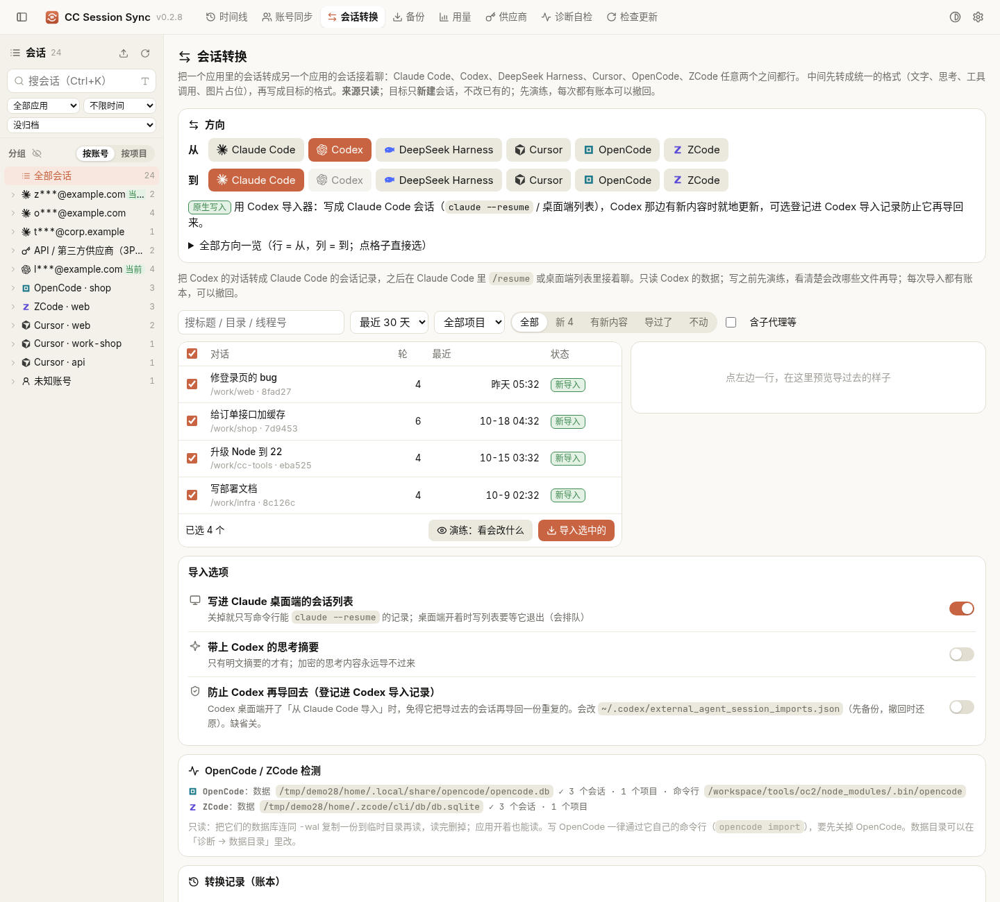 |

**0.2.9**：「时间线」和「备份」合成一个页面 **「时间线与备份」**，顶栏变成 时间线与备份 / 账号同步 / 会话转换 / 用量 / 供应商 / 诊断自检。
页面顶上三个分栏 **时间线 | 备份 | 撤销记录**，旁边一直显示上次 / 下次备份和「立即备份」：

- **时间线**（缺省）：原来的时间线一样不少——分段条、选时间点、预览、恢复到 Claude、按账号 / 按项目分组、增长曲线。
- **备份**：会话备份库（自动备份间隔、立即备份、保留规则、清理旧版本、数据库位置和大小、最近的版本）、回收站、导出 / 导入 .md / .html。
- **撤销记录**：排队中的改动、会话操作记录、Claude 账号同步备份、Codex / DeepSeek Harness / Cursor 导入账本、会话转换账本，都能撤回。

`?page=backups`、`#backups`、记住的上次页面「备份」、托盘、通知（备份失败 → 备份分栏；排队的改动 → 撤销记录）、会话转换页的「撤销记录」链接
都打开这个页面并切到对应分栏；`?page=timeline&tab=bk|undo` 也行。分栏会记住。托盘菜单多了「时间线与备份…」。

| 之前（0.2.8）：时间线 | 之前（0.2.8）：备份 |
|---|---|
| 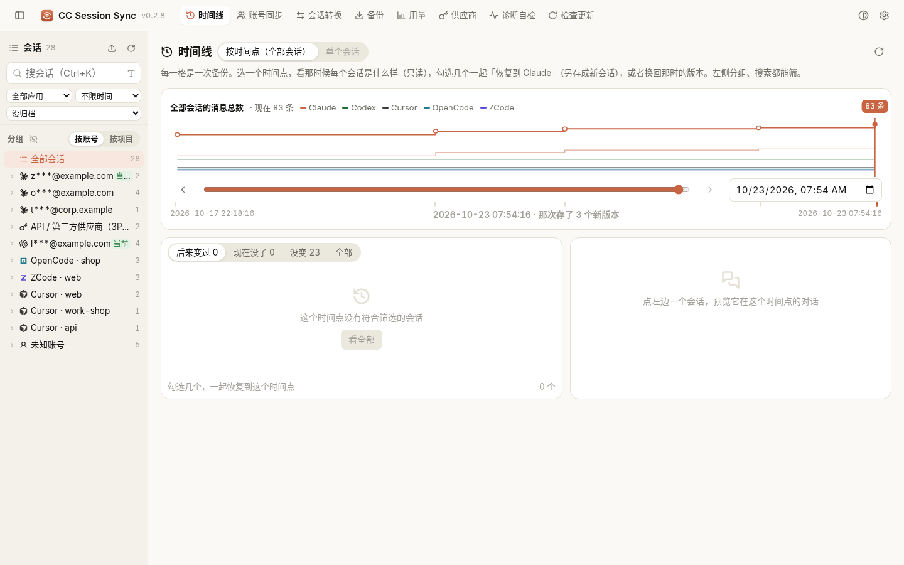 | 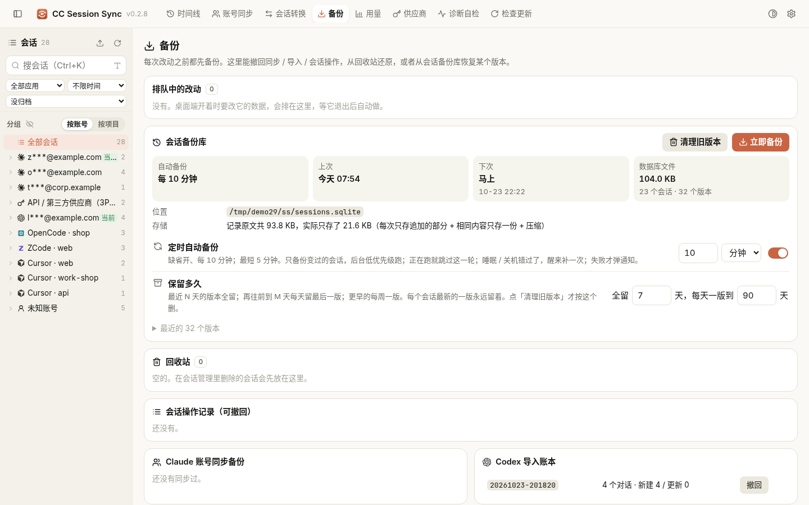 |

| 之后（0.2.9）：时间线 | 之后：备份 |
|---|---|
| 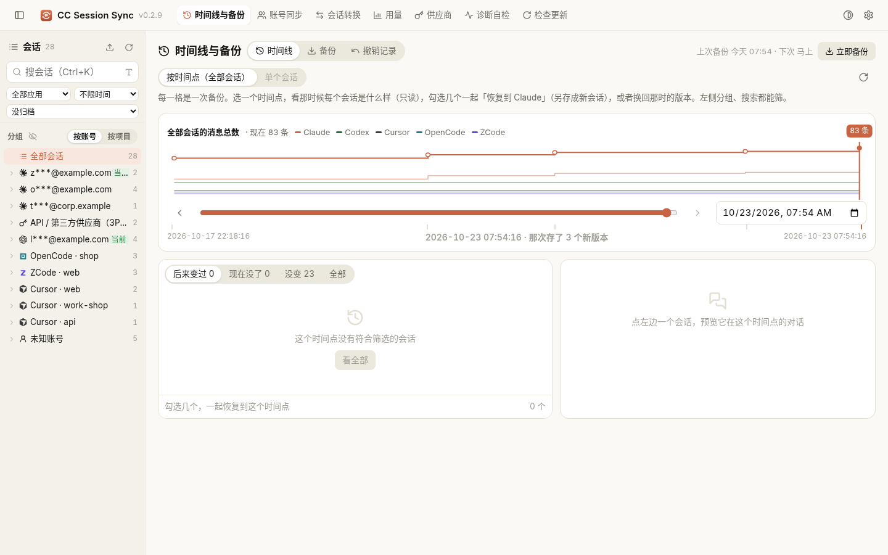 | 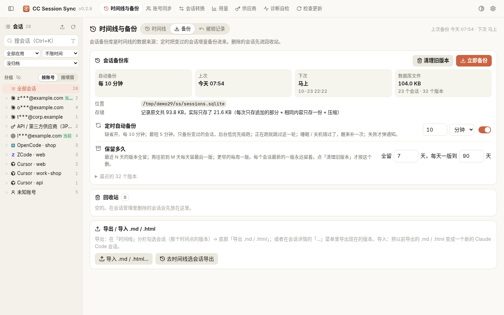 |
| **之后：撤销记录** | **之后：特大字号 + 150% 缩放** |
| 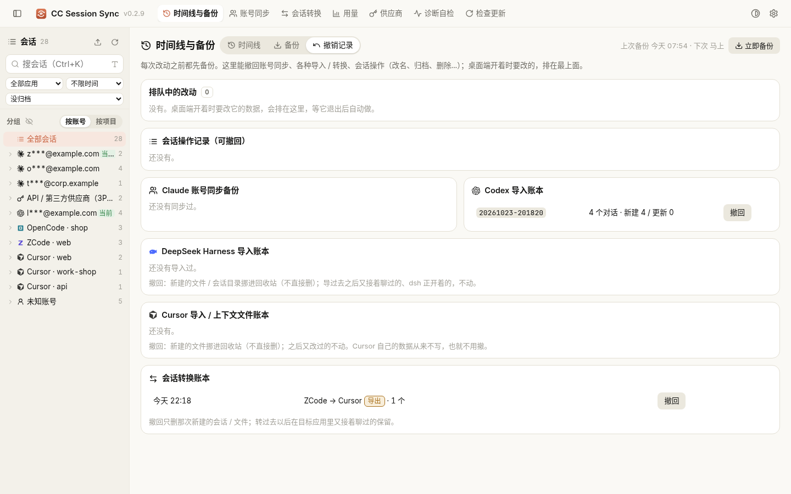 | 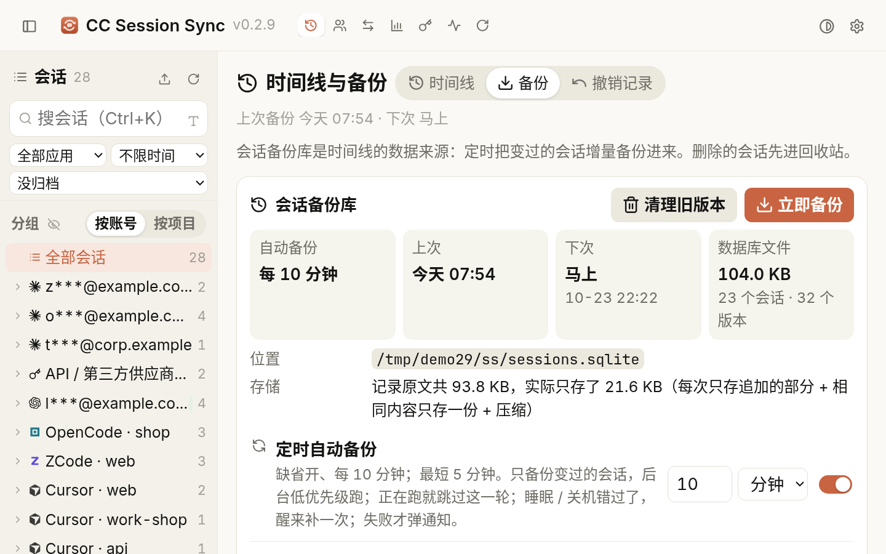 |

### 打开更快、内存更省（0.4.0）

- **一打开就有列表**：先显示上次的会话列表（标「上次的列表 · 正在刷新…」），后台再看有没有新的 / 改过的会话，看完悄悄换成新的。
- **只重读改过的**：每个会话文件记下修改时间和大小（`~/.cc-sessionsync/cache/`），没变的不再打开读标题，只读改过的和新的。
- **点开才读详情**：列表只带标题、项目、时间这些；点开一个会话时才去读它的内容和「继续」命令。很长的会话只留最后要看的那几条在内存里。
- **内存有上限**：缓存最多记 6 万个会话；空闲 3 分钟后把列表缓存放掉，下次用时再从磁盘缓存拿。
- 缓存坏了、被删了都没关系，会自动重建；缓存里不存账号邮箱这类原文（和界面一样先遮住）。

在测试机上用脚本生成的假数据（6 个应用）量的，「再次启动」= 第二次打开：

| 场景 | 启动到列表出来 | 再要一次列表 | 内存峰值 |
|---|---|---|---|
| 5 006 个会话，0.3.9 再次启动 | 1.17 秒 | 0.217 秒 | 61 MB |
| 5 006 个会话，0.4.0 再次启动 | **0.10 秒**（先显示上次的列表） | **0.022 秒** | **53 MB** |
| 15 006 个会话，0.3.9 再次启动 | 4.39 秒 | 0.696 秒 | 143 MB |
| 15 006 个会话，0.4.0 再次启动 | **0.15 秒**（先显示上次的列表） | **0.064 秒** | **101 MB** |

| 再次打开：先显示上次的列表 | 点开才读详情 |
|---|---|
| 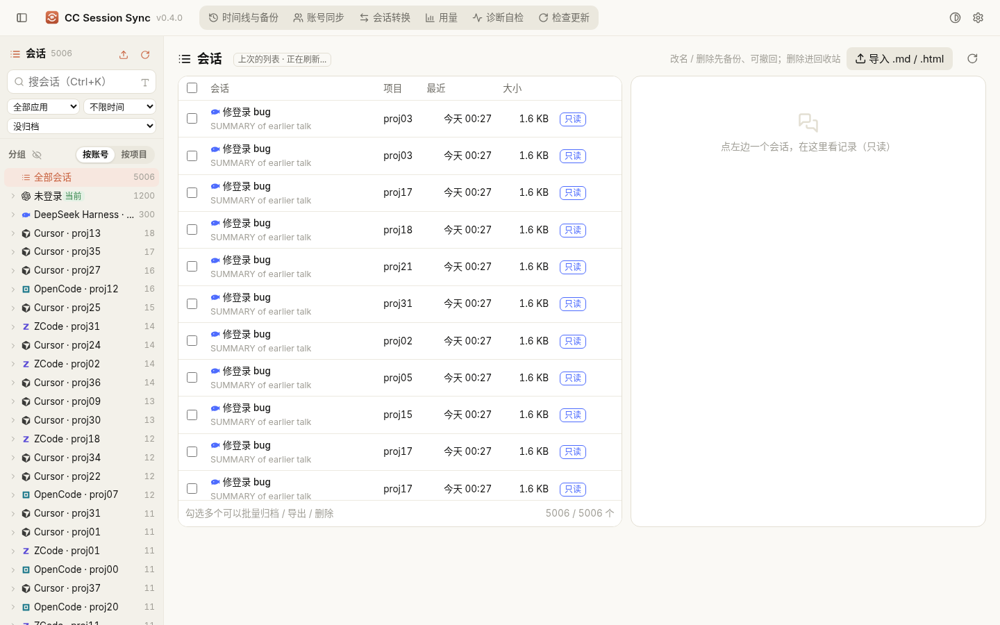 | 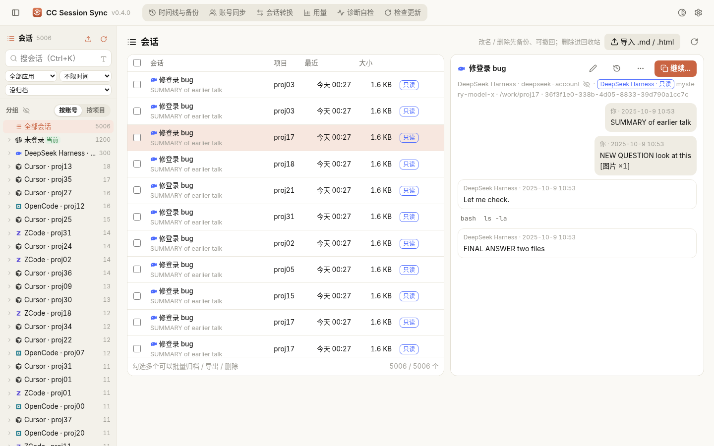 |

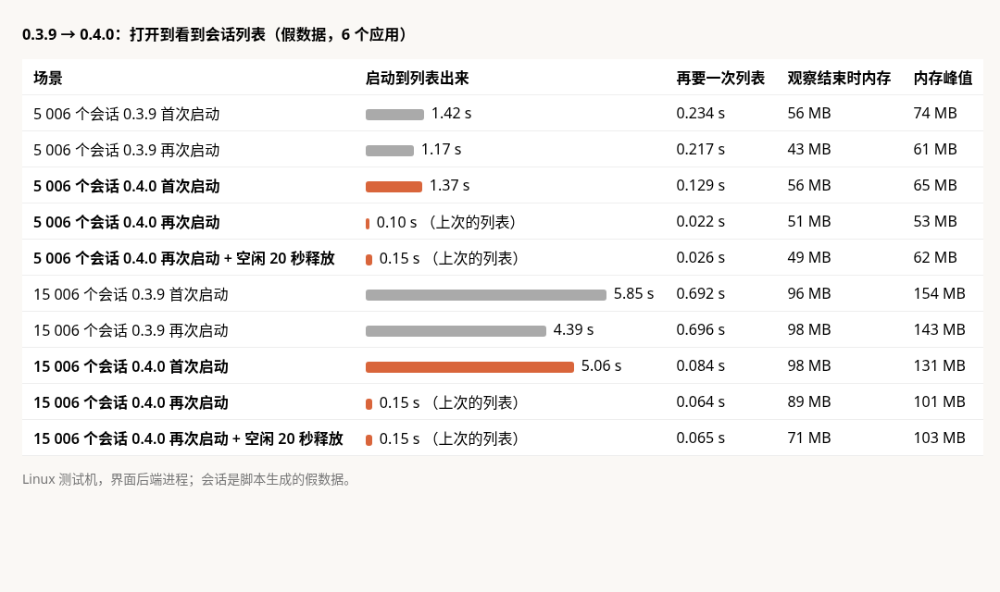

### 清理配置备份（0.3.9）

`~/.cc-sessionsync/backups` 里放的是改配置文件之前留的备份，来自 0.2–0.3.4 改 Codex / Claude Code 配置时，以及 0.3.5 收拾旧改动时。
时间久了会越攒越多。它和会话备份（`sessions.sqlite`）、Claude 同步备份（`claude-sync-bak`）无关，这里不碰那两样。

- **手动清理**：设置 → 数据 → 配置备份 →「清理…」。
  - 填规则：删比 N 天旧的，和 / 或总共超过 M MB 时从最旧的删（填 0 = 不按这一条删）。
  - 先列出**会删哪些**（备份时间、是哪个文件的、为什么备份、大小）和**能腾出多少**，确认了才删。
- **自动清理**：设置 → 高级 →「自动清理旧的配置备份」，**缺省关**。打开后每天最多清一次，规则同上。
- **每个文件最新的一份永远不删**：按 `index.jsonl` 里记的原文件分组；没有记录的，按标签和后缀分组。
- 只删 backups 文件夹第一层里认得出来的备份文件，`index.jsonl` 里对应的行会一起去掉。子文件夹和认不出来的文件都不动。
- 命令行：`cc-sessionsync clean-backups --days 90 [--mb 200]` 只预览，加 `--yes` 才删。

| 清理前预览 | 设置 → 高级 |
|---|---|
| 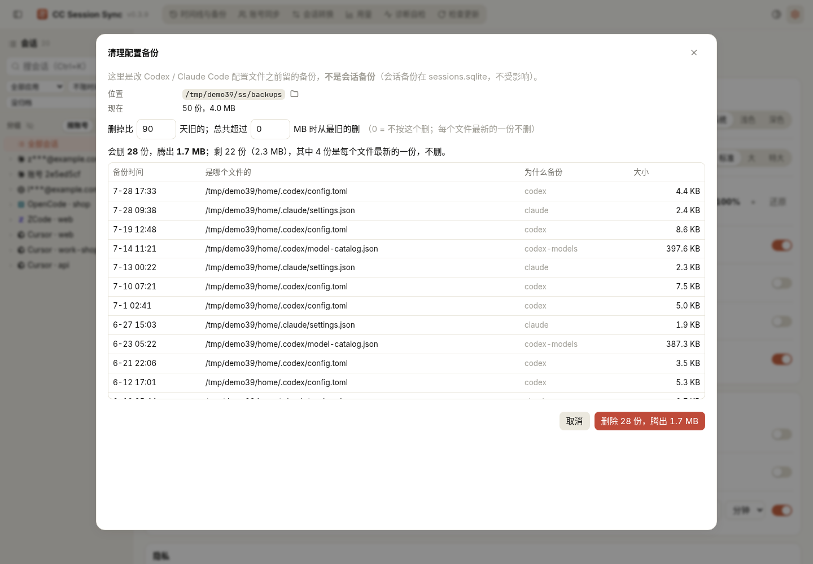 | 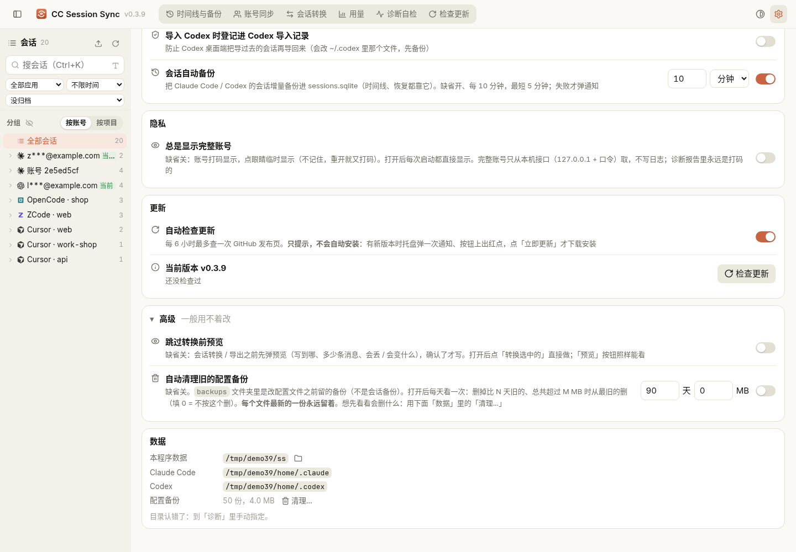 |

### 存储格式自检（0.3.8）

应用升级后可能改了存会话的格式：OpenCode 换了表、ZCode 改了列名、Cursor 的 `_v` 版本变了、Codex 的 rollout 多了新的记录类型等等。
以前遇到这种情况，会话就悄悄从列表里少了几个；现在会**明确告诉你**。

- 启动 1 分钟后在后台查一次，之后每 6 小时查一次，**只读**：只看表名、列名、记录类型、格式版本和条数，不读账号或凭据表。
- 有问题时**顶上出提示条**：哪些应用、有几个会话读不出来。点「看诊断」看细节；点「知道了」后，同样的问题不再提示，出了新问题才会再提示。
  托盘也会弹一次通知，每种问题只弹一次。
- **诊断自检 → 存储格式自检**：每个应用一行，写明认出的格式、读得出 / 读不出的会话数、发现了什么，并给出建议（一般是先升级 CC Session Sync；会话本身没坏）。可以点「重新检查」。
  「自检」列表里也有每个应用的「存储格式」一项。
- 会话转换页：某个应用有会话读不出来时，会话数旁边会显示「另有 N 个读不出来」，点它会跳到诊断。
- OpenCode / ZCode 缺了不认识的可选列时，照样把能读的会话读出来，不再整库读失败。

| 顶上提示 | 诊断里的存储格式自检 |
|---|---|
| 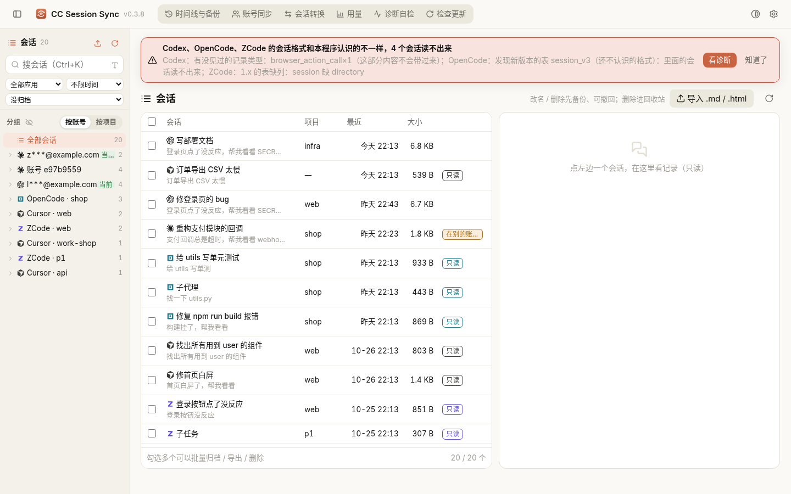 | 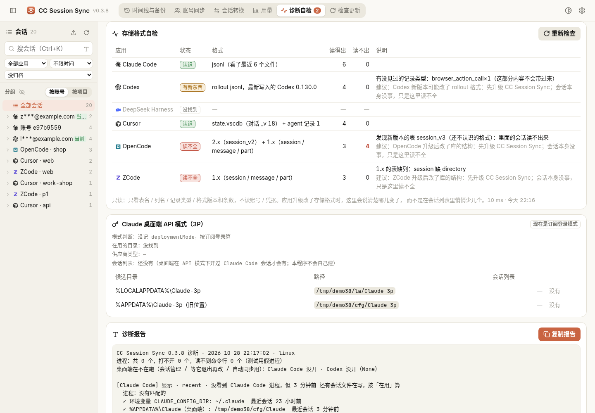 |

### 全部应用：跨应用搜索 + 批量转换（0.3.7）

会话转换页「从」那一排最前面多了 **全部应用**：六个应用（Claude Code、Codex、DeepSeek Harness、Cursor、OpenCode、ZCode）的会话放在一张表里搜、勾、一起转。

- **搜**：关键词（标题 / 项目目录 / 会话号；空格分开，每个词都要有）、**应用**（点按钮开 / 关，Ctrl 点只看这一个；按钮上是命中个数）、**项目**、**时间**
  （24 小时 / 7 / 30 / 90 天 / 一年内，或自定义日期）。勾「**也搜对话内容**」在问 / 答文字里找，命中的会显示一小段上下文。
- **快**：会话清单缓存在内存里，旧了在后台刷新；对话内容建一个本地索引 `~/.cc-sessionsync/search-index.sqlite`（只存问 / 答文字，
  按文件修改时间增量更新，后台建，建好的先出结果）。几千个会话也不卡；表格先画前 300 个。索引随时可以删，下次自动重建。
- **批量转**：跨应用勾好几个（和目标是同一个应用的不能勾），点「转换选中的 → 目标」：先弹**合起来的预览**（每个来源几个、共多少条消息、会丢 / 会变什么、
  每个会话写到哪），确认后**后台做、显示进度**（可以关掉进度框），做完列出每个结果；导出方向会自动复制粘贴提示。每个来源应用一本账，在「转换记录」里撤回。
  目标应用开着时整批排成一个任务，等它退出后做。
- 单个应用的会话列表也只先画前 400 个（「再显示」），会话很多时不再卡。

| 全部应用 | 也搜对话内容 |
|---|---|
| 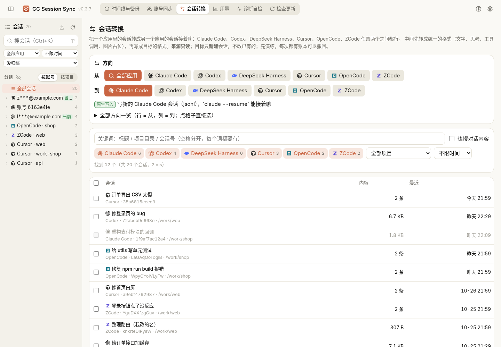 | 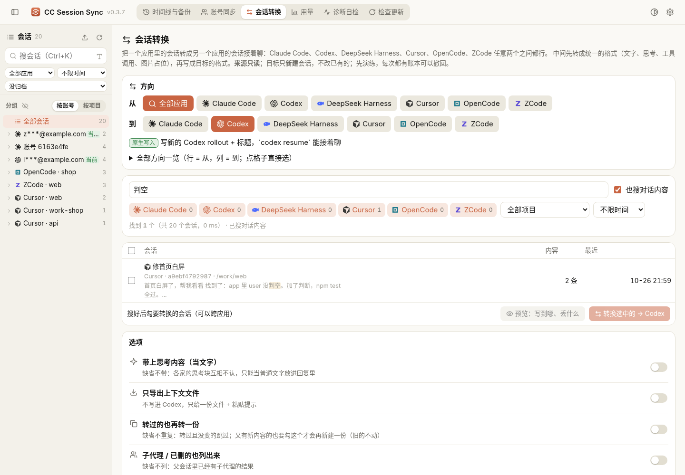 |
| **批量转换前预览** | **批量导出完成（深色）** |
| 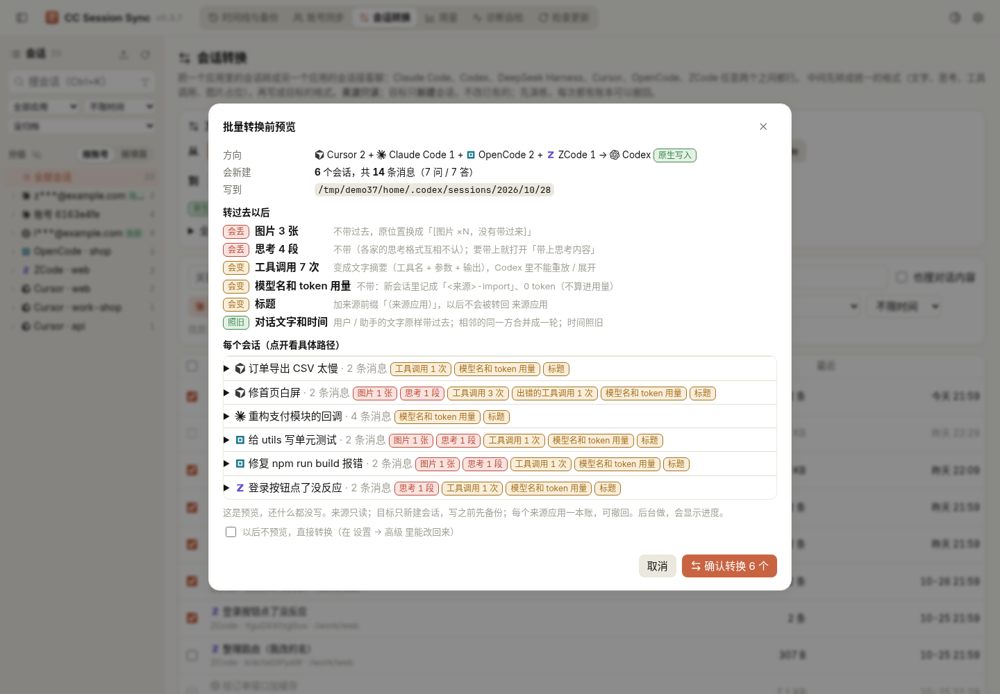 | 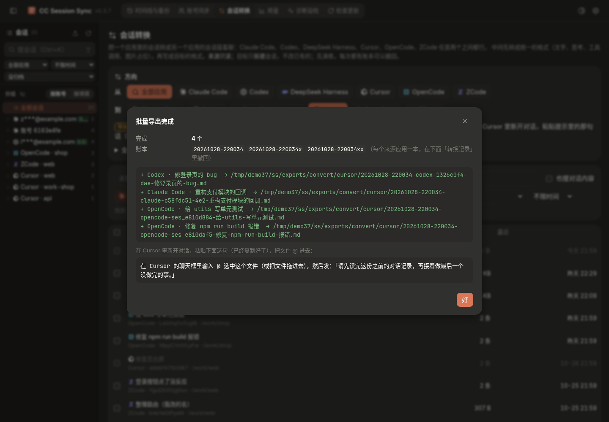 |

### 转换前预览（0.3.6）

会话转换 / 导出之前先弹一个**预览**，确认了才写：

- **写到哪**：每个会话具体写到哪个目录 / 文件（Claude Code 是 `~/.claude/projects/<项目>/<新会话号>.jsonl`，并说明会不会写进桌面端列表；
  Codex 是 `sessions/年/月/日/rollout-….jsonl` + `session_index.jsonl`；dsh 是会话根下的新目录；OpenCode 交给 `opencode import`；导出是哪个文件）。
- **多少条消息**：一共几问几答、每个会话几条、时间范围。
- **会丢 / 会变 / 照旧**：图片、文件附件（PDF 等）不带过去（换成占位）；思考缺省不带（打开「带上思考内容」就当文字带上）；工具调用变成文字摘要，
  输出超过 20 行 / 2000 字的会截短（预览里写明几个）；出错的工具调用标出来；模型名和 token 用量不带；导出方向不进目标应用的会话列表、只有对话文字。
- 上面是合起来的，下面每个会话可以点开看自己的。Codex → Claude Code 的导入器确认框里也加了「转过去以后」。
- 嫌烦可以勾「以后不预览，直接转换」，或者在 **设置 → 高级 → 跳过转换前预览** 里开 / 关（缺省关）。开了以后「预览」按钮照样能看。

| 转换前预览 | 导出前预览（深色） |
|---|---|
| 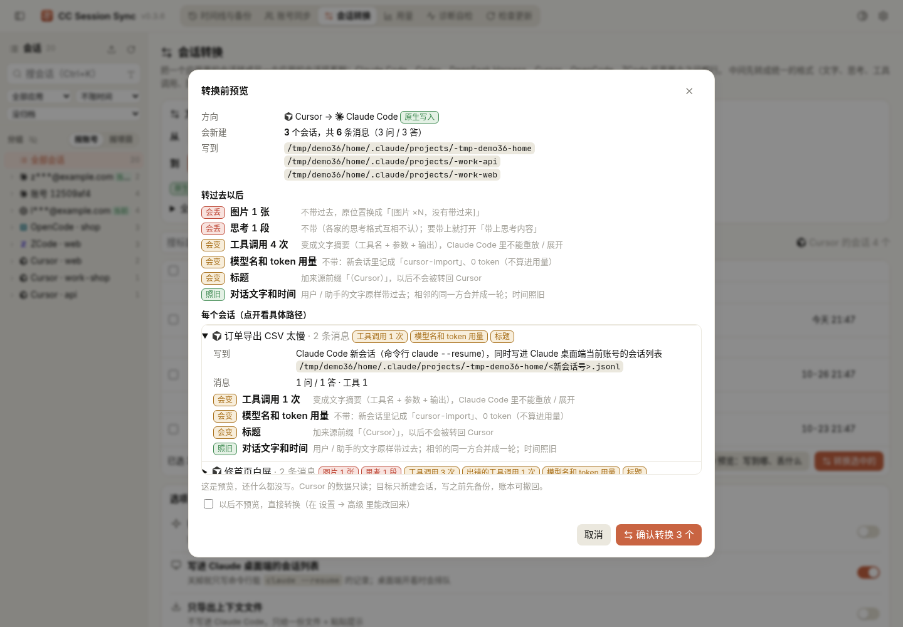 | 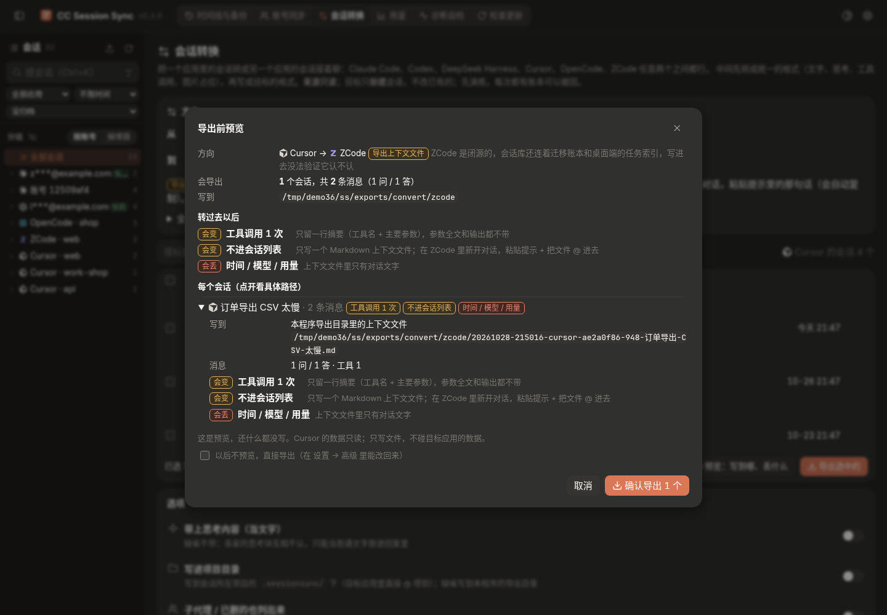 |
| **设置 → 高级** | |
|  | |

### 拿掉了「供应商」（0.3.5）

「供应商」页（Agent / 服务商 / 高级）、模型路由（本机协议转换代理、Anthropic ⇄ OpenAI Responses / Chat 转换、多 key 轮换）、
给 Codex 写的模型目录、配置提醒 / 一键修复、托盘里的「供应商…」、命令行 `route`，**全部拿掉了**：太重，也不好懂。
要换模型 / 服务商，直接用 Codex / Claude Code 自己的配置（或 CC Switch 之类专门的工具）。

**更新到 0.3.5 后第一次启动**（打开窗口，或旧的开机自启项先跑到也一样），程序把 0.3.0–0.3.4 改过的东西收拾干净，只做一次，做完在窗口顶上提示一次
「供应商功能已移除，已把 Codex / Claude Code 配置恢复原样」并列出做了什么：

- **Codex `~/.codex/config.toml`**：启用时记下的原值放回去（`model_provider`、`model`、`model_catalog_json`、推理等级等）；文件启用后没被动过就**按字节还原**，
  动过就只把「现在还是我们写的值」的那几项放回，别的键（包括你后来加的）不碰。删掉 `[model_providers.cc-route]`、`[profiles.cc-route]`。
  **没有记录时**（老版本 / 记录丢了）只删我们写的：`model_provider = "cc-route"` 连同给它用的 `model` 一起删（回到 Codex 默认的 ChatGPT 登录和默认模型），
  `model_catalog_json` 指着 `ccss-models-*.json` 就删掉这个键。**不会留下 `model_provider` 指向 cc-route。** `auth.json`（ChatGPT 登录）从来不动。
- **Codex 其他文件**：删 `cc-route.config.toml`（profile）、我们生成的模型目录 `ccss-models-*.json`（`ccss-models-cc-route.json`、0.2 供应商列表写的 `ccss-models-<id>.json`，
  比如 `ccss-models-cpa.json`；这个前缀只有本程序用）、Codex 的模型列表缓存 `models_cache.json`（让它马上按恢复后的设置重新拉）。
- **Claude Code `~/.claude/settings.json`**：同样按记录还原；没有记录时删掉指向本机代理的 `ANTHROPIC_BASE_URL` / `ANTHROPIC_AUTH_TOKEN`，
  和取本机代理口令的 `apiKeyHelper`（`… key get route-token`）。你自己的代理、自己的 `apiKeyHelper` 不碰。删 `~/.cc-sessionsync/route/claude-settings.json`。
- 停掉后台代理进程，删开机自启项「CC Session Sync Route」（HKCU\…\Run），删凭据管理器里的本机代理口令 `route-token`。
- 每个要改的文件**先备份**进 `~/.cc-sessionsync/backups`（和以前改配置时的备份同一处），做了什么记在 `~/.cc-sessionsync/legacy-0.3.5.json` / `legacy-0.3.5.log`；
  旧记录 `route.json` 改名成 `route.json.removed-0.3.5`。「诊断自检」里会检查还有没有残留。

| 第一次启动 0.3.5 | 之后（顶栏没有「供应商」了） |
|---|---|
|  |  |

**没动的**：你存在凭据管理器里的服务商 key（`prov-…` / `card-…` / 0.2 的 `claude-…` / `codex-…`）留着；`CCSessionSync.exe key get <名字>` 命令也留着——
0.2 的「供应商列表」切换过去、或者直连卡片写的取 key 命令还指着它，删了那些配置会断。不想要了就在 Codex / Claude Code 里改回自己的设置，再到 Windows 凭据管理器里删 `CCSessionSync/key/…`。

### 字号与界面缩放（0.2.6）

- 缺省字号调大了一号（正文 15px，最小的标签 12px）。
- 「设置 → 外观与窗口」：**字号** 小 / 标准 / 大 / 特大；**界面缩放** 80%–200%（每次 10%），快捷键 `Ctrl` + `=` 放大、`Ctrl` + `-` 缩小、
  `Ctrl` + `0` 还原，也可以按住 `Ctrl` 滚滚轮。两个都会记住。
- Windows 桌面版按显示器的缩放（125% / 150%）清晰显示（DPI 感知），上面的缩放是在这之外再放大。顶栏放不下时只留图标（鼠标停上去看名字）。

| 100% | 125% | 150% |
|---|---|---|
|  |  |  |

| 界面缩放 150% | 字号「特大」 |
|---|---|
|  |  |

### 检查更新（不会自动安装）

- 启动后、之后每 6 小时最多查一次 GitHub 的最新发布（公开接口，不用登录）。
- 有新版本：**同一个版本只弹一次**托盘通知；顶栏「检查更新」按钮和设置里的检查更新上出现**小红点**，托盘菜单那一项变成
  「● 有新版本 x.y.z…」、托盘图标也带红点，
  窗口顶部有提示条（「立即更新」「看看更新了什么」「稍后」「忽略此版本」）。红点一直在，直到你装了这个版本或点了「忽略此版本」。
- **只有你点「立即更新」才装**：下载安装包 → 核对 sha256（对不上就不装）→ 静默安装 → 重新打开。pip 装的版本只提示 `pip install -U` 命令。


### 各页

| | |
|---|---|
|  |  |
| **时间线（按时间点）**：拖滑块选一次备份，看那时候每个会话的样子，勾选几个一起恢复。 | **恢复到 Claude**：新会话的继续命令、桌面端登记情况、撤回。 |
|  |  |
| **按账号分组**（深色）：账号下再按项目分，选中一组可以整组导出。 | **备份**：自动备份的上次 / 下次 / 结果、数据库大小、保留规则、清理。 |
|  |  |
| **Codex → Claude Code**：搜索 / 按时间、项目、状态筛，勾选，右边预览转换后的样子；先「演练」看会新建 / 更新哪些文件，再确认导入。 | 演练结果：每个要写的文件、桌面端列表写进哪个账号、防重复导入开没开。 |
|  |  |
| **会话**（深色）：只读查看、改名、归档、导出、在终端里接着聊、删除进回收站，可批量。 | **导入 .md / .html**：先预览，无损 / 按标题解析一目了然。 |
|  | |
| **用量**（页面，不是弹窗）：读本机会话日志（同一次请求只算一次），缓存读 / 写分开算；费用「按 API 价折算」，不是实际账单；没价格的模型显示「—」。 | |
|  |  |
| **设置**：主题、托盘、开机自启、通知、自动同步、自动备份、总是显示完整账号、检查更新。 | **诊断 / 自检**：每一项通过 / 注意 / 没通过，附建议；第一次启动自动跑一次。报告里账号打码，可以直接复制发出来。 |

### 会话管理怎么改文件

- **改名**：缺省只改本程序里的显示名（别名），什么文件都不动。勾「也改 Claude/Codex 自己显示的名字」才写：Claude 在会话记录末尾追加一条
  `custom-title`（Claude Code 自己的改名格式），登记过的再改桌面端列表标题；Codex 在 `session_index.jsonl` 追加一条、并改 state 数据库里的名字
  （和 Codex 自己改名的做法一样）。改之前先备份。
- **归档**：Claude 改桌面端列表里的「已归档」；Codex 跟 Codex 自己一样，把会话文件挪进 `archived_sessions/` 并更新数据库。
- **删除**：先把会话记录完整存进会话备份库，再把文件（和桌面端列表那一条）挪进 `~/.cc-sessionsync/trash/`。回收站里「彻底删除」要再输入 `DELETE` 确认。
- **还原**：原位置空着就放回原位；原位置已经有文件了就另存一份新的，不覆盖。
- 要改 Claude 桌面端列表、它又开着：排队，等它退出后再做（见下文「怎么保证安全」）。每一步都进操作记录，可以撤回。

## 命令行

```bash
cc-sessionsync                            # 打开桌面窗口（= cc-sessionsync desktop）
cc-sessionsync ui --port 8766 --no-browser  # 只起本地网页界面，不开窗口
cc-sessionsync status                     # 桌面端 / 命令行当前登的号、各账号文件夹、Codex 对话数

# ① 换号后补齐
cc-sessionsync sync --dry-run             # 演练：两边（桌面端 / 命令行）各算一遍会补哪些
cc-sessionsync sync                       # 按桌面端当前账号补齐
cc-sessionsync sync --source cli          # 按命令行（~/.claude.json）当前账号补齐
cc-sessionsync sync --to <账号>/<组织>     # 手动指定目标文件夹
cc-sessionsync backups                    # 每次同步前的备份
cc-sessionsync clean-backups --days 90    # 清理旧的配置备份：先预览，加 --yes 才删；每个文件最新的一份不删（0.3.9）
cc-sessionsync restore 20261017-101500    # 撤回某次同步（撤回前也先备份）
cc-sessionsync auto                       # 前台常驻：桌面端没开时自动补齐（Ctrl+C 停）

# ② Codex → Claude Code
cc-sessionsync codex list --days 0                     # 列出 Codex 对话（0 = 不限时间）
cc-sessionsync codex import                            # 演练（缺省就是演练，什么都不写）
cc-sessionsync codex import --only 3f9a1c,77b0de --apply   # 只导这两个（线程号末几位）
cc-sessionsync codex import --cwd D:\work\shop --apply     # 只导这个项目下的
cc-sessionsync codex import --no-desktop --apply       # 只写命令行用的会话记录，不碰桌面端列表
cc-sessionsync codex import --mark-codex-imported --apply   # 同时登记进 Codex 导入记录（防止 Codex 再导回去，见下文）
cc-sessionsync settings --codex-mark-imported on       # 以后缺省就登记（off 关掉；单次用 --no-mark-codex-imported）
cc-sessionsync codex ledgers                           # 导入账本
cc-sessionsync codex undo 20261017-101800              # 撤回一次导入

# ③ DeepSeek Harness ⇄ Claude Code
cc-sessionsync dsh detect                              # 装在哪、数据目录、会话根 / 压缩方式、开没开
cc-sessionsync dsh list                                # 列出 dsh 会话
cc-sessionsync dsh validate <会话号或文件>              # 按 dsh 的规则离线校验
cc-sessionsync dsh to-claude [--only 末几位] [--reasoning] [--images] [--no-desktop] [--apply]
cc-sessionsync dsh from-claude [--only 末几位] [--again] [--apply]   # 只新建 dsh 会话
cc-sessionsync dsh ledgers                             # 导入账本
cc-sessionsync dsh undo 20261018-151308               # 撤回一次导入

# ④ Cursor ⇄ Claude Code（Cursor 的数据只读）
cc-sessionsync cursor detect                           # 装在哪、数据库 / ~/.cursor 在哪、开没开、几个对话
cc-sessionsync cursor list [-n 50]                     # 列出 Cursor 对话
cc-sessionsync cursor to-claude [--only 末几位] [--reasoning] [--subagents] [--no-desktop] [--apply]
cc-sessionsync cursor context <claude|codex|dsh|cursor> <会话号> [--project] [--apply]   # 给 Cursor 用的上下文文件
cc-sessionsync cursor ledgers                          # 账本
cc-sessionsync cursor undo 20261018-201957            # 撤回

# ⑥ 会话转换：任意 → 任意（0.2.7）
cc-sessionsync convert matrix                          # 方向表：哪些原生写、哪些只导出
cc-sessionsync convert detect                          # OpenCode / ZCode 装在哪、数据在哪、几个会话、opencode 命令行
cc-sessionsync convert list <claude|codex|dsh|cursor|opencode|zcode> [-n 50]
cc-sessionsync convert run --from opencode --to claude --id 会话号[,会话号] [--apply] [--again] [--reasoning] [--no-desktop] [--export] [--project]
cc-sessionsync convert ledgers                         # 账本
cc-sessionsync convert undo 20261021-042339            # 撤回

cc-sessionsync jobs [--cancel ID]         # 等桌面端退出再做的任务
cc-sessionsync diag                       # 检测报告（家目录已打码，可以直接发出来）
cc-sessionsync selfcheck [--offline] [--json]   # 自检；有没通过的项返回 1

# ⑤ 会话管理（命令行只读；改名 / 删除 / 还原请在窗口里做）
cc-sessionsync sessions list [--agent claude|codex] [-n 50]
cc-sessionsync sessions backup            # 增量备份进 ~/.cc-sessionsync/sessions.sqlite
cc-sessionsync sessions export claude <会话号> --fmt md
cc-sessionsync sessions trash             # 回收站
cc-sessionsync sessions ops               # 操作记录
cc-sessionsync usage [--full]             # 用量汇总
```

导入后命令行会打印每个会话的打开方式，例如：

```
cd D:\work\shop && claude --resume 8d7c1c3e-…
```

（Claude Code 按工作目录找会话，要先进到 Codex 对话当时的工作目录。）桌面端：打开 / 重启 Claude 桌面端，列表里标题前带「（Codex）」的就是。

## 怎么保证安全

- **先演练**：`sync --dry-run`、`codex import`（不加 `--apply`）只算不写；界面上也是先「演练」才能点执行。
- **桌面端开着不写它的数据**：Claude 桌面端把会话列表放在内存里，退出时写回磁盘，开着的时候改会被盖掉。所以要改桌面端列表时，
  如果它开着，先问你：「关闭并执行（完成后重启）」会请它正常退出（不强制；强制结束要再确认一次），或者排队等你自己退出，
  后台等它完全退出后再做，做完按原来的方式把它重新打开（`jobs` 能看、能取消）。只写命令行会话（`--no-desktop`）不用等。
- **备份 + 撤回**：
  - 同步：每次写之前把目标账号文件夹整个拷到 `~/.cc-sessionsync/claude-sync-bak/<时间>/`，旁边 `ledger.json` 记补了哪些、刷新了哪些；
    `restore` 把补进来的挪进回收站、刷新过的换回原版本。撤回过的会话，自动同步不会再补回来。
  - Codex 导入：`~/.cc-sessionsync/codex-import/<时间>/ledger.json` 记这次新建 / 更新了哪些文件，更新前的版本拷在旁边；
    `codex undo` 把新建的挪进回收站（`~/.cc-sessionsync/trash/`，不直接删）、更新过的换回原版本。导过去之后你在 Claude 里接着聊过的会话不动。
- **只补不删**：同步只补缺的、刷新旧的，不删除；在当前账号里删过的会话（桌面端留了墓碑）不复活；对话记录文件已经没了的不补。
- **再导一次**：Codex 那边又聊了 → 更新同一份 Claude 会话（先备份）；你已经在 Claude 里接着聊过 → 不覆盖。
- 所有写都是「写临时文件再一步换上」，不会写出半个文件。

## 目录怎么认

| | 缺省 | 改 |
|---|---|---|
| Claude Code 数据 | `~/.claude` | `CLAUDE_CONFIG_DIR` |
| Codex 数据 | `~/.codex`（商店版 Codex 的虚拟化目录里有会话、`~/.codex` 没有时用那边） | `CODEX_HOME` |
| Claude 桌面端数据 | Windows `%APPDATA%\Claude`；商店（MSIX）版 `%LOCALAPPDATA%\Packages\Claude_*\LocalCache\Roaming\Claude`；macOS `~/Library/Application Support/Claude`；Linux `~/.config/Claude` | 界面「检测 / 目录」里手动选 |
| Claude 桌面端 API 模式（3P） | `%LOCALAPPDATA%\Claude-3p`（旧位置 `%APPDATA%\Claude-3p`，商店版虚拟化目录里的也认） | `CLAUDE_USER_DATA_DIR`（签名版桌面端会忽略） |
| 本工具自己的数据 | `~/.cc-sessionsync` | `CC_SESSIONSYNC_HOME` |

两个桌面端目录都有时：会话列表、Local Storage（账号）、IndexedDB 各自看哪边最近有写入；一样新时，桌面端是从 WindowsApps（商店版）跑的就用 MSIX 那边。
`status` / `diag` 会写明每一项用的是哪边、为什么。

## Codex → Claude Code 的限制

转换出来的是「文字版」的对话，能接着聊、上下文都在，但不是 1:1 的原样：

- **工具调用折成文字**：Codex 的 shell / exec_command / apply_patch / update_plan / web_search / MCP 调用，写成助手回复里的一段
  「〔Codex 调用了 …〕+ 命令 + 截短的输出（缺省每个 20 行 / 2000 字符）」，不是 Claude 的 `tool_use` / `tool_result`。
  原因：两边工具名和参数格式不一样，硬塞成 Claude 的工具调用可能被 API 拒掉，整份会话就续不上。所以 Claude 接手后要自己再看一下文件 / git 状态（导入的第一条消息里也这么提示了）。
- **思考过程（reasoning）缺省不带**：Codex 的大多是加密的，读不出来；有明文摘要的可以用 `--reasoning` 带上。
- **图片不带**：用户贴的图、工具返回的图、生成的图都换成「[图片…]」占位。
- **Codex 注入的上下文不带**：AGENTS.md、环境信息、权限说明等（Claude Code 自己会重新带上它的）。
- **只导用户自己开的对话**：子代理、`codex exec` 一次性任务、从 Claude 导进 Codex 的线程缺省跳过（免得来回套娃）；`--all` 可以都算上。
- **很长的对话**：全部历史都会导进来，太长时 Claude Code 第一次接着聊可能提示上下文太长，用 `/compact` 压一下即可。
- **模型显示**：导入的助手消息模型名记为 `codex-import`，费用 / token 统计为 0。
- Claude Code 的会话文件格式不是官方公开格式，这里按本机 Claude Code（测试用 2.1.302）实际写出的文件来拼；CI 每次都用最新版 Claude Code
  真的 `claude --resume` 一遍（连本机假 API）确认能打开。Claude Code 以后改格式可能需要跟着更新。
- Codex 桌面端如果开了「从 Claude Code 导入会话」，可能会把导过去的这份当成 Claude 会话再导回 Codex 一份。缺省不处理（不碰 Codex 的文件），
  要防止就打开下面的「登记进 Codex 导入记录」。

## 登记进 Codex 导入记录（可选，缺省关）

Codex 桌面端「从 Claude Code 导入会话」会扫 `~/.claude/projects`，用 `<CODEX_HOME>/external_agent_session_imports.json` 记哪些已经导过。
打开这个开关后，每导一个会话，就在这个文件里加一条记录：「这份 Claude 会话 = 原来那个 Codex 线程」，Codex 看到就不会再导一份重复的。

- 打开方式：命令行 `--mark-codex-imported`（单次）、`cc-sessionsync settings --codex-mark-imported on`（以后缺省），
  或界面「Codex → Claude Code」页的「登记进 Codex 导入记录」勾选（会记住）。缺省关。
- 记录格式和 Codex 自己写的一样（对照 Codex 开源代码 `codex-rs/external-agent-migration/src/sessions/ledger.rs`）：
  `{"records": [{"source_path", "content_sha256", "imported_thread_id", "imported_at", "source_modified_at", "connector_names", "title"}],
  "detected_connector_records": [...]}`；`source_path` 按 Codex 的写法（Windows 是 `\\?\C:\…`），`imported_thread_id` 是原来的 Codex 线程号。
- **只动这一个文件**，Codex 的其它文件（对话、索引、数据库、配置）一概不碰。改之前把原文件拷进这次导入的账本，写临时文件再一步换上；
  文件里原有的记录和其它字段原样保留，只增 / 改我们自己那几条。文件不存在就按 Codex 的格式新建。
- **格式不对就整个不动**：文件不是合法 JSON、或者不是 `{"records": [...]}` 的样子 → 报错，这次导入一个文件都不写（演练时就会提示）。
  修好它，或者这次用 `--no-mark-codex-imported` 不登记。
- **撤回**：`codex undo` 一起还原。文件从导入以后没变过 → 原样换回备份（导入前没有这个文件 → 挪进回收站）；
  之后 Codex 自己又往里加过记录 → 只把我们那几条换回原样，Codex 后来加的保留。你在 Claude 里接着聊过、被保留下来的会话，登记也保留。
- 你在 Claude 里接着聊了以后，这份会话的内容和登记的不一样了，Codex 会试着把新增的部分接到原来那个 Codex 线程后面
  （它要求内容严格对得上，转换过的文字版一般对不上，就放弃）；不会再新建一份重复的。
- Codex 桌面端开着时也可以导：写之前会重新读一遍文件再原子替换，窗口很短；保险起见可以先退出 Codex 再导。

## 开发

```bash
pip install -e . pytest
python -m pytest -v                                    # 场景测试，全在临时目录里跑
npm i -g @anthropic-ai/claude-code
python tools/verify_resume.py "$(command -v claude)"   # 真的 claude --resume 打开导入的会话（本机假 API，不联网不登录）
python tests/demo_env.py /tmp/demo --serve 8797        # 假数据 + 界面，截图用（只写 /tmp/demo）
```

Windows 安装包：`tools/build_desktop.ps1`（Nuitka 编译 + 隐藏窗口冒烟测试 + Inno Setup），CI 里还会真装一遍、跑自检、再卸载。

发版：改 `cc_sessionsync/__init__.py` 的 `__version__`，打 `v<版本>` 标签，`release` 工作流会出 `CCSessionSync-Setup-<版本>.exe`（+ `.sha256`）、
wheel、sdist 和 `SHA256SUMS.txt`。

许可：MIT，见 [LICENSE](LICENSE)；第三方声明见 [THIRD_PARTY_NOTICES.md](THIRD_PARTY_NOTICES.md)。

---

## English

**CC Session Sync** is a Windows desktop app (also a pip-installable CLI for Windows / Linux / macOS) that manages Claude Code and
Codex sessions. Everything is backed up, recorded in a ledger and undoable; anything that can be dry-run is.

**Install:** download `CCSessionSync-Setup-<version>.exe` from Releases (per-user install to `%LOCALAPPDATA%\Programs\CCSessionSync`,
no admin, Start-menu shortcut, uninstaller; uses the system Edge WebView2; unsigned, so SmartScreen may warn; a `.sha256` is published).
Or `pip install "cc-sessionsync[desktop]"` from the wheel / `pip install git+https://github.com/helefee/CC-SessionSync` (CLI + browser UI).

**Desktop app:** single instance, tray icon (minimize/close to tray, autostart, start hidden), system notifications. The UI listens on
127.0.0.1:8766 only and every request needs a per-launch token. Since 0.2.2 all pages live in a **top button bar** (since 0.2.9: Timeline & backups, Account sync,
会话转换 (conversion), Usage, Providers, Diagnostics, Check for updates with a red dot, theme; **settings gear at the top-right**), shown in the
main area (Usage and Providers are full pages, not dialogs; tray entries open the window on that page). The resizable, collapsible (Ctrl+B)
**left panel shows only the session list**: search, filters and a group tree whose leaves are the sessions, grouped
**by account** (every Claude Desktop account/org folder on the PC incl. the MSIX store dir, the CLI account, Codex accounts/providers;
"未知账号" for sessions not registered anywhere) or **by project**.

- **Reveal accounts (0.2.1):** accounts are masked by default; the eye button in the session list fetches the full email/name/org from the local token-protected
  API, keeps it in page memory only (never logged or stored); optional "always show full account" setting (off by default). Diagnostics stay masked.
- **Automatic session backup (0.2.1):** on by default every 10 minutes (min 5 min; minutes/hours/days), incremental (appended-delta + content
  dedup + zlib), low priority, skips if busy, catches up after sleep, notifies only on failure. Retention: all for 7 days, daily to 90 days,
  weekly after; the latest version of every session is always kept; manual cleanup.
- **Timeline (0.2.1):** pick a point in time (slider / date-time) per session or for all sessions, preview the conversation read-only with a
  diff against now, then **Restore to Claude** (new Claude Code session with a new id and "（恢复 @time）" title, registered in Claude Desktop
  for the current account, queued while Desktop runs; shows the `claude --resume` command). Also replace-current (backed up first, extra
  confirmation) and restore-to-Codex. Ledger + undo.
- **Export / import .md / .html (0.2.1):** readable files with the raw jsonl embedded, so importing back is lossless; import creates a new
  Claude Code session in the chosen project (dry-run preview first, undoable). `tools/verify_resume.py` checks that restored and imported
  sessions really resume in Claude Code.

- **Account-switch detection:** polls login files by mtime (cheap), debounces, then shows one notification
  "检测到 Claude Code/Codex 账号已切换：old → new" plus an in-window banner with Sync now / Open. Only masked emails are shown; tokens are
  never read. Tray balloons cannot carry buttons, so clicking the notification opens the window where the banner has the actions.
- **Updates are never installed automatically.** At most every 6 hours the app checks the latest GitHub release. A new version gives one tray
  notification per version, a red dot on the top-bar / settings "Check for updates" buttons and the tray icon, "● 有新版本 …" in the tray menu, and a banner (Update now / What's new /
  Later / Ignore this version) until you install or ignore it. Only **Update now** downloads the installer, verifies its SHA-256, installs
  silently and restarts.
- **Sessions:** list/search/filter Claude Code and Codex sessions, read-only viewer, rename (alias by default; optionally the tool's own
  title via `custom-title` / Codex `session_index.jsonl` + state DB), archive, export md/jsonl, resume in a terminal, delete (backed up to
  the session DB, then moved to `~/.cc-sessionsync/trash`; purging needs typing `DELETE`), restore to the original path only if it is free,
  otherwise as a new copy. Claude Desktop index edits are queued while Desktop runs.
- **Close & run, then relaunch (0.2.3):** when an action needs Claude Desktop closed (sync, restore, delete/archive/rename, trash restore,
  timeline replace), a dialog offers 关闭并同步（完成后重启） / wait until it quits / cancel. It records how Desktop was launched (MSIX AUMID via
  Get-AppxPackage, or the Squirrel `AnthropicClaude\claude.exe`), asks it to quit gracefully (WM_CLOSE + `taskkill` without `/F`, up to 15 s with
  progress), force-kills only after a second confirmation (and only Desktop's own process tree), warns about Claude Code sessions started by
  Desktop that would be interrupted, never touches other CLI `claude` processes, runs the queued jobs, relaunches Desktop the same way, verifies
  it started and reports the result (dialog + notification).
- **API mode / 3P (0.2.4):** discovers Claude Desktop's API-mode data dir (`%LOCALAPPDATA%\Claude-3p`, legacy `%APPDATA%\Claude-3p`, MSIX
  copies, `CLAUDE_USER_DATA_DIR`), groups its sessions as "API / 第三方供应商（3P）" (provider type only, never the key or gateway URL),
  shows entries whose transcript is missing as "无法打开" with limited actions, and adds an "API 模式" sync target that only writes into the
  bucket Desktop already created (never creates `ant-did` or folders). Diagnostics show the mode, active dir and candidates.
- **Usage accuracy (0.2.4):** 5m/1h cache-write pricing, most-complete streaming snapshot per `message.id:requestId`, Codex per-event deltas
  from `total_token_usage`, long-context tiers per request, fast/priority/flex multipliers, verified price table with dates, local-day
  buckets, per-row cost breakdown, Cowork / 3P logs, migration of the existing DB. Curve chart style (toggle, remembered) and per-model /
  per-project distribution charts; timeline grouped by day with a growth sparkline and ←/→ keys.
- **DeepSeek Harness ⇄ Claude Code (0.2.5):** reads DeepSeek Harness (dsh, MIT) v4 session logs (`$DSH_HOME/sessions/--project--/<id>/session.v4.jsonl[.zstd]`,
  independent checksummed zstd frames; profile `session-persistence-jsonl` root/compression overrides honoured), lists them read-only in
  session management (source filter + group), backs them up, and converts both ways with dry-run, ledger + hash-checked undo and idempotency.
  dsh → Claude Code applies `surfaceOp` (compaction), renders tools as text, drops reasoning (opt-in as text), images as placeholders (opt-in
  base64 from the attachment store), skips system prompt / runtime context. Claude Code → dsh only ever creates a new session dir (text only,
  atomic write, validated in memory first, contiguous seq, refuses format ≠ 4, mixed encodings, duplicate ids, locked/existing sessions).
  Verified end-to-end in CI: `claude --resume` on the imported session and the real dsh CLI resuming the written session in a scratch
  `DSH_HOME` against a local mock model. dsh usage is counted with DeepSeek's price table (peak rates; unknown models show "—").
- **Faster startup, capped memory (0.4.0):** the session list from last time is shown instantly on launch (tagged 上次的列表 · 正在刷新…)
  and refreshed in the background; only session files whose mtime/size changed are re-read (disk head cache in `~/.cc-sessionsync/cache/`).
  The list is slim; a session's content and resume command load when you open it. Cache capped at 60k entries and released after 3 min idle.
  Synthetic data, relaunch: 5,006 sessions 1.17 s → 0.10 s to first list, peak RSS 61 → 53 MB; 15,006 sessions 4.39 s → 0.15 s, 143 → 101 MB.
- **Backup cleanup (0.3.9):** `~/.cc-sessionsync/backups` (config-file backups from 0.2–0.3.5) can be cleaned by age and/or total size:
  a manual 清理 dialog in 设置 → 数据 previews exactly which files go and how much space is freed; optional daily auto-clean under 高级
  (off by default); `cc-sessionsync clean-backups --days N [--mb M] [--yes]`. The newest backup of every original file is never deleted;
  `index.jsonl` is updated; unknown files, subfolders, `sessions.sqlite` and `claude-sync-bak` are untouched.
- **Storage format self-check (0.3.8):** read-only probes (table / column names, record types, format versions, counts; never account or
  credential tables) for Claude Code, Codex, Cursor, DeepSeek Harness, OpenCode and ZCode detect when an app changed how it stores sessions
  (new OpenCode tables, renamed ZCode columns, a newer Cursor `_v`, unknown Codex rollout records, broken files). Instead of sessions silently
  missing, a dismissible banner names the apps and how many sessions can't be read, 诊断自检 gets a "存储格式自检" card and per-app self-check
  items, and the conversion page shows "另有 N 个读不出来". Runs 1 min after start and every 6 h; notifies once per distinct problem.
- **Cross-app search + batch convert (0.3.7):** a 全部应用 source searches all six apps by keyword, app, project and time range (optionally
  inside conversation text via an incremental background index, `search-index.sqlite`), and converts / exports many sessions at once with a
  combined preview, a background job with progress, and one undo ledger per source app. Session lists are cached (stale-while-refresh) and
  rendered in pages.
- **Conversion preview (0.3.6):** before writing, shows target paths, message counts and what is lost / changed (images, attachments,
  reasoning, tool output, model names); "skip preview" lives under 设置 → 高级 (off by default).
- **Providers removed (0.3.5):** the 供应商 page (Agent / 服务商 / 高级), the model-routing proxy (Anthropic ⇄ OpenAI Responses / Chat
  conversion, key rotation), the generated Codex model catalogs, config warnings / one-click fixes, the tray entry and the `route` CLI are
  gone — too heavy. On the first launch of 0.3.5 the app undoes what 0.3.0–0.3.4 wrote, once: Codex `config.toml` and Claude Code
  `settings.json` are restored byte-identical when untouched since enabling, otherwise only the values still equal to ours are put back
  (`model_provider`, `model`, `model_catalog_json`, effort, env vars, `apiKeyHelper`); `[model_providers.cc-route]` / `[profiles.cc-route]`,
  `cc-route.config.toml`, `ccss-models-*.json` and `models_cache.json` are removed; without records only our keys are removed and
  `model_provider` never stays on cc-route (falls back to Codex's default ChatGPT login). The background proxy is stopped, the
  "CC Session Sync Route" Run entry and the local `route-token` are deleted. Every file is backed up to `~/.cc-sessionsync/backups` first;
  the result is logged (`legacy-0.3.5.json/.log`) and shown once in the window. Provider keys you stored and `key get` stay, because
  v0.2 provider switches / direct cards reference them from your configs.
- **Timeline & backups (0.2.9):** the Timeline and Backups pages are merged into one top-bar page "时间线与备份" with sub-tabs
  时间线 (timeline: segment bars, point-in-time picking, preview, restore to Claude, account/project grouping, growth curve) | 备份 (session
  backup DB: schedule, back up now, retention, location/size, recent versions; recycle bin; export/import .md/.html) | 撤销记录 (queued changes,
  session-operation log, account-sync backups, Codex/dsh/Cursor import ledgers and conversion ledgers, all with undo). `?page=backups`,
  `#backups`, the remembered last page, tray, notifications and the 会话转换 undo link open the right sub-tab (`?page=timeline&tab=bk|undo`).
- **Navigation (0.2.8):** the top bar no longer has per-pair pages; "Codex→Claude" is merged into "会话转换" (Codex → Claude Code
  embeds the Codex importer with its day/project/state filters, include-subagents, preview, in-place update and the anti-reimport switch).
  The old Codex / dsh / Cursor pages are only linked at the bottom of 会话转换; tray item, notifications, `?page=codex` deep links and the
  remembered last page open 会话转换 with the direction preselected.
- **Any-to-any session conversion + OpenCode / ZCode (0.2.7):** a unified "会话转换" page (and `cc-sessionsync convert …`) converts sessions
  between Claude Code, Codex, DeepSeek Harness, Cursor, OpenCode and ZCode through a common intermediate model (`ccss-ir/1`). Native
  targets write a **new** session the target can resume: Claude Code (jsonl, optional desktop registration), Codex (rollout + session index),
  dsh (new session dir) and OpenCode (imported through OpenCode's own CLI: `opencode session import --standalone` on 2.x, `opencode import`
  on 1.x, incl. the desktop app's bundled `opencode-cli`). Cursor and ZCode are export-only (Markdown context file + paste prompt), as is
  OpenCode when no CLI is found. Dry-run, ledgers + undo (sessions continued after conversion are kept), idempotency (same / changed /
  again), loop protection, origin title prefixes. OpenCode (`~/.local/share/opencode/opencode.db`, 1.x `session/message/part` and 2.x
  `session_v2/session_message`) and ZCode (`~/.zcode/cli/db/db.sqlite` + `v2/tasks-index.sqlite`) are read from a temp copy (db + wal),
  listed read-only in session management grouped by project, backed up and shown in the timeline; credential/account tables are never read.
  CI resumes converted sessions with the real CLIs: `claude --resume`, `codex exec resume`, `dsh --session-id`, `opencode run -s` (1.x and 2.x).
- **Cursor ⇄ Claude Code (0.2.6):** reads Cursor's editor DB (`User/globalStorage/state.vscdb`: `cursorDiskKV` `composerData:<id>` +
  `bubbleId:<id>:<bubble>`, `composerHeaders`; `workspaceStorage/<hash>/workspace.json` for grouping), agent transcripts
  (`~/.cursor/projects/*/agent-transcripts`) and `cursor-agent` CLI stores (`~/.cursor/chats/<md5(cwd)>/<id>/store.db`) strictly read-only
  (`immutable=1` when Cursor is closed, `mode=ro` otherwise, prefix range queries) into a normalized mirror used for viewing, backups, timeline
  and import. Cursor → Claude Code: text, tool calls/results as text (clipped), code/diffs as text, reasoning opt-in as text, images as
  placeholders, injected context dropped; dry-run, ledger + hash-checked undo, idempotent update; verified in CI with `claude --resume`
  for all three sources (`tools/verify_cursor.py`). Claude Code / Codex / dsh → Cursor is an exported Markdown context file (optionally in
  `<project>/.cursor/sessionsync/`) that you @-mention in a new Cursor chat — writing into Cursor's DB is not done because the format is
  undocumented and versioned, a chat spans three stores, new agent chats depend on opaque/encrypted `conversationState`/`agentKv` state,
  and it cannot be verified without logging in.
- **Font size & zoom (0.2.6):** larger default text (15px body, ≥12px labels), font size presets, 80–200% UI zoom (Ctrl+= / Ctrl+- / Ctrl+0,
  Ctrl+wheel), remembered; per-monitor DPI awareness on Windows; top nav collapses to icons when it doesn't fit.
- **Fix (0.2.6):** dsh → Claude Code with "register in desktop list" crashed (`_desktop_entry() got an unexpected keyword argument 'prefix'`).
- **Timeline growth curve (0.2.5):** total messages across all backed-up sessions per backup run (with per-app lines), draggable cursor.
- **Account-switch false positive fixed (0.2.5):** a months-old `000005.ldb` in Claude Desktop's Local Storage still held another account's
  telemetry; whenever the current account's records were uploaded/compacted away, "newest record wins" picked the stale account and the
  watcher reported a switch (and later a switch back). Now: last-known desktop account guarded by timestamp, 2 consecutive stable reads,
  persisted baseline (`watch-state.json`), 3P mode changes reported as mode switches, and a switch is marked handled after a sync or when
  there is nothing to sync.
- **Backups** (in 时间线与备份 since 0.2.9)**:** incremental, de-duplicated SQLite session backup (`~/.cc-sessionsync/sessions.sqlite`, optional schedule), recycle bin,
  operation ledger with undo.
- **Usage** (session-log based, request de-dup, cache tokens, costs "at API prices", "—" for unpriced models), **Model & API** (Claude Code
  and Codex providers, keys in Windows Credential Manager, `apiKeyHelper` / `model_providers`, model list, mapping, connection test, backups
  before every config write), **Diagnostics / Self-check** (pass / warn / fail with suggested fixes; runs on first launch).

The original two features:

1. **Bring back Claude Code sessions after switching accounts.** Claude Desktop keeps its session list per account/organization
   folder (`claude-code-sessions/<account>/<org>/local_*.json`); after an account switch the new folder is empty although the
   transcripts are still on disk. `cc-sessionsync sync` copies the missing entries into the current account's folder (Desktop or CLI
   login, MSIX/Store install supported). It never deletes, keeps tombstoned (deleted) sessions deleted, backs up the target folder
   first, and `restore` undoes a sync.
2. **Import Codex conversations into Claude Code.** `cc-sessionsync codex import` converts Codex rollouts
   (`~/.codex/sessions/**/rollout-*.jsonl`) into new Claude Code transcripts (`~/.claude/projects/<slug>/<uuid>.jsonl`) plus,
   optionally, a Claude Desktop session-list entry, so you can `claude --resume <id>` or open it in Desktop. Codex files are only
   read. It is a dry run unless you pass `--apply`; every run writes a ledger and `codex undo <ledger>` moves created files to a
   trash folder and restores updated ones.

**Optional `--mark-codex-imported` (default off):** also records each imported session in Codex's own
`<CODEX_HOME>/external_agent_session_imports.json` (same schema Codex writes: `records[]` with `source_path` in Rust-canonical form,
`content_sha256`, `imported_thread_id` = the original Codex thread, `imported_at`, `source_modified_at` in ns, `connector_names`, `title`),
so Codex Desktop's "import from Claude Code" does not re-import it as a duplicate. Enable per run with the flag, persistently with
`cc-sessionsync settings --codex-mark-imported on`, or with the toggle in the UI. It is the only Codex file ever written: the original is
backed up into the import ledger, the write is atomic, existing records and keys are preserved, and a malformed file is left untouched
(the import is refused with a clear error). `codex undo` restores the file byte-for-byte if it has not changed since, otherwise it reverts
only our records.

Changes to Claude Desktop's data are deferred while Desktop is running (it would overwrite them on exit): the job is queued,
a background process waits for Desktop to quit, applies it and relaunches Desktop.

Run `cc-sessionsync` for the desktop window (falls back to the browser without pywebview) or see the command list above.

**Conversion limitations:** tool calls are rendered as text (command + truncated output) rather than native `tool_use` blocks;
reasoning is dropped by default (mostly encrypted; `--reasoning` keeps plaintext summaries); images become placeholders;
Codex-injected context (AGENTS.md, environment) is skipped; sub-agent / `codex exec` / imported-from-Claude threads are skipped
unless `--all`. The Claude Code transcript format is undocumented; CI verifies with the latest Claude Code that an imported
session opens with `claude --resume` (against a local mock API).

License: MIT.
